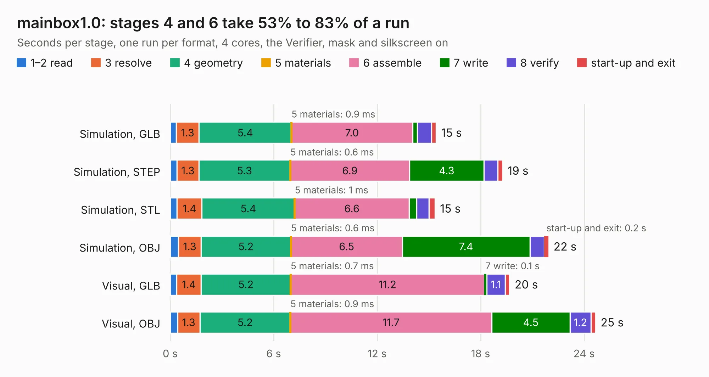

# 598. mainbox1.0

Board 598 of the 3,118 of [Corpus Testing](../Corpus-Testing.md), on [Corpus Page 6](../CorpusTestingPages/Corpus-Testing-06.md#598-mainbox10).

| Mode and format | 1–2 read | 3 resolve | 4 geometry | 5 materials | 6 assemble | 7 write | 8 verify | start-up and exit | Total |
|---|---:|---:|---:|---:|---:|---:|---:|---:|---:|
| Simulation, GLB | 0.4 | 1.3 | 5.4 | 0.9&nbsp;ms | 7.0 | 0.3 | 0.8 | 0.3 | 15.4 |
| Simulation, STEP | 0.4 | 1.3 | 5.3 | 0.6&nbsp;ms | 6.9 | 4.3 | 0.8 | 0.3 | 19.3 |
| Simulation, STL | 0.4 | 1.4 | 5.4 | 1&nbsp;ms | 6.6 | 0.4 | 0.7 | 0.3 | 15.4 |
| Simulation, OBJ | 0.5 | 1.3 | 5.2 | 0.6&nbsp;ms | 6.5 | 7.4 | 0.8 | 0.2 | 21.9 |
| Visual, GLB | 0.4 | 1.4 | 5.2 | 0.7&nbsp;ms | 11.2 | 0.1 | 1.1 | 0.3 | 19.7 |
| Visual, OBJ | 0.4 | 1.3 | 5.2 | 0.9&nbsp;ms | 11.7 | 4.5 | 1.2 | 0.3 | 24.7 |

<table align="center"><tr><td valign="top">

| Board | Repo: [bluejayracing/bjr_kicad](https://github.com/bluejayracing/bjr_kicad) Board: `mainbox1.0.kicad_pcb` |
|---|---|
| Folder | 21xt / 02-mainbox / bjr_kicad_aaren_copy / 21xt / 02-mainbox / mainbox1.0 |
| Complexity | 318&nbsp;/&nbsp;1000 (size&nbsp;233, features&nbsp;85) |
| KESE&nbsp;features | through vias, rounded, trapezoid or chamfered pads, filled zones, curved board outline, stack-up, dielectric εr and tanδ |
| Tested | 9th November 2026 |
| Copper&nbsp;layers | 4 |
| File&nbsp;format | KiCad 7 (20221018) |
| Parts,&nbsp;tracks,&nbsp;vias | 58, 804, 111 |
| Triangles,&nbsp;simulation | 1,389,196 in 142 parts |
| Verifier | PASS in all six runs |

</td><td valign="top">

<table>
<tr><th>File type</th><th>File size</th><th>Peak memory used</th></tr>
<tr><th colspan="3" align="left">Simulation</th></tr>
<tr><td>GLB</td><td align="right">47&nbsp;MB</td><td align="right">549&nbsp;MB</td></tr>
<tr><td>STEP</td><td align="right">206&nbsp;MB</td><td align="right">625&nbsp;MB</td></tr>
<tr><td>STL</td><td align="right">69&nbsp;MB</td><td align="right">548&nbsp;MB</td></tr>
<tr><td>OBJ</td><td align="right">143&nbsp;MB</td><td align="right">959&nbsp;MB</td></tr>
<tr><th colspan="3" align="left">Visual</th></tr>
<tr><td>GLB</td><td align="right">29&nbsp;MB</td><td align="right">750&nbsp;MB</td></tr>
<tr><td>OBJ</td><td align="right">89&nbsp;MB</td><td align="right">747&nbsp;MB</td></tr>
</table>

</td></tr></table>

| Previous | Next |
|:---|---:|
| [597. accessoryidk](b0597b_bjr-kicad_accessoryidk.md) | [599. mainbox2.0](b0599b_bjr-kicad_21xt-02-mainbox-bjr-kicad-aaren-copy-21xt-02-mainbox-mainbox2-0_mainbox2-0.md) |
