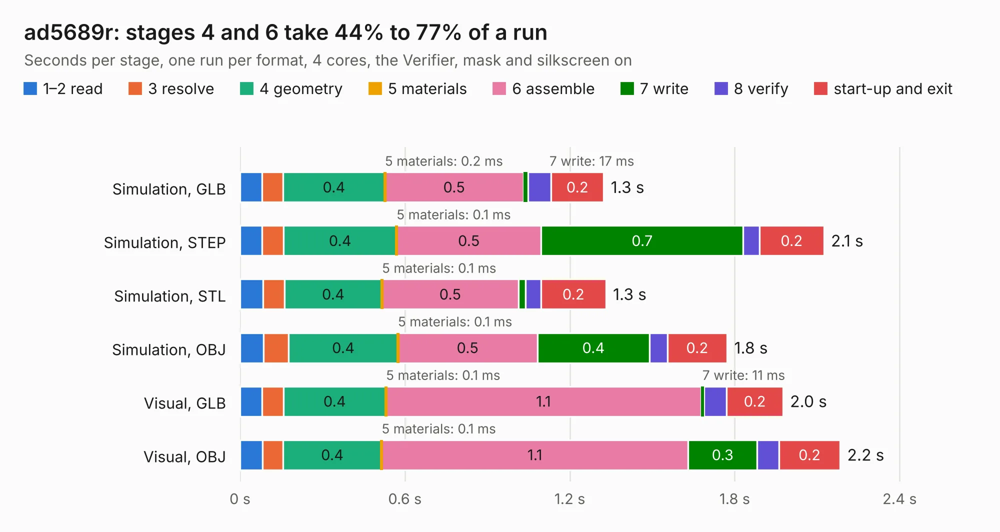

# 598. ad5689r

Board 598 of the 3,132 of [Corpus Testing](../Corpus-Testing.md), on [Corpus Page 6](../CorpusTestingPages/Corpus-Testing-06.md#598-ad5689r).

| Mode and format | 1–2 read | 3 resolve | 4 geometry | 5 materials | 6 assemble | 7 write | 8 verify | start-up and exit | Total |
|---|---:|---:|---:|---:|---:|---:|---:|---:|---:|
| Simulation, GLB | 81&nbsp;ms | 76&nbsp;ms | 0.4 | 0.2&nbsp;ms | 0.5 | 17&nbsp;ms | 84&nbsp;ms | 0.2 | 1.3 |
| Simulation, STEP | 80&nbsp;ms | 79&nbsp;ms | 0.4 | 0.1&nbsp;ms | 0.5 | 0.7 | 59&nbsp;ms | 0.2 | 2.1 |
| Simulation, STL | 84&nbsp;ms | 78&nbsp;ms | 0.4 | 0.1&nbsp;ms | 0.5 | 26&nbsp;ms | 56&nbsp;ms | 0.2 | 1.3 |
| Simulation, OBJ | 85&nbsp;ms | 92&nbsp;ms | 0.4 | 0.1&nbsp;ms | 0.5 | 0.4 | 64&nbsp;ms | 0.2 | 1.8 |
| Visual, GLB | 81&nbsp;ms | 77&nbsp;ms | 0.4 | 0.1&nbsp;ms | 1.1 | 11&nbsp;ms | 83&nbsp;ms | 0.2 | 2.0 |
| Visual, OBJ | 82&nbsp;ms | 75&nbsp;ms | 0.4 | 0.1&nbsp;ms | 1.1 | 0.3 | 79&nbsp;ms | 0.2 | 2.2 |

<table align="center"><tr><td valign="top">

| Board | Repo: [bluejayracing/bjr_kicad](https://github.com/bluejayracing/bjr_kicad) Board: `ad5689r.kicad_pcb` |
|---|---|
| Folder | 21xt / 01-accessory / ad5689r |
| Complexity | 153&nbsp;/&nbsp;1000 (size&nbsp;108, features&nbsp;45) |
| KESE&nbsp;features | through vias, rounded, trapezoid or chamfered pads, filled zones |
| Tested | 9th November 2026 |
| Copper&nbsp;layers | 2 |
| File&nbsp;format | KiCad 7 (20221018) |
| Parts,&nbsp;tracks,&nbsp;vias | 6, 63, 3 |
| Triangles,&nbsp;simulation | 108,038 in 24 parts |
| Verifier | PASS in all six runs |

</td><td valign="top">

<table>
<tr><th>File type</th><th>File size</th><th>Peak memory used</th></tr>
<tr><th colspan="3" align="left">Simulation</th></tr>
<tr><td>GLB</td><td align="right">3.8&nbsp;MB</td><td align="right">188&nbsp;MB</td></tr>
<tr><td>STEP</td><td align="right">19&nbsp;MB</td><td align="right">190&nbsp;MB</td></tr>
<tr><td>STL</td><td align="right">5.4&nbsp;MB</td><td align="right">179&nbsp;MB</td></tr>
<tr><td>OBJ</td><td align="right">11&nbsp;MB</td><td align="right">186&nbsp;MB</td></tr>
<tr><th colspan="3" align="left">Visual</th></tr>
<tr><td>GLB</td><td align="right">2.4&nbsp;MB</td><td align="right">156&nbsp;MB</td></tr>
<tr><td>OBJ</td><td align="right">6.6&nbsp;MB</td><td align="right">151&nbsp;MB</td></tr>
</table>

</td></tr></table>

| Previous | Next |
|:---|---:|
| [597. accessory_v2](b0597b_bjr-kicad_accessory-v2.md) | [599. accessoryidk](b0599b_bjr-kicad_accessoryidk.md) |
