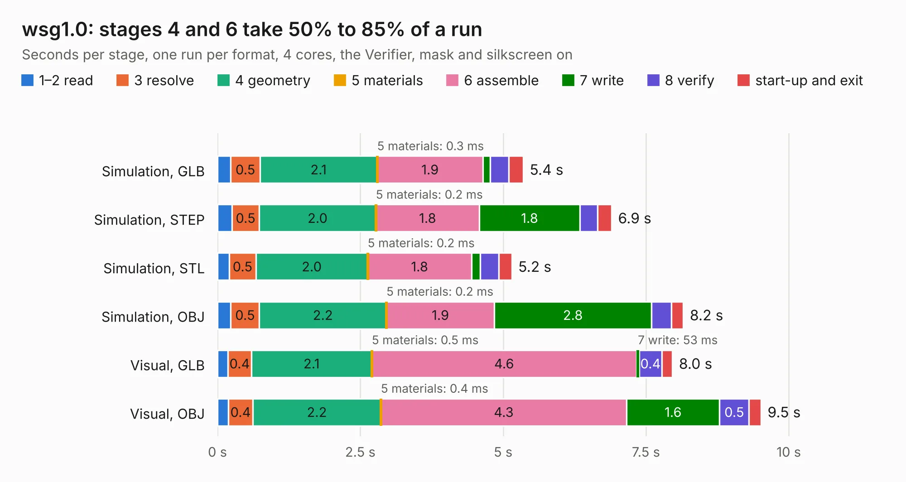

# 598. wsg1.0

Board 598 of the 3,112 of [Corpus Testing](../Corpus-Testing.md), on [Corpus Page 6](../CorpusTestingPages/Corpus-Testing-06.md#598-wsg10).

| Mode and format | 1–2 read | 3 resolve | 4 geometry | 5 materials | 6 assemble | 7 write | 8 verify | start-up and exit | Total |
|---|---:|---:|---:|---:|---:|---:|---:|---:|---:|
| Simulation, GLB | 0.2 | 0.5 | 2.1 | 0.3&nbsp;ms | 1.9 | 0.1 | 0.3 | 0.3 | 5.4 |
| Simulation, STEP | 0.3 | 0.5 | 2.0 | 0.2&nbsp;ms | 1.8 | 1.8 | 0.3 | 0.2 | 6.9 |
| Simulation, STL | 0.2 | 0.5 | 2.0 | 0.2&nbsp;ms | 1.8 | 0.2 | 0.3 | 0.2 | 5.2 |
| Simulation, OBJ | 0.2 | 0.5 | 2.2 | 0.2&nbsp;ms | 1.9 | 2.8 | 0.3 | 0.2 | 8.2 |
| Visual, GLB | 0.2 | 0.4 | 2.1 | 0.5&nbsp;ms | 4.6 | 53&nbsp;ms | 0.4 | 0.2 | 8.0 |
| Visual, OBJ | 0.2 | 0.4 | 2.2 | 0.4&nbsp;ms | 4.3 | 1.6 | 0.5 | 0.2 | 9.5 |

<table align="center"><tr><td valign="top">

| Board | Repo: [bluejayracing/bjr_kicad](https://github.com/bluejayracing/bjr_kicad) Board: `wsg1.0.kicad_pcb` |
|---|---|
| Folder | 21xt / 02-mainbox / bjr_kicad_aaren_copy / 21xt / 03-wireless_strain_gauge / wsg1.0 |
| Complexity | 249&nbsp;/&nbsp;1000 (size&nbsp;174, features&nbsp;75) |
| KESE&nbsp;features | through vias, rounded, trapezoid or chamfered pads, filled zones, stack-up, dielectric εr and tanδ |
| Tested | 9th November 2026 |
| Copper&nbsp;layers | 4 |
| File&nbsp;format | KiCad 7 (20221018) |
| Parts,&nbsp;tracks,&nbsp;vias | 36, 267, 71 |
| Triangles,&nbsp;simulation | 600,312 in 49 parts |
| Verifier | PASS in all six runs |

</td><td valign="top">

<table>
<tr><th>File type</th><th>File size</th><th>Peak memory used</th></tr>
<tr><th colspan="3" align="left">Simulation</th></tr>
<tr><td>GLB</td><td align="right">21&nbsp;MB</td><td align="right">332&nbsp;MB</td></tr>
<tr><td>STEP</td><td align="right">80&nbsp;MB</td><td align="right">349&nbsp;MB</td></tr>
<tr><td>STL</td><td align="right">30&nbsp;MB</td><td align="right">344&nbsp;MB</td></tr>
<tr><td>OBJ</td><td align="right">61&nbsp;MB</td><td align="right">443&nbsp;MB</td></tr>
<tr><th colspan="3" align="left">Visual</th></tr>
<tr><td>GLB</td><td align="right">12&nbsp;MB</td><td align="right">351&nbsp;MB</td></tr>
<tr><td>OBJ</td><td align="right">36&nbsp;MB</td><td align="right">354&nbsp;MB</td></tr>
</table>

</td></tr></table>

| Previous | Next |
|:---|---:|
| [597. AD5626_Breakout](b0597b_bjr-kicad_AD5626-Breakout.md) | [599. mainbox1.0](b0599b_bjr-kicad_21xt-02-mainbox-mainbox1-0_mainbox1-0.md) |
