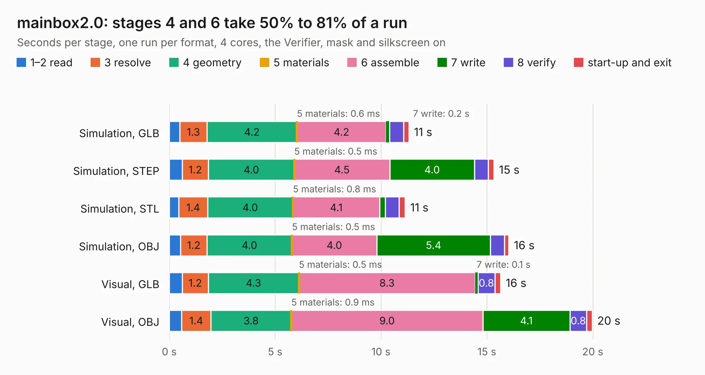

# 600. mainbox2.0

Board 600 of the 3,129 of [Corpus Testing](../Corpus-Testing.md), on [Corpus Page 6](../CorpusTestingPages/Corpus-Testing-06.md#600-mainbox20).

| Mode and format | 1–2 read | 3 resolve | 4 geometry | 5 materials | 6 assemble | 7 write | 8 verify | start-up and exit | Total |
|---|---:|---:|---:|---:|---:|---:|---:|---:|---:|
| Simulation, GLB | 0.5 | 1.3 | 4.2 | 0.6&nbsp;ms | 4.2 | 0.2 | 0.7 | 0.3 | 11.3 |
| Simulation, STEP | 0.6 | 1.2 | 4.0 | 0.5&nbsp;ms | 4.5 | 4.0 | 0.6 | 0.3 | 15.3 |
| Simulation, STL | 0.5 | 1.4 | 4.0 | 0.8&nbsp;ms | 4.1 | 0.3 | 0.7 | 0.3 | 11.1 |
| Simulation, OBJ | 0.5 | 1.2 | 4.0 | 0.5&nbsp;ms | 4.0 | 5.4 | 0.7 | 0.2 | 16.0 |
| Visual, GLB | 0.6 | 1.2 | 4.3 | 0.5&nbsp;ms | 8.3 | 0.1 | 0.8 | 0.3 | 15.7 |
| Visual, OBJ | 0.6 | 1.4 | 3.8 | 0.9&nbsp;ms | 9.0 | 4.1 | 0.8 | 0.3 | 20.0 |

<table align="center"><tr><td valign="top">

| Board | Repo: [bluejayracing/bjr_kicad](https://github.com/bluejayracing/bjr_kicad) Board: `mainbox2.0.kicad_pcb` |
|---|---|
| Folder | 21xt / 02-mainbox / bjr_kicad_aaren_copy / 21xt / 02-mainbox / mainbox2.0 |
| Complexity | 270&nbsp;/&nbsp;1000 (size&nbsp;185, features&nbsp;85) |
| KESE&nbsp;features | through vias, rounded, trapezoid or chamfered pads, filled zones, curved board outline, stack-up, dielectric εr and tanδ |
| Tested | 9th November 2026 |
| Copper&nbsp;layers | 4 |
| File&nbsp;format | KiCad 7 (20221018) |
| Parts,&nbsp;tracks,&nbsp;vias | 63, 520, 55 |
| Triangles,&nbsp;simulation | 875,582 in 126 parts |
| Verifier | PASS in all six runs |

</td><td valign="top">

<table>
<tr><th>File type</th><th>File size</th><th>Peak memory used</th></tr>
<tr><th colspan="3" align="left">Simulation</th></tr>
<tr><td>GLB</td><td align="right">30&nbsp;MB</td><td align="right">416&nbsp;MB</td></tr>
<tr><td>STEP</td><td align="right">153&nbsp;MB</td><td align="right">510&nbsp;MB</td></tr>
<tr><td>STL</td><td align="right">44&nbsp;MB</td><td align="right">417&nbsp;MB</td></tr>
<tr><td>OBJ</td><td align="right">89&nbsp;MB</td><td align="right">640&nbsp;MB</td></tr>
<tr><th colspan="3" align="left">Visual</th></tr>
<tr><td>GLB</td><td align="right">21&nbsp;MB</td><td align="right">555&nbsp;MB</td></tr>
<tr><td>OBJ</td><td align="right">63&nbsp;MB</td><td align="right">562&nbsp;MB</td></tr>
</table>

</td></tr></table>

| Previous | Next |
|:---|---:|
| [599. mainbox1.0](b0599b_bjr-kicad_21xt-02-mainbox-bjr-kicad-aaren-copy-21xt-02-mainbox-mainbox1-0_mainbox1-0.md) | [601. mainbox2.0_sophie](b0601b_bjr-kicad_mainbox2-0-sophie.md) |
