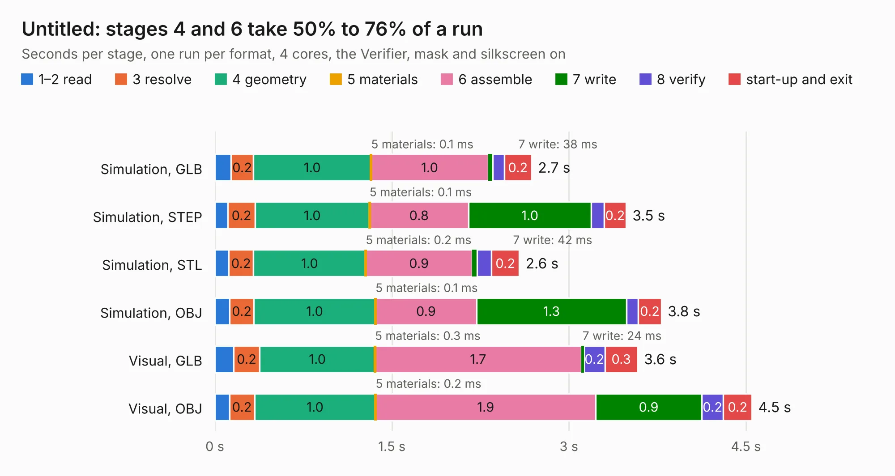

# 601. Untitled

Board 601 of the 3,109 of [Corpus Testing](../Corpus-Testing.md), on [Corpus Page 6](../CorpusTestingPages/Corpus-Testing-06.md#601-untitled).

| Mode and format | 1–2 read | 3 resolve | 4 geometry | 5 materials | 6 assemble | 7 write | 8 verify | start-up and exit | Total |
|---|---:|---:|---:|---:|---:|---:|---:|---:|---:|
| Simulation, GLB | 0.1 | 0.2 | 1.0 | 0.1&nbsp;ms | 1.0 | 38&nbsp;ms | 99&nbsp;ms | 0.2 | 2.7 |
| Simulation, STEP | 0.1 | 0.2 | 1.0 | 0.1&nbsp;ms | 0.8 | 1.0 | 0.1 | 0.2 | 3.5 |
| Simulation, STL | 0.1 | 0.2 | 1.0 | 0.2&nbsp;ms | 0.9 | 42&nbsp;ms | 0.1 | 0.2 | 2.6 |
| Simulation, OBJ | 0.1 | 0.2 | 1.0 | 0.1&nbsp;ms | 0.9 | 1.3 | 99&nbsp;ms | 0.2 | 3.8 |
| Visual, GLB | 0.2 | 0.2 | 1.0 | 0.3&nbsp;ms | 1.7 | 24&nbsp;ms | 0.2 | 0.3 | 3.6 |
| Visual, OBJ | 0.1 | 0.2 | 1.0 | 0.2&nbsp;ms | 1.9 | 0.9 | 0.2 | 0.2 | 4.5 |

<table align="center"><tr><td valign="top">

| Board | Repo: [bluejayracing/bjr_kicad](https://github.com/bluejayracing/bjr_kicad) Board: `Untitled.kicad_pcb` |
|---|---|
| Folder | 21xt / 03-wireless_strain_gauge / PumpDACBreakout |
| Complexity | 182&nbsp;/&nbsp;1000 (size&nbsp;127, features&nbsp;55) |
| KESE&nbsp;features | through vias, rounded, trapezoid or chamfered pads, filled zones, curved board outline |
| Tested | 9th November 2026 |
| Copper&nbsp;layers | 2 |
| File&nbsp;format | KiCad 7 (20221018) |
| Parts,&nbsp;tracks,&nbsp;vias | 12, 93, 21 |
| Triangles,&nbsp;simulation | 175,894 in 31 parts |
| Verifier | PASS in all six runs |

</td><td valign="top">

<table>
<tr><th>File type</th><th>File size</th><th>Peak memory used</th></tr>
<tr><th colspan="3" align="left">Simulation</th></tr>
<tr><td>GLB</td><td align="right">6.2&nbsp;MB</td><td align="right">204&nbsp;MB</td></tr>
<tr><td>STEP</td><td align="right">27&nbsp;MB</td><td align="right">220&nbsp;MB</td></tr>
<tr><td>STL</td><td align="right">8.8&nbsp;MB</td><td align="right">202&nbsp;MB</td></tr>
<tr><td>OBJ</td><td align="right">17&nbsp;MB</td><td align="right">208&nbsp;MB</td></tr>
<tr><th colspan="3" align="left">Visual</th></tr>
<tr><td>GLB</td><td align="right">4.5&nbsp;MB</td><td align="right">187&nbsp;MB</td></tr>
<tr><td>OBJ</td><td align="right">13&nbsp;MB</td><td align="right">186&nbsp;MB</td></tr>
</table>

</td></tr></table>

| Previous | Next |
|:---|---:|
| [600. mainbox2.1](b0600b_bjr-kicad_mainbox2-1.md) | [602. SPIBreakout](b0602b_bjr-kicad_SPIBreakout.md) |
