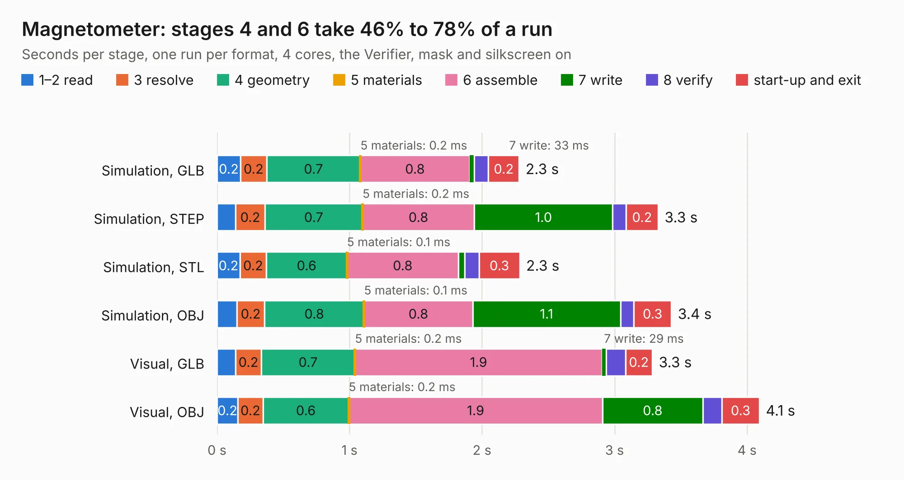

# 604. Magnetometer

Board 604 of the 3,105 of [Corpus Testing](../Corpus-Testing.md), on [Corpus Page 6](../CorpusTestingPages/Corpus-Testing-06.md#604-magnetometer).

| Mode and format | 1–2 read | 3 resolve | 4 geometry | 5 materials | 6 assemble | 7 write | 8 verify | start-up and exit | Total |
|---|---:|---:|---:|---:|---:|---:|---:|---:|---:|
| Simulation, GLB | 0.2 | 0.2 | 0.7 | 0.2&nbsp;ms | 0.8 | 33&nbsp;ms | 0.1 | 0.2 | 2.3 |
| Simulation, STEP | 0.1 | 0.2 | 0.7 | 0.2&nbsp;ms | 0.8 | 1.0 | 0.1 | 0.2 | 3.3 |
| Simulation, STL | 0.2 | 0.2 | 0.6 | 0.1&nbsp;ms | 0.8 | 48&nbsp;ms | 0.1 | 0.3 | 2.3 |
| Simulation, OBJ | 0.2 | 0.2 | 0.8 | 0.1&nbsp;ms | 0.8 | 1.1 | 0.1 | 0.3 | 3.4 |
| Visual, GLB | 0.1 | 0.2 | 0.7 | 0.2&nbsp;ms | 1.9 | 29&nbsp;ms | 0.1 | 0.2 | 3.3 |
| Visual, OBJ | 0.2 | 0.2 | 0.6 | 0.2&nbsp;ms | 1.9 | 0.8 | 0.1 | 0.3 | 4.1 |

<table align="center"><tr><td valign="top">

| Board | Repo: [bluejayracing/bjr_kicad](https://github.com/bluejayracing/bjr_kicad) Board: `Magnetometer.kicad_pcb` |
|---|---|
| Folder | 21xt / 06-magnetometer |
| Complexity | 237&nbsp;/&nbsp;1000 (size&nbsp;152, features&nbsp;85) |
| KESE&nbsp;features | through vias, rounded, trapezoid or chamfered pads, filled zones, curved board outline, stack-up, dielectric εr and tanδ |
| Tested | 9th November 2026 |
| Copper&nbsp;layers | 4 |
| File&nbsp;format | KiCad 8 (20240108) |
| Parts,&nbsp;tracks,&nbsp;vias | 21, 81, 31 |
| Triangles,&nbsp;simulation | 190,370 in 27 parts |
| Verifier | PASS in all six runs |

</td><td valign="top">

<table>
<tr><th>File type</th><th>File size</th><th>Peak memory used</th></tr>
<tr><th colspan="3" align="left">Simulation</th></tr>
<tr><td>GLB</td><td align="right">6.5&nbsp;MB</td><td align="right">205&nbsp;MB</td></tr>
<tr><td>STEP</td><td align="right">24&nbsp;MB</td><td align="right">213&nbsp;MB</td></tr>
<tr><td>STL</td><td align="right">9.5&nbsp;MB</td><td align="right">203&nbsp;MB</td></tr>
<tr><td>OBJ</td><td align="right">19&nbsp;MB</td><td align="right">208&nbsp;MB</td></tr>
<tr><th colspan="3" align="left">Visual</th></tr>
<tr><td>GLB</td><td align="right">4.0&nbsp;MB</td><td align="right">178&nbsp;MB</td></tr>
<tr><td>OBJ</td><td align="right">11&nbsp;MB</td><td align="right">180&nbsp;MB</td></tr>
</table>

</td></tr></table>

| Previous | Next |
|:---|---:|
| [603. wsg3.0](b0603b_bjr-kicad_wsg3-0.md) | [605. MagnetometerLayout](b0605b_bjr-kicad_MagnetometerLayout.md) |
