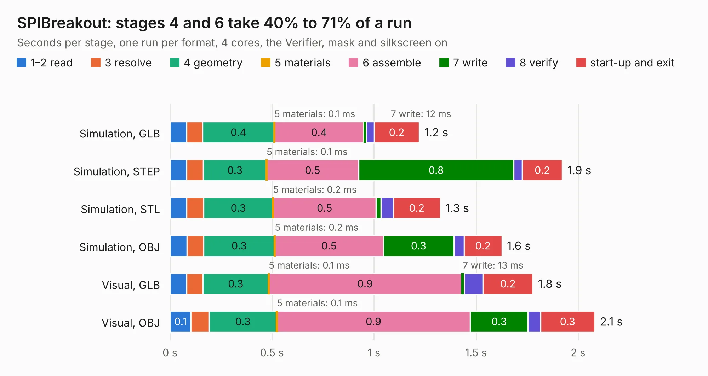

# 605. SPIBreakout

Board 605 of the 3,116 of [Corpus Testing](../Corpus-Testing.md), on [Corpus Page 6](../CorpusTestingPages/Corpus-Testing-06.md#605-spibreakout).

| Mode and format | 1–2 read | 3 resolve | 4 geometry | 5 materials | 6 assemble | 7 write | 8 verify | start-up and exit | Total |
|---|---:|---:|---:|---:|---:|---:|---:|---:|---:|
| Simulation, GLB | 81&nbsp;ms | 79&nbsp;ms | 0.4 | 0.1&nbsp;ms | 0.4 | 12&nbsp;ms | 39&nbsp;ms | 0.2 | 1.2 |
| Simulation, STEP | 82&nbsp;ms | 81&nbsp;ms | 0.3 | 0.1&nbsp;ms | 0.5 | 0.8 | 42&nbsp;ms | 0.2 | 1.9 |
| Simulation, STL | 82&nbsp;ms | 83&nbsp;ms | 0.3 | 0.2&nbsp;ms | 0.5 | 24&nbsp;ms | 60&nbsp;ms | 0.2 | 1.3 |
| Simulation, OBJ | 84&nbsp;ms | 80&nbsp;ms | 0.3 | 0.2&nbsp;ms | 0.5 | 0.3 | 49&nbsp;ms | 0.2 | 1.6 |
| Visual, GLB | 81&nbsp;ms | 79&nbsp;ms | 0.3 | 0.1&nbsp;ms | 0.9 | 13&nbsp;ms | 92&nbsp;ms | 0.2 | 1.8 |
| Visual, OBJ | 0.1 | 88&nbsp;ms | 0.3 | 0.1&nbsp;ms | 0.9 | 0.3 | 61&nbsp;ms | 0.3 | 2.1 |

<table align="center"><tr><td valign="top">

| Board | Repo: [bluejayracing/bjr_kicad](https://github.com/bluejayracing/bjr_kicad) Board: `SPIBreakout.kicad_pcb` |
|---|---|
| Folder | 21xt / 03-wireless_strain_gauge / SPIBreakout |
| Complexity | 160&nbsp;/&nbsp;1000 (size&nbsp;105, features&nbsp;55) |
| KESE&nbsp;features | through vias, rounded, trapezoid or chamfered pads, filled zones, curved board outline |
| Tested | 9th November 2026 |
| Copper&nbsp;layers | 2 |
| File&nbsp;format | KiCad 7 (20221018) |
| Parts,&nbsp;tracks,&nbsp;vias | 3, 27, 20 |
| Triangles,&nbsp;simulation | 68,840 in 19 parts |
| Verifier | PASS in all six runs |

</td><td valign="top">

<table>
<tr><th>File type</th><th>File size</th><th>Peak memory used</th></tr>
<tr><th colspan="3" align="left">Simulation</th></tr>
<tr><td>GLB</td><td align="right">2.4&nbsp;MB</td><td align="right">171&nbsp;MB</td></tr>
<tr><td>STEP</td><td align="right">9.3&nbsp;MB</td><td align="right">173&nbsp;MB</td></tr>
<tr><td>STL</td><td align="right">3.4&nbsp;MB</td><td align="right">171&nbsp;MB</td></tr>
<tr><td>OBJ</td><td align="right">6.6&nbsp;MB</td><td align="right">168&nbsp;MB</td></tr>
<tr><th colspan="3" align="left">Visual</th></tr>
<tr><td>GLB</td><td align="right">1.7&nbsp;MB</td><td align="right">151&nbsp;MB</td></tr>
<tr><td>OBJ</td><td align="right">4.9&nbsp;MB</td><td align="right">152&nbsp;MB</td></tr>
</table>

</td></tr></table>

| Previous | Next |
|:---|---:|
| [604. Untitled](b0604b_bjr-kicad_Untitled.md) | [606. usb_c_daughter](b0606b_bjr-kicad_usb-c-daughter.md) |
