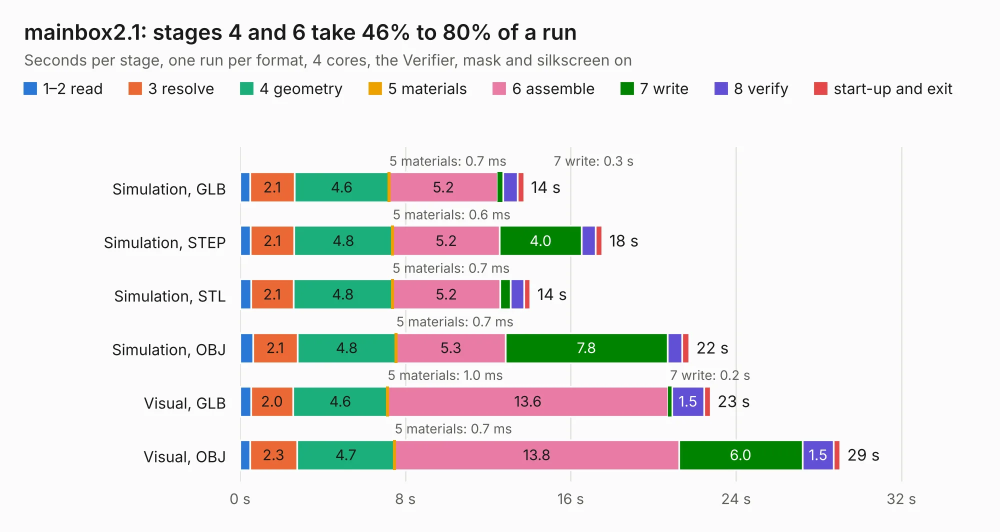

# 606. mainbox2.1

Board 606 of the 3,125 of [Corpus Testing](../Corpus-Testing.md), on [Corpus Page 6](../CorpusTestingPages/Corpus-Testing-06.md#606-mainbox21).

| Mode and format | 1–2 read | 3 resolve | 4 geometry | 5 materials | 6 assemble | 7 write | 8 verify | start-up and exit | Total |
|---|---:|---:|---:|---:|---:|---:|---:|---:|---:|
| Simulation, GLB | 0.5 | 2.1 | 4.6 | 0.7&nbsp;ms | 5.2 | 0.3 | 0.7 | 0.3 | 13.7 |
| Simulation, STEP | 0.5 | 2.1 | 4.8 | 0.6&nbsp;ms | 5.2 | 4.0 | 0.7 | 0.3 | 17.5 |
| Simulation, STL | 0.5 | 2.1 | 4.8 | 0.7&nbsp;ms | 5.2 | 0.5 | 0.6 | 0.3 | 14.0 |
| Simulation, OBJ | 0.6 | 2.1 | 4.8 | 0.7&nbsp;ms | 5.3 | 7.8 | 0.7 | 0.3 | 21.7 |
| Visual, GLB | 0.5 | 2.0 | 4.6 | 1.0&nbsp;ms | 13.6 | 0.2 | 1.5 | 0.3 | 22.8 |
| Visual, OBJ | 0.5 | 2.3 | 4.7 | 0.7&nbsp;ms | 13.8 | 6.0 | 1.5 | 0.3 | 29.0 |

<table align="center"><tr><td valign="top">

| Board | Repo: [bluejayracing/bjr_kicad](https://github.com/bluejayracing/bjr_kicad) Board: `mainbox2.1.kicad_pcb` |
|---|---|
| Folder | 21xt / 02-mainbox / mainbox2.1 |
| Complexity | 298&nbsp;/&nbsp;1000 (size&nbsp;198, features&nbsp;100) |
| KESE&nbsp;features | through vias, rounded, trapezoid or chamfered pads, arc tracks, filled zones, curved board outline, stack-up, dielectric εr and tanδ |
| Tested | 9th November 2026 |
| Copper&nbsp;layers | 4 |
| File&nbsp;format | KiCad 8 (20240108) |
| Parts,&nbsp;tracks,&nbsp;vias | 64, 599, 287 |
| Triangles,&nbsp;simulation | 1,494,246 in 123 parts |
| Verifier | PASS in all six runs |

</td><td valign="top">

<table>
<tr><th>File type</th><th>File size</th><th>Peak memory used</th></tr>
<tr><th colspan="3" align="left">Simulation</th></tr>
<tr><td>GLB</td><td align="right">51&nbsp;MB</td><td align="right">712&nbsp;MB</td></tr>
<tr><td>STEP</td><td align="right">185&nbsp;MB</td><td align="right">770&nbsp;MB</td></tr>
<tr><td>STL</td><td align="right">75&nbsp;MB</td><td align="right">709&nbsp;MB</td></tr>
<tr><td>OBJ</td><td align="right">153&nbsp;MB</td><td align="right">1.0&nbsp;GB</td></tr>
<tr><th colspan="3" align="left">Visual</th></tr>
<tr><td>GLB</td><td align="right">37&nbsp;MB</td><td align="right">720&nbsp;MB</td></tr>
<tr><td>OBJ</td><td align="right">113&nbsp;MB</td><td align="right">866&nbsp;MB</td></tr>
</table>

</td></tr></table>

| Previous | Next |
|:---|---:|
| [605. mainbox2.0](b0605b_bjr-kicad_21xt-02-mainbox-mainbox2-0_mainbox2-0.md) | [607. Untitled](b0607b_bjr-kicad_Untitled.md) |
