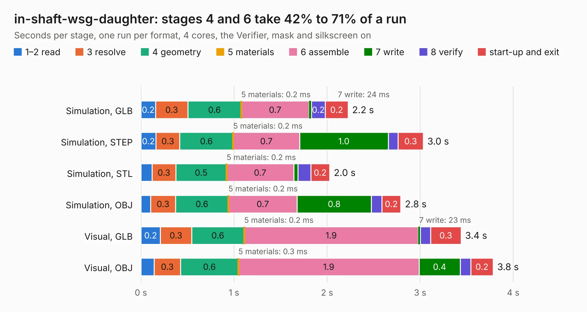

# 609. in-shaft-wsg-daughter

Board 609 of the 3,106 of [Corpus Testing](../Corpus-Testing.md), on [Corpus Page 6](../CorpusTestingPages/Corpus-Testing-06.md#609-in-shaft-wsg-daughter).

| Mode and format | 1–2 read | 3 resolve | 4 geometry | 5 materials | 6 assemble | 7 write | 8 verify | start-up and exit | Total |
|---|---:|---:|---:|---:|---:|---:|---:|---:|---:|
| Simulation, GLB | 0.2 | 0.3 | 0.6 | 0.2&nbsp;ms | 0.7 | 24&nbsp;ms | 0.2 | 0.2 | 2.2 |
| Simulation, STEP | 0.2 | 0.3 | 0.6 | 0.2&nbsp;ms | 0.7 | 1.0 | 0.1 | 0.3 | 3.0 |
| Simulation, STL | 0.1 | 0.3 | 0.5 | 0.2&nbsp;ms | 0.7 | 44&nbsp;ms | 0.1 | 0.2 | 2.0 |
| Simulation, OBJ | 0.1 | 0.3 | 0.6 | 0.2&nbsp;ms | 0.7 | 0.8 | 0.1 | 0.2 | 2.8 |
| Visual, GLB | 0.2 | 0.3 | 0.6 | 0.2&nbsp;ms | 1.9 | 23&nbsp;ms | 0.1 | 0.3 | 3.4 |
| Visual, OBJ | 0.1 | 0.3 | 0.6 | 0.3&nbsp;ms | 1.9 | 0.4 | 0.1 | 0.2 | 3.8 |

<table align="center"><tr><td valign="top">

| Board | Repo: [bluejayracing/bjr_kicad](https://github.com/bluejayracing/bjr_kicad) Board: `in-shaft-wsg-daughter.kicad_pcb` |
|---|---|
| Folder | 21xt / in-shaft-wsg / in-shaft-wsg-daughter |
| Complexity | 225&nbsp;/&nbsp;1000 (size&nbsp;135, features&nbsp;90) |
| KESE&nbsp;features | through vias, slotted holes, custom pads, rounded, trapezoid or chamfered pads, filled zones, copper drawings, curved board outline |
| Tested | 9th November 2026 |
| Copper&nbsp;layers | 4 |
| File&nbsp;format | KiCad 8 (20240108) |
| Parts,&nbsp;tracks,&nbsp;vias | 7, 95, 10 |
| Triangles,&nbsp;simulation | 162,876 in 30 parts |
| Verifier | PASS in all six runs |

</td><td valign="top">

<table>
<tr><th>File type</th><th>File size</th><th>Peak memory used</th></tr>
<tr><th colspan="3" align="left">Simulation</th></tr>
<tr><td>GLB</td><td align="right">5.7&nbsp;MB</td><td align="right">198&nbsp;MB</td></tr>
<tr><td>STEP</td><td align="right">24&nbsp;MB</td><td align="right">199&nbsp;MB</td></tr>
<tr><td>STL</td><td align="right">8.1&nbsp;MB</td><td align="right">193&nbsp;MB</td></tr>
<tr><td>OBJ</td><td align="right">17&nbsp;MB</td><td align="right">198&nbsp;MB</td></tr>
<tr><th colspan="3" align="left">Visual</th></tr>
<tr><td>GLB</td><td align="right">3.4&nbsp;MB</td><td align="right">159&nbsp;MB</td></tr>
<tr><td>OBJ</td><td align="right">9.8&nbsp;MB</td><td align="right">160&nbsp;MB</td></tr>
</table>

</td></tr></table>

| Previous | Next |
|:---|---:|
| [608. justin_big_hbridge](b0608b_bjr-kicad_justin-big-hbridge.md) | [610. in-shaft-wsg-mommy](b0610b_bjr-kicad_in-shaft-wsg-mommy.md) |
