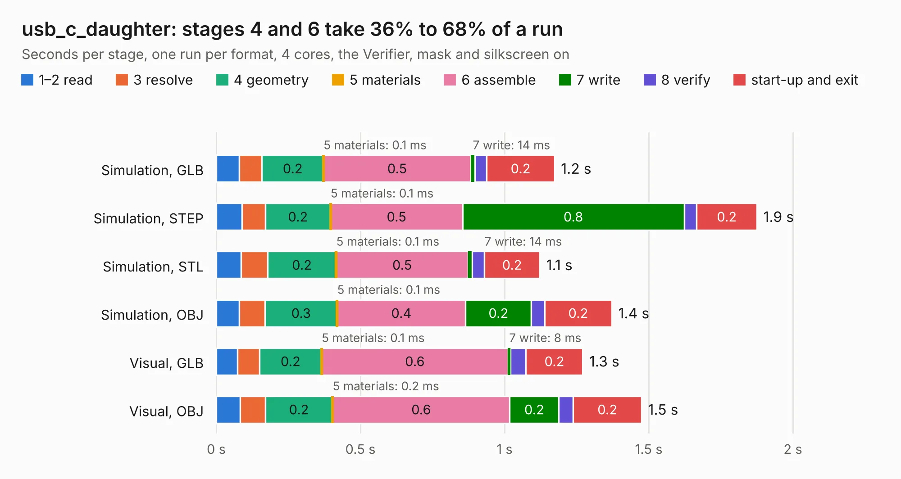

# 609. usb_c_daughter

Board 609 of the 3,126 of [Corpus Testing](../Corpus-Testing.md), on [Corpus Page 6](../CorpusTestingPages/Corpus-Testing-06.md#609-usb_c_daughter).

| Mode and format | 1–2 read | 3 resolve | 4 geometry | 5 materials | 6 assemble | 7 write | 8 verify | start-up and exit | Total |
|---|---:|---:|---:|---:|---:|---:|---:|---:|---:|
| Simulation, GLB | 80&nbsp;ms | 79&nbsp;ms | 0.2 | 0.1&nbsp;ms | 0.5 | 14&nbsp;ms | 41&nbsp;ms | 0.2 | 1.2 |
| Simulation, STEP | 89&nbsp;ms | 82&nbsp;ms | 0.2 | 0.1&nbsp;ms | 0.5 | 0.8 | 44&nbsp;ms | 0.2 | 1.9 |
| Simulation, STL | 86&nbsp;ms | 92&nbsp;ms | 0.2 | 0.1&nbsp;ms | 0.5 | 14&nbsp;ms | 42&nbsp;ms | 0.2 | 1.1 |
| Simulation, OBJ | 79&nbsp;ms | 90&nbsp;ms | 0.3 | 0.1&nbsp;ms | 0.4 | 0.2 | 46&nbsp;ms | 0.2 | 1.4 |
| Visual, GLB | 74&nbsp;ms | 76&nbsp;ms | 0.2 | 0.1&nbsp;ms | 0.6 | 8&nbsp;ms | 54&nbsp;ms | 0.2 | 1.3 |
| Visual, OBJ | 83&nbsp;ms | 87&nbsp;ms | 0.2 | 0.2&nbsp;ms | 0.6 | 0.2 | 50&nbsp;ms | 0.2 | 1.5 |

<table align="center"><tr><td valign="top">

| Board | Repo: [bluejayracing/bjr_kicad](https://github.com/bluejayracing/bjr_kicad) Board: `usb_c_daughter.kicad_pcb` |
|---|---|
| Folder | 21xt / 03-wireless_strain_gauge / usb_c_daughter |
| Complexity | 180&nbsp;/&nbsp;1000 (size&nbsp;105, features&nbsp;75) |
| KESE&nbsp;features | through vias, filled zones, curved board outline, stack-up, dielectric εr and tanδ |
| Tested | 9th November 2026 |
| Copper&nbsp;layers | 2 |
| File&nbsp;format | KiCad 7 (20221018) |
| Parts,&nbsp;tracks,&nbsp;vias | 3, 55, 10 |
| Triangles,&nbsp;simulation | 53,658 in 18 parts |
| Verifier | PASS in all six runs |

</td><td valign="top">

<table>
<tr><th>File type</th><th>File size</th><th>Peak memory used</th></tr>
<tr><th colspan="3" align="left">Simulation</th></tr>
<tr><td>GLB</td><td align="right">1.8&nbsp;MB</td><td align="right">70&nbsp;MB</td></tr>
<tr><td>STEP</td><td align="right">6.8&nbsp;MB</td><td align="right">171&nbsp;MB</td></tr>
<tr><td>STL</td><td align="right">2.7&nbsp;MB</td><td align="right">70&nbsp;MB</td></tr>
<tr><td>OBJ</td><td align="right">5.1&nbsp;MB</td><td align="right">81&nbsp;MB</td></tr>
<tr><th colspan="3" align="left">Visual</th></tr>
<tr><td>GLB</td><td align="right">1.3&nbsp;MB</td><td align="right">108&nbsp;MB</td></tr>
<tr><td>OBJ</td><td align="right">3.5&nbsp;MB</td><td align="right">106&nbsp;MB</td></tr>
</table>

</td></tr></table>

| Previous | Next |
|:---|---:|
| [608. SPIBreakout](b0608b_bjr-kicad_SPIBreakout.md) | [610. wsg3.0](b0610b_bjr-kicad_wsg3-0.md) |
