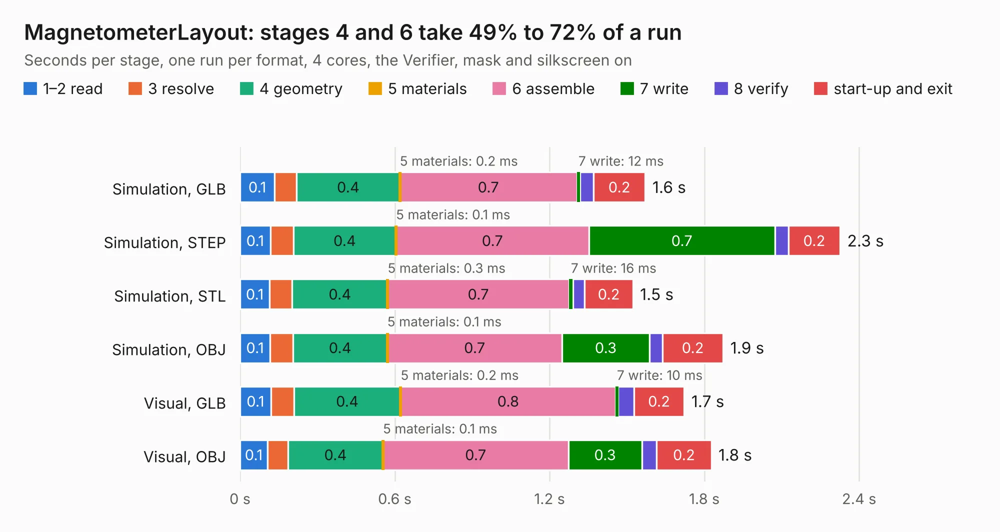

# 610. MagnetometerLayout

Board 610 of the 3,117 of [Corpus Testing](../Corpus-Testing.md), on [Corpus Page 6](../CorpusTestingPages/Corpus-Testing-06.md#610-magnetometerlayout).

| Mode and format | 1–2 read | 3 resolve | 4 geometry | 5 materials | 6 assemble | 7 write | 8 verify | start-up and exit | Total |
|---|---:|---:|---:|---:|---:|---:|---:|---:|---:|
| Simulation, GLB | 0.1 | 86&nbsp;ms | 0.4 | 0.2&nbsp;ms | 0.7 | 12&nbsp;ms | 52&nbsp;ms | 0.2 | 1.6 |
| Simulation, STEP | 0.1 | 90&nbsp;ms | 0.4 | 0.1&nbsp;ms | 0.7 | 0.7 | 53&nbsp;ms | 0.2 | 2.3 |
| Simulation, STL | 0.1 | 88&nbsp;ms | 0.4 | 0.3&nbsp;ms | 0.7 | 16&nbsp;ms | 45&nbsp;ms | 0.2 | 1.5 |
| Simulation, OBJ | 0.1 | 88&nbsp;ms | 0.4 | 0.1&nbsp;ms | 0.7 | 0.3 | 50&nbsp;ms | 0.2 | 1.9 |
| Visual, GLB | 0.1 | 89&nbsp;ms | 0.4 | 0.2&nbsp;ms | 0.8 | 10&nbsp;ms | 61&nbsp;ms | 0.2 | 1.7 |
| Visual, OBJ | 0.1 | 80&nbsp;ms | 0.4 | 0.1&nbsp;ms | 0.7 | 0.3 | 58&nbsp;ms | 0.2 | 1.8 |

<table align="center"><tr><td valign="top">

| Board | Repo: [bluejayracing/bjr_kicad](https://github.com/bluejayracing/bjr_kicad) Board: `MagnetometerLayout.kicad_pcb` |
|---|---|
| Folder | 21xt / 06-magnetometer |
| Complexity | 135&nbsp;/&nbsp;1000 (size&nbsp;125, features&nbsp;10) |
| KESE&nbsp;features | rounded, trapezoid or chamfered pads |
| Tested | 9th November 2026 |
| Copper&nbsp;layers | 2 |
| File&nbsp;format | KiCad 8 (20240108) |
| Parts,&nbsp;tracks,&nbsp;vias | 16, 116, 0 |
| Triangles,&nbsp;simulation | 65,130 in 19 parts |
| Verifier | PASS in all six runs |

</td><td valign="top">

<table>
<tr><th>File type</th><th>File size</th><th>Peak memory used</th></tr>
<tr><th colspan="3" align="left">Simulation</th></tr>
<tr><td>GLB</td><td align="right">2.4&nbsp;MB</td><td align="right">73&nbsp;MB</td></tr>
<tr><td>STEP</td><td align="right">12&nbsp;MB</td><td align="right">181&nbsp;MB</td></tr>
<tr><td>STL</td><td align="right">3.3&nbsp;MB</td><td align="right">75&nbsp;MB</td></tr>
<tr><td>OBJ</td><td align="right">6.4&nbsp;MB</td><td align="right">102&nbsp;MB</td></tr>
<tr><th colspan="3" align="left">Visual</th></tr>
<tr><td>GLB</td><td align="right">1.9&nbsp;MB</td><td align="right">106&nbsp;MB</td></tr>
<tr><td>OBJ</td><td align="right">5.1&nbsp;MB</td><td align="right">118&nbsp;MB</td></tr>
</table>

</td></tr></table>

| Previous | Next |
|:---|---:|
| [609. Magnetometer](b0609b_bjr-kicad_Magnetometer.md) | [611. big_hbridge](b0611b_bjr-kicad_big-hbridge.md) |
