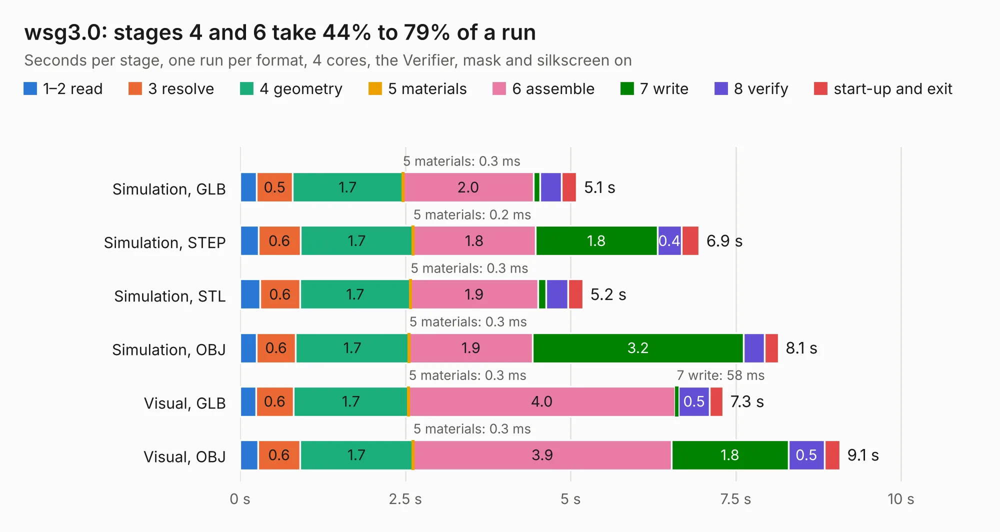

# 610. wsg3.0

Board 610 of the 3,124 of [Corpus Testing](../Corpus-Testing.md), on [Corpus Page 6](../CorpusTestingPages/Corpus-Testing-06.md#610-wsg30).

| Mode and format | 1–2 read | 3 resolve | 4 geometry | 5 materials | 6 assemble | 7 write | 8 verify | start-up and exit | Total |
|---|---:|---:|---:|---:|---:|---:|---:|---:|---:|
| Simulation, GLB | 0.3 | 0.5 | 1.7 | 0.3&nbsp;ms | 2.0 | 99&nbsp;ms | 0.3 | 0.2 | 5.1 |
| Simulation, STEP | 0.3 | 0.6 | 1.7 | 0.2&nbsp;ms | 1.8 | 1.8 | 0.4 | 0.3 | 6.9 |
| Simulation, STL | 0.3 | 0.6 | 1.7 | 0.3&nbsp;ms | 1.9 | 0.1 | 0.3 | 0.2 | 5.2 |
| Simulation, OBJ | 0.2 | 0.6 | 1.7 | 0.3&nbsp;ms | 1.9 | 3.2 | 0.3 | 0.2 | 8.1 |
| Visual, GLB | 0.2 | 0.6 | 1.7 | 0.3&nbsp;ms | 4.0 | 58&nbsp;ms | 0.5 | 0.2 | 7.3 |
| Visual, OBJ | 0.3 | 0.6 | 1.7 | 0.3&nbsp;ms | 3.9 | 1.8 | 0.5 | 0.2 | 9.1 |

<table align="center"><tr><td valign="top">

| Board | Repo: [bluejayracing/bjr_kicad](https://github.com/bluejayracing/bjr_kicad) Board: `wsg3.0.kicad_pcb` |
|---|---|
| Folder | 21xt / 03-wireless_strain_gauge / wsg3.0 |
| Complexity | 299&nbsp;/&nbsp;1000 (size&nbsp;179, features&nbsp;120) |
| KESE&nbsp;features | through vias, slotted holes, custom pads, rounded, trapezoid or chamfered pads, filled zones, copper drawings, curved board outline, stack-up, dielectric εr and tanδ |
| Tested | 9th November 2026 |
| Copper&nbsp;layers | 4 |
| File&nbsp;format | KiCad 8 (20240108) |
| Parts,&nbsp;tracks,&nbsp;vias | 42, 391, 74 |
| Triangles,&nbsp;simulation | 570,698 in 69 parts |
| Verifier | PASS in all six runs |

</td><td valign="top">

<table>
<tr><th>File type</th><th>File size</th><th>Peak memory used</th></tr>
<tr><th colspan="3" align="left">Simulation</th></tr>
<tr><td>GLB</td><td align="right">20&nbsp;MB</td><td align="right">305&nbsp;MB</td></tr>
<tr><td>STEP</td><td align="right">76&nbsp;MB</td><td align="right">359&nbsp;MB</td></tr>
<tr><td>STL</td><td align="right">29&nbsp;MB</td><td align="right">312&nbsp;MB</td></tr>
<tr><td>OBJ</td><td align="right">58&nbsp;MB</td><td align="right">437&nbsp;MB</td></tr>
<tr><th colspan="3" align="left">Visual</th></tr>
<tr><td>GLB</td><td align="right">12&nbsp;MB</td><td align="right">350&nbsp;MB</td></tr>
<tr><td>OBJ</td><td align="right">37&nbsp;MB</td><td align="right">350&nbsp;MB</td></tr>
</table>

</td></tr></table>

| Previous | Next |
|:---|---:|
| [609. usb_c_daughter](b0609b_bjr-kicad_usb-c-daughter.md) | [611. Magnetometer](b0611b_bjr-kicad_Magnetometer.md) |
