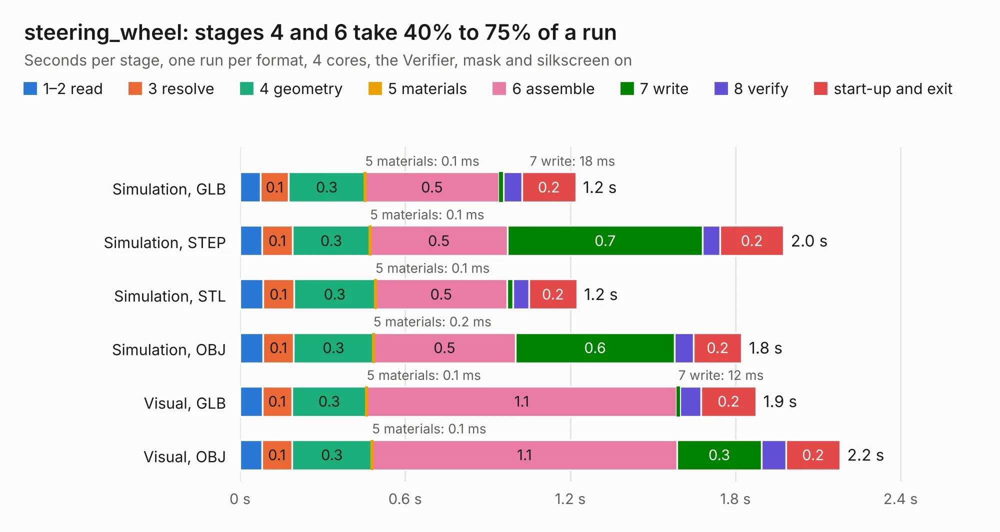

# 611. steering_wheel

Board 611 of the 3,102 of [Corpus Testing](../Corpus-Testing.md), on [Corpus Page 6](../CorpusTestingPages/Corpus-Testing-06.md#611-steering_wheel).

| Mode and format | 1–2 read | 3 resolve | 4 geometry | 5 materials | 6 assemble | 7 write | 8 verify | start-up and exit | Total |
|---|---:|---:|---:|---:|---:|---:|---:|---:|---:|
| Simulation, GLB | 75&nbsp;ms | 0.1 | 0.3 | 0.1&nbsp;ms | 0.5 | 18&nbsp;ms | 67&nbsp;ms | 0.2 | 1.2 |
| Simulation, STEP | 80&nbsp;ms | 0.1 | 0.3 | 0.1&nbsp;ms | 0.5 | 0.7 | 63&nbsp;ms | 0.2 | 2.0 |
| Simulation, STL | 83&nbsp;ms | 0.1 | 0.3 | 0.1&nbsp;ms | 0.5 | 23&nbsp;ms | 57&nbsp;ms | 0.2 | 1.2 |
| Simulation, OBJ | 84&nbsp;ms | 0.1 | 0.3 | 0.2&nbsp;ms | 0.5 | 0.6 | 69&nbsp;ms | 0.2 | 1.8 |
| Visual, GLB | 81&nbsp;ms | 0.1 | 0.3 | 0.1&nbsp;ms | 1.1 | 12&nbsp;ms | 77&nbsp;ms | 0.2 | 1.9 |
| Visual, OBJ | 80&nbsp;ms | 0.1 | 0.3 | 0.1&nbsp;ms | 1.1 | 0.3 | 89&nbsp;ms | 0.2 | 2.2 |

<table align="center"><tr><td valign="top">

| Board | Repo: [bluejayracing/bjr_kicad](https://github.com/bluejayracing/bjr_kicad) Board: `steering_wheel.kicad_pcb` |
|---|---|
| Folder | 21xt / steering_wheel |
| Complexity | 177&nbsp;/&nbsp;1000 (size&nbsp;122, features&nbsp;55) |
| KESE&nbsp;features | through vias, rounded, trapezoid or chamfered pads, filled zones, curved board outline |
| Tested | 9th November 2026 |
| Copper&nbsp;layers | 4 |
| File&nbsp;format | KiCad 8 (20240108) |
| Parts,&nbsp;tracks,&nbsp;vias | 7, 34, 7 |
| Triangles,&nbsp;simulation | 102,210 in 27 parts |
| Verifier | PASS in all six runs |

</td><td valign="top">

<table>
<tr><th>File type</th><th>File size</th><th>Peak memory used</th></tr>
<tr><th colspan="3" align="left">Simulation</th></tr>
<tr><td>GLB</td><td align="right">3.5&nbsp;MB</td><td align="right">175&nbsp;MB</td></tr>
<tr><td>STEP</td><td align="right">14&nbsp;MB</td><td align="right">185&nbsp;MB</td></tr>
<tr><td>STL</td><td align="right">5.1&nbsp;MB</td><td align="right">180&nbsp;MB</td></tr>
<tr><td>OBJ</td><td align="right">10.0&nbsp;MB</td><td align="right">181&nbsp;MB</td></tr>
<tr><th colspan="3" align="left">Visual</th></tr>
<tr><td>GLB</td><td align="right">2.2&nbsp;MB</td><td align="right">154&nbsp;MB</td></tr>
<tr><td>OBJ</td><td align="right">6.2&nbsp;MB</td><td align="right">155&nbsp;MB</td></tr>
</table>

</td></tr></table>

| Previous | Next |
|:---|---:|
| [610. serial_bulkhead](b0610b_bjr-kicad_serial-bulkhead.md) | [612. Acorn-A3010](b0612b_Acorn-A3010_Acorn-A3010.md) |
