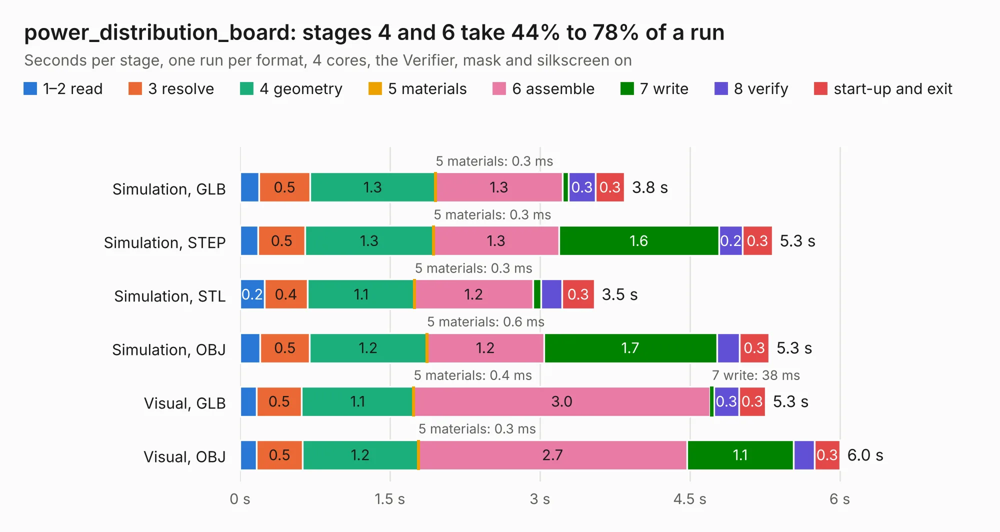

# 612. power_distribution_board

Board 612 of the 3,106 of [Corpus Testing](../Corpus-Testing.md), on [Corpus Page 6](../CorpusTestingPages/Corpus-Testing-06.md#612-power_distribution_board).

| Mode and format | 1–2 read | 3 resolve | 4 geometry | 5 materials | 6 assemble | 7 write | 8 verify | start-up and exit | Total |
|---|---:|---:|---:|---:|---:|---:|---:|---:|---:|
| Simulation, GLB | 0.2 | 0.5 | 1.3 | 0.3&nbsp;ms | 1.3 | 61&nbsp;ms | 0.3 | 0.3 | 3.8 |
| Simulation, STEP | 0.2 | 0.5 | 1.3 | 0.3&nbsp;ms | 1.3 | 1.6 | 0.2 | 0.3 | 5.3 |
| Simulation, STL | 0.2 | 0.4 | 1.1 | 0.3&nbsp;ms | 1.2 | 83&nbsp;ms | 0.2 | 0.3 | 3.5 |
| Simulation, OBJ | 0.2 | 0.5 | 1.2 | 0.6&nbsp;ms | 1.2 | 1.7 | 0.2 | 0.3 | 5.3 |
| Visual, GLB | 0.2 | 0.5 | 1.1 | 0.4&nbsp;ms | 3.0 | 38&nbsp;ms | 0.3 | 0.3 | 5.3 |
| Visual, OBJ | 0.2 | 0.5 | 1.2 | 0.3&nbsp;ms | 2.7 | 1.1 | 0.2 | 0.3 | 6.0 |

<table align="center"><tr><td valign="top">

| Board | Repo: [bluejayracing/bjr_kicad](https://github.com/bluejayracing/bjr_kicad) Board: `power_distribution_board.kicad_pcb` |
|---|---|
| Folder | 21xt / Power_distribution_board |
| Complexity | 218&nbsp;/&nbsp;1000 (size&nbsp;163, features&nbsp;55) |
| KESE&nbsp;features | through vias, slotted holes, rounded, trapezoid or chamfered pads, filled zones |
| Tested | 9th November 2026 |
| Copper&nbsp;layers | 4 |
| File&nbsp;format | KiCad 8 (20240108) |
| Parts,&nbsp;tracks,&nbsp;vias | 25, 199, 41 |
| Triangles,&nbsp;simulation | 302,468 in 55 parts |
| Verifier | PASS in all six runs |

</td><td valign="top">

<table>
<tr><th>File type</th><th>File size</th><th>Peak memory used</th></tr>
<tr><th colspan="3" align="left">Simulation</th></tr>
<tr><td>GLB</td><td align="right">10&nbsp;MB</td><td align="right">235&nbsp;MB</td></tr>
<tr><td>STEP</td><td align="right">37&nbsp;MB</td><td align="right">254&nbsp;MB</td></tr>
<tr><td>STL</td><td align="right">15&nbsp;MB</td><td align="right">234&nbsp;MB</td></tr>
<tr><td>OBJ</td><td align="right">31&nbsp;MB</td><td align="right">257&nbsp;MB</td></tr>
<tr><th colspan="3" align="left">Visual</th></tr>
<tr><td>GLB</td><td align="right">6.5&nbsp;MB</td><td align="right">214&nbsp;MB</td></tr>
<tr><td>OBJ</td><td align="right">19&nbsp;MB</td><td align="right">217&nbsp;MB</td></tr>
</table>

</td></tr></table>

| Previous | Next |
|:---|---:|
| [611. main_bulkhead](b0611b_bjr-kicad_main-bulkhead.md) | [613. serial_bulkhead](b0613b_bjr-kicad_serial-bulkhead.md) |
