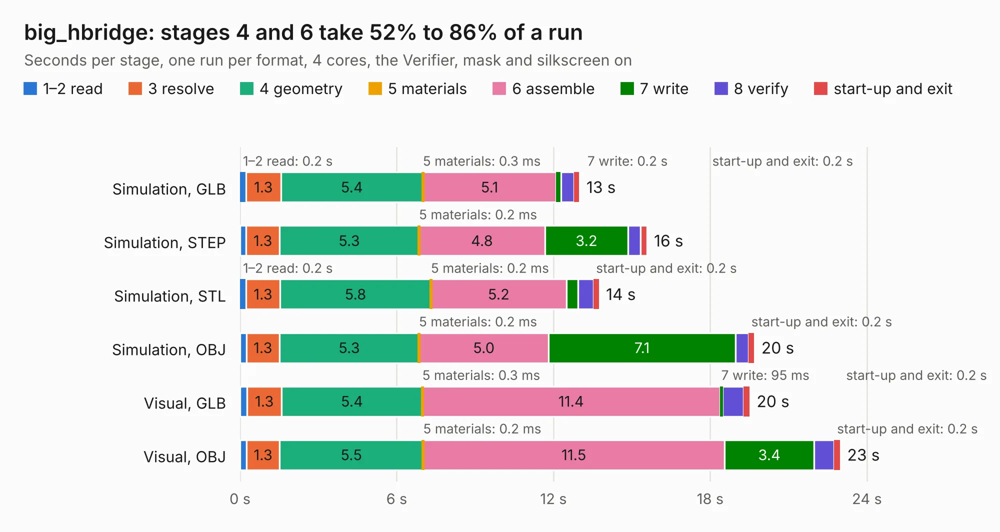

# 614. big_hbridge

Board 614 of the 3,139 of [Corpus Testing](../Corpus-Testing.md), on [Corpus Page 6](../CorpusTestingPages/Corpus-Testing-06.md#614-big_hbridge).

| Mode and format | 1–2 read | 3 resolve | 4 geometry | 5 materials | 6 assemble | 7 write | 8 verify | start-up and exit | Total |
|---|---:|---:|---:|---:|---:|---:|---:|---:|---:|
| Simulation, GLB | 0.2 | 1.3 | 5.4 | 0.3&nbsp;ms | 5.1 | 0.2 | 0.5 | 0.2 | 13.0 |
| Simulation, STEP | 0.2 | 1.3 | 5.3 | 0.2&nbsp;ms | 4.8 | 3.2 | 0.5 | 0.2 | 15.6 |
| Simulation, STL | 0.2 | 1.3 | 5.8 | 0.2&nbsp;ms | 5.2 | 0.4 | 0.6 | 0.2 | 13.7 |
| Simulation, OBJ | 0.2 | 1.3 | 5.3 | 0.2&nbsp;ms | 5.0 | 7.1 | 0.5 | 0.2 | 19.7 |
| Visual, GLB | 0.3 | 1.3 | 5.4 | 0.3&nbsp;ms | 11.4 | 95&nbsp;ms | 0.8 | 0.2 | 19.5 |
| Visual, OBJ | 0.3 | 1.3 | 5.5 | 0.2&nbsp;ms | 11.5 | 3.4 | 0.8 | 0.2 | 23.0 |

<table align="center"><tr><td valign="top">

| Board | Repo: [bluejayracing/bjr_kicad](https://github.com/bluejayracing/bjr_kicad) Board: `big_hbridge.kicad_pcb` |
|---|---|
| Folder | 21xt / big_hbridge |
| Complexity | 297&nbsp;/&nbsp;1000 (size&nbsp;187, features&nbsp;110) |
| KESE&nbsp;features | through vias, slotted holes, rounded, trapezoid or chamfered pads, filled zones, curved board outline, stack-up, dielectric εr and tanδ, copper finish |
| Tested | 9th November 2026 |
| Copper&nbsp;layers | 4 |
| File&nbsp;format | KiCad 8 (20240108) |
| Parts,&nbsp;tracks,&nbsp;vias | 23, 131, 432 |
| Triangles,&nbsp;simulation | 1,472,620 in 34 parts |
| Verifier | PASS in all six runs |

</td><td valign="top">

<table>
<tr><th>File type</th><th>File size</th><th>Peak memory used</th></tr>
<tr><th colspan="3" align="left">Simulation</th></tr>
<tr><td>GLB</td><td align="right">49&nbsp;MB</td><td align="right">473&nbsp;MB</td></tr>
<tr><td>STEP</td><td align="right">130&nbsp;MB</td><td align="right">603&nbsp;MB</td></tr>
<tr><td>STL</td><td align="right">74&nbsp;MB</td><td align="right">475&nbsp;MB</td></tr>
<tr><td>OBJ</td><td align="right">148&nbsp;MB</td><td align="right">976&nbsp;MB</td></tr>
<tr><th colspan="3" align="left">Visual</th></tr>
<tr><td>GLB</td><td align="right">23&nbsp;MB</td><td align="right">716&nbsp;MB</td></tr>
<tr><td>OBJ</td><td align="right">71&nbsp;MB</td><td align="right">648&nbsp;MB</td></tr>
</table>

</td></tr></table>

| Previous | Next |
|:---|---:|
| [613. MagnetometerLayout](b0613b_bjr-kicad_MagnetometerLayout.md) | [615. justin_big_hbridge](b0615b_bjr-kicad_justin-big-hbridge.md) |
