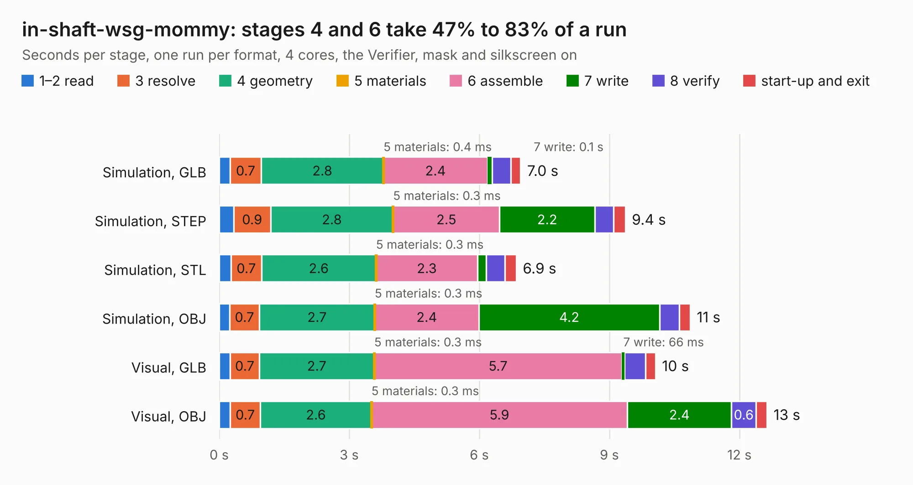

# 614. in-shaft-wsg-mommy

Board 614 of the 3,117 of [Corpus Testing](../Corpus-Testing.md), on [Corpus Page 6](../CorpusTestingPages/Corpus-Testing-06.md#614-in-shaft-wsg-mommy).

| Mode and format | 1–2 read | 3 resolve | 4 geometry | 5 materials | 6 assemble | 7 write | 8 verify | start-up and exit | Total |
|---|---:|---:|---:|---:|---:|---:|---:|---:|---:|
| Simulation, GLB | 0.3 | 0.7 | 2.8 | 0.4&nbsp;ms | 2.4 | 0.1 | 0.4 | 0.2 | 7.0 |
| Simulation, STEP | 0.3 | 0.9 | 2.8 | 0.3&nbsp;ms | 2.5 | 2.2 | 0.4 | 0.3 | 9.4 |
| Simulation, STL | 0.3 | 0.7 | 2.6 | 0.3&nbsp;ms | 2.3 | 0.2 | 0.4 | 0.3 | 6.9 |
| Simulation, OBJ | 0.2 | 0.7 | 2.7 | 0.3&nbsp;ms | 2.4 | 4.2 | 0.5 | 0.3 | 10.9 |
| Visual, GLB | 0.3 | 0.7 | 2.7 | 0.3&nbsp;ms | 5.7 | 66&nbsp;ms | 0.5 | 0.2 | 10.1 |
| Visual, OBJ | 0.3 | 0.7 | 2.6 | 0.3&nbsp;ms | 5.9 | 2.4 | 0.6 | 0.3 | 12.6 |

<table align="center"><tr><td valign="top">

| Board | Repo: [bluejayracing/bjr_kicad](https://github.com/bluejayracing/bjr_kicad) Board: `in-shaft-wsg-mommy.kicad_pcb` |
|---|---|
| Folder | 21xt / in-shaft-wsg / in-shaft-wsg-mommy |
| Complexity | 306&nbsp;/&nbsp;1000 (size&nbsp;186, features&nbsp;120) |
| KESE&nbsp;features | through vias, slotted holes, custom pads, rounded, trapezoid or chamfered pads, filled zones, copper drawings, curved board outline, stack-up, dielectric εr and tanδ |
| Tested | 9th November 2026 |
| Copper&nbsp;layers | 4 |
| File&nbsp;format | KiCad 8 (20240108) |
| Parts,&nbsp;tracks,&nbsp;vias | 62, 399, 110 |
| Triangles,&nbsp;simulation | 696,216 in 77 parts |
| Verifier | PASS in all six runs |

</td><td valign="top">

<table>
<tr><th>File type</th><th>File size</th><th>Peak memory used</th></tr>
<tr><th colspan="3" align="left">Simulation</th></tr>
<tr><td>GLB</td><td align="right">24&nbsp;MB</td><td align="right">326&nbsp;MB</td></tr>
<tr><td>STEP</td><td align="right">90&nbsp;MB</td><td align="right">396&nbsp;MB</td></tr>
<tr><td>STL</td><td align="right">35&nbsp;MB</td><td align="right">350&nbsp;MB</td></tr>
<tr><td>OBJ</td><td align="right">71&nbsp;MB</td><td align="right">496&nbsp;MB</td></tr>
<tr><th colspan="3" align="left">Visual</th></tr>
<tr><td>GLB</td><td align="right">14&nbsp;MB</td><td align="right">444&nbsp;MB</td></tr>
<tr><td>OBJ</td><td align="right">41&nbsp;MB</td><td align="right">446&nbsp;MB</td></tr>
</table>

</td></tr></table>

| Previous | Next |
|:---|---:|
| [613. in-shaft-wsg-daughter](b0613b_bjr-kicad_in-shaft-wsg-daughter.md) | [615. main_bulkhead](b0615b_bjr-kicad_main-bulkhead.md) |
