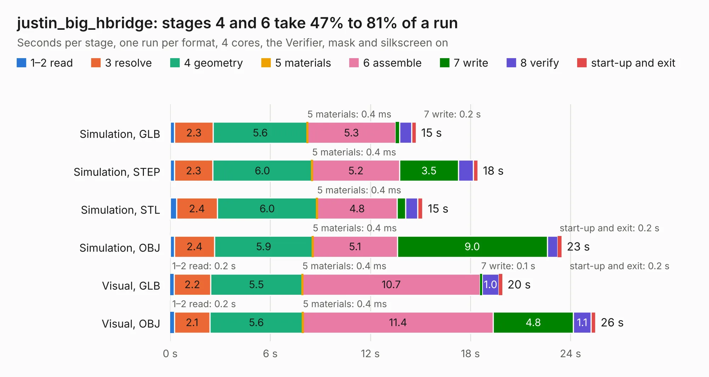

# 615. justin_big_hbridge

Board 615 of the 3,132 of [Corpus Testing](../Corpus-Testing.md), on [Corpus Page 6](../CorpusTestingPages/Corpus-Testing-06.md#615-justin_big_hbridge).

| Mode and format | 1–2 read | 3 resolve | 4 geometry | 5 materials | 6 assemble | 7 write | 8 verify | start-up and exit | Total |
|---|---:|---:|---:|---:|---:|---:|---:|---:|---:|
| Simulation, GLB | 0.3 | 2.3 | 5.6 | 0.4&nbsp;ms | 5.3 | 0.2 | 0.7 | 0.3 | 14.7 |
| Simulation, STEP | 0.3 | 2.3 | 6.0 | 0.4&nbsp;ms | 5.2 | 3.5 | 0.9 | 0.3 | 18.4 |
| Simulation, STL | 0.4 | 2.4 | 6.0 | 0.4&nbsp;ms | 4.8 | 0.5 | 0.7 | 0.3 | 15.1 |
| Simulation, OBJ | 0.3 | 2.4 | 5.9 | 0.4&nbsp;ms | 5.1 | 9.0 | 0.6 | 0.2 | 23.5 |
| Visual, GLB | 0.2 | 2.2 | 5.5 | 0.4&nbsp;ms | 10.7 | 0.1 | 1.0 | 0.2 | 19.9 |
| Visual, OBJ | 0.2 | 2.1 | 5.6 | 0.4&nbsp;ms | 11.4 | 4.8 | 1.1 | 0.3 | 25.5 |

<table align="center"><tr><td valign="top">

| Board | Repo: [bluejayracing/bjr_kicad](https://github.com/bluejayracing/bjr_kicad) Board: `justin_big_hbridge.kicad_pcb` |
|---|---|
| Folder | 21xt / big_hbridge |
| Complexity | 261&nbsp;/&nbsp;1000 (size&nbsp;186, features&nbsp;75) |
| KESE&nbsp;features | through vias, rounded, trapezoid or chamfered pads, filled zones, stack-up, dielectric εr and tanδ |
| Tested | 9th November 2026 |
| Copper&nbsp;layers | 4 |
| File&nbsp;format | KiCad 8 (20240108) |
| Parts,&nbsp;tracks,&nbsp;vias | 19, 220, 436 |
| Triangles,&nbsp;simulation | 1,513,264 in 33 parts |
| Verifier | PASS in all six runs |

</td><td valign="top">

<table>
<tr><th>File type</th><th>File size</th><th>Peak memory used</th></tr>
<tr><th colspan="3" align="left">Simulation</th></tr>
<tr><td>GLB</td><td align="right">51&nbsp;MB</td><td align="right">582&nbsp;MB</td></tr>
<tr><td>STEP</td><td align="right">133&nbsp;MB</td><td align="right">639&nbsp;MB</td></tr>
<tr><td>STL</td><td align="right">76&nbsp;MB</td><td align="right">565&nbsp;MB</td></tr>
<tr><td>OBJ</td><td align="right">153&nbsp;MB</td><td align="right">1.0&nbsp;GB</td></tr>
<tr><th colspan="3" align="left">Visual</th></tr>
<tr><td>GLB</td><td align="right">26&nbsp;MB</td><td align="right">701&nbsp;MB</td></tr>
<tr><td>OBJ</td><td align="right">79&nbsp;MB</td><td align="right">641&nbsp;MB</td></tr>
</table>

</td></tr></table>

| Previous | Next |
|:---|---:|
| [614. big_hbridge](b0614b_bjr-kicad_big-hbridge.md) | [616. in-shaft-wsg-daughter](b0616b_bjr-kicad_in-shaft-wsg-daughter.md) |
