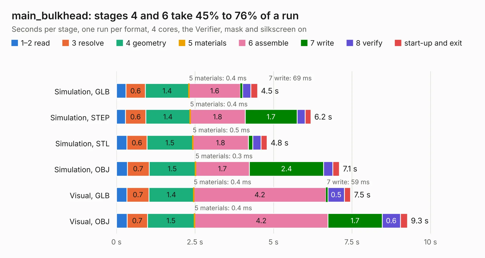

# 617. main_bulkhead

Board 617 of the 3,126 of [Corpus Testing](../Corpus-Testing.md), on [Corpus Page 6](../CorpusTestingPages/Corpus-Testing-06.md#617-main_bulkhead).

| Mode and format | 1–2 read | 3 resolve | 4 geometry | 5 materials | 6 assemble | 7 write | 8 verify | start-up and exit | Total |
|---|---:|---:|---:|---:|---:|---:|---:|---:|---:|
| Simulation, GLB | 0.3 | 0.6 | 1.4 | 0.4&nbsp;ms | 1.6 | 69&nbsp;ms | 0.3 | 0.2 | 4.5 |
| Simulation, STEP | 0.3 | 0.6 | 1.4 | 0.4&nbsp;ms | 1.8 | 1.7 | 0.3 | 0.2 | 6.2 |
| Simulation, STL | 0.3 | 0.6 | 1.5 | 0.5&nbsp;ms | 1.8 | 0.1 | 0.3 | 0.2 | 4.8 |
| Simulation, OBJ | 0.3 | 0.7 | 1.5 | 0.3&nbsp;ms | 1.7 | 2.4 | 0.3 | 0.2 | 7.1 |
| Visual, GLB | 0.3 | 0.7 | 1.4 | 0.4&nbsp;ms | 4.2 | 59&nbsp;ms | 0.5 | 0.2 | 7.5 |
| Visual, OBJ | 0.3 | 0.7 | 1.5 | 0.4&nbsp;ms | 4.2 | 1.7 | 0.6 | 0.2 | 9.3 |

<table align="center"><tr><td valign="top">

| Board | Repo: [bluejayracing/bjr_kicad](https://github.com/bluejayracing/bjr_kicad) Board: `main_bulkhead.kicad_pcb` |
|---|---|
| Folder | 21xt / main_bulkhead |
| Complexity | 249&nbsp;/&nbsp;1000 (size&nbsp;179, features&nbsp;70) |
| KESE&nbsp;features | through vias, rounded, trapezoid or chamfered pads, arc tracks, filled zones, curved board outline |
| Tested | 9th November 2026 |
| Copper&nbsp;layers | 4 |
| File&nbsp;format | KiCad 7 (20221018) |
| Parts,&nbsp;tracks,&nbsp;vias | 30, 666, 31 |
| Triangles,&nbsp;simulation | 535,276 in 108 parts |
| Verifier | PASS in all six runs |

</td><td valign="top">

<table>
<tr><th>File type</th><th>File size</th><th>Peak memory used</th></tr>
<tr><th colspan="3" align="left">Simulation</th></tr>
<tr><td>GLB</td><td align="right">19&nbsp;MB</td><td align="right">309&nbsp;MB</td></tr>
<tr><td>STEP</td><td align="right">85&nbsp;MB</td><td align="right">358&nbsp;MB</td></tr>
<tr><td>STL</td><td align="right">27&nbsp;MB</td><td align="right">311&nbsp;MB</td></tr>
<tr><td>OBJ</td><td align="right">56&nbsp;MB</td><td align="right">412&nbsp;MB</td></tr>
<tr><th colspan="3" align="left">Visual</th></tr>
<tr><td>GLB</td><td align="right">14&nbsp;MB</td><td align="right">373&nbsp;MB</td></tr>
<tr><td>OBJ</td><td align="right">41&nbsp;MB</td><td align="right">369&nbsp;MB</td></tr>
</table>

</td></tr></table>

| Previous | Next |
|:---|---:|
| [616. in-shaft-wsg-mommy](b0616b_bjr-kicad_in-shaft-wsg-mommy.md) | [618. power_distribution_board](b0618b_bjr-kicad_power-distribution-board.md) |
