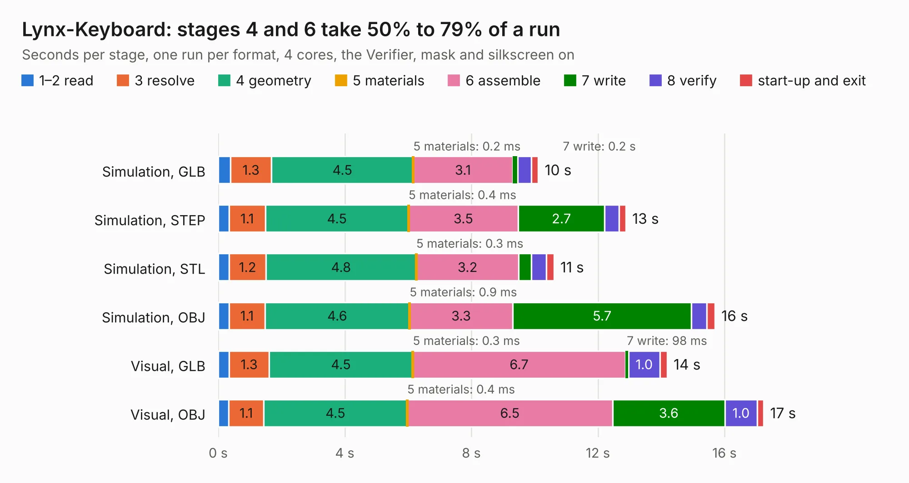

# 618. Lynx-Keyboard

Board 618 of the 3,109 of [Corpus Testing](../Corpus-Testing.md), on [Corpus Page 6](../CorpusTestingPages/Corpus-Testing-06.md#618-lynx-keyboard).

| Mode and format | 1–2 read | 3 resolve | 4 geometry | 5 materials | 6 assemble | 7 write | 8 verify | start-up and exit | Total |
|---|---:|---:|---:|---:|---:|---:|---:|---:|---:|
| Simulation, GLB | 0.4 | 1.3 | 4.5 | 0.2&nbsp;ms | 3.1 | 0.2 | 0.4 | 0.2 | 10.1 |
| Simulation, STEP | 0.3 | 1.1 | 4.5 | 0.4&nbsp;ms | 3.5 | 2.7 | 0.5 | 0.2 | 12.9 |
| Simulation, STL | 0.4 | 1.2 | 4.8 | 0.3&nbsp;ms | 3.2 | 0.4 | 0.5 | 0.2 | 10.6 |
| Simulation, OBJ | 0.3 | 1.1 | 4.6 | 0.9&nbsp;ms | 3.3 | 5.7 | 0.5 | 0.3 | 15.7 |
| Visual, GLB | 0.4 | 1.3 | 4.5 | 0.3&nbsp;ms | 6.7 | 98&nbsp;ms | 1.0 | 0.2 | 14.2 |
| Visual, OBJ | 0.3 | 1.1 | 4.5 | 0.4&nbsp;ms | 6.5 | 3.6 | 1.0 | 0.2 | 17.2 |

<table align="center"><tr><td valign="top">

| Board | Repo: [Board-Folk/Camputers-Lynx](https://github.com/Board-Folk/Camputers-Lynx) Board: `Lynx-Keyboard.kicad_pcb` |
|---|---|
| Folder | Lynx 96 / Expansions / Lynx-Keyboard / Kicad |
| Complexity | 221&nbsp;/&nbsp;1000 (size&nbsp;166, features&nbsp;55) |
| KESE&nbsp;features | through vias, curved board outline, stack-up, dielectric εr and tanδ |
| Tested | 9th November 2026 |
| Copper&nbsp;layers | 2 |
| File&nbsp;format | KiCad 7 (20221018) |
| Parts,&nbsp;tracks,&nbsp;vias | 67, 564, 1 |
| Triangles,&nbsp;simulation | 1,048,610 in 37 parts |
| Verifier | PASS in all six runs |

</td><td valign="top">

<table>
<tr><th>File type</th><th>File size</th><th>Peak memory used</th></tr>
<tr><th colspan="3" align="left">Simulation</th></tr>
<tr><td>GLB</td><td align="right">36&nbsp;MB</td><td align="right">453&nbsp;MB</td></tr>
<tr><td>STEP</td><td align="right">135&nbsp;MB</td><td align="right">550&nbsp;MB</td></tr>
<tr><td>STL</td><td align="right">52&nbsp;MB</td><td align="right">437&nbsp;MB</td></tr>
<tr><td>OBJ</td><td align="right">106&nbsp;MB</td><td align="right">724&nbsp;MB</td></tr>
<tr><th colspan="3" align="left">Visual</th></tr>
<tr><td>GLB</td><td align="right">23&nbsp;MB</td><td align="right">604&nbsp;MB</td></tr>
<tr><td>OBJ</td><td align="right">68&nbsp;MB</td><td align="right">576&nbsp;MB</td></tr>
</table>

</td></tr></table>

| Previous | Next |
|:---|---:|
| [617. lynx128](b0617b_Camputers-Lynx_Lynx-128-Kicad_lynx128.md) | [619. Lynx-MK1-MEM](b0619b_Camputers-Lynx_Lynx-96-Expansions-Lynx-MK1-MEM-Original-Kicad_Lynx-MK1-MEM.md) |
