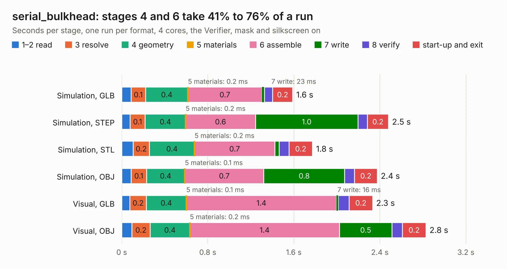

# 619. serial_bulkhead

Board 619 of the 3,130 of [Corpus Testing](../Corpus-Testing.md), on [Corpus Page 6](../CorpusTestingPages/Corpus-Testing-06.md#619-serial_bulkhead).

| Mode and format | 1–2 read | 3 resolve | 4 geometry | 5 materials | 6 assemble | 7 write | 8 verify | start-up and exit | Total |
|---|---:|---:|---:|---:|---:|---:|---:|---:|---:|
| Simulation, GLB | 86&nbsp;ms | 0.1 | 0.4 | 0.2&nbsp;ms | 0.7 | 23&nbsp;ms | 77&nbsp;ms | 0.2 | 1.6 |
| Simulation, STEP | 77&nbsp;ms | 0.1 | 0.4 | 0.2&nbsp;ms | 0.6 | 1.0 | 88&nbsp;ms | 0.2 | 2.5 |
| Simulation, STL | 0.1 | 0.2 | 0.4 | 0.2&nbsp;ms | 0.7 | 40&nbsp;ms | 93&nbsp;ms | 0.2 | 1.8 |
| Simulation, OBJ | 88&nbsp;ms | 0.1 | 0.4 | 0.1&nbsp;ms | 0.7 | 0.8 | 92&nbsp;ms | 0.2 | 2.4 |
| Visual, GLB | 75&nbsp;ms | 0.2 | 0.4 | 0.1&nbsp;ms | 1.4 | 16&nbsp;ms | 0.1 | 0.2 | 2.3 |
| Visual, OBJ | 95&nbsp;ms | 0.2 | 0.4 | 0.2&nbsp;ms | 1.4 | 0.5 | 96&nbsp;ms | 0.2 | 2.8 |

<table align="center"><tr><td valign="top">

| Board | Repo: [bluejayracing/bjr_kicad](https://github.com/bluejayracing/bjr_kicad) Board: `serial_bulkhead.kicad_pcb` |
|---|---|
| Folder | 21xt / serial_bulkhead |
| Complexity | 205&nbsp;/&nbsp;1000 (size&nbsp;135, features&nbsp;70) |
| KESE&nbsp;features | through vias, rounded, trapezoid or chamfered pads, arc tracks, filled zones, curved board outline |
| Tested | 9th November 2026 |
| Copper&nbsp;layers | 4 |
| File&nbsp;format | KiCad 7 (20221018) |
| Parts,&nbsp;tracks,&nbsp;vias | 5, 142, 2 |
| Triangles,&nbsp;simulation | 146,838 in 23 parts |
| Verifier | PASS in all six runs |

</td><td valign="top">

<table>
<tr><th>File type</th><th>File size</th><th>Peak memory used</th></tr>
<tr><th colspan="3" align="left">Simulation</th></tr>
<tr><td>GLB</td><td align="right">4.9&nbsp;MB</td><td align="right">175&nbsp;MB</td></tr>
<tr><td>STEP</td><td align="right">20&nbsp;MB</td><td align="right">182&nbsp;MB</td></tr>
<tr><td>STL</td><td align="right">7.3&nbsp;MB</td><td align="right">175&nbsp;MB</td></tr>
<tr><td>OBJ</td><td align="right">14&nbsp;MB</td><td align="right">175&nbsp;MB</td></tr>
<tr><th colspan="3" align="left">Visual</th></tr>
<tr><td>GLB</td><td align="right">3.2&nbsp;MB</td><td align="right">135&nbsp;MB</td></tr>
<tr><td>OBJ</td><td align="right">9.1&nbsp;MB</td><td align="right">136&nbsp;MB</td></tr>
</table>

</td></tr></table>

| Previous | Next |
|:---|---:|
| [618. power_distribution_board](b0618b_bjr-kicad_power-distribution-board.md) | [620. steering_wheel](b0620b_bjr-kicad_steering-wheel.md) |
