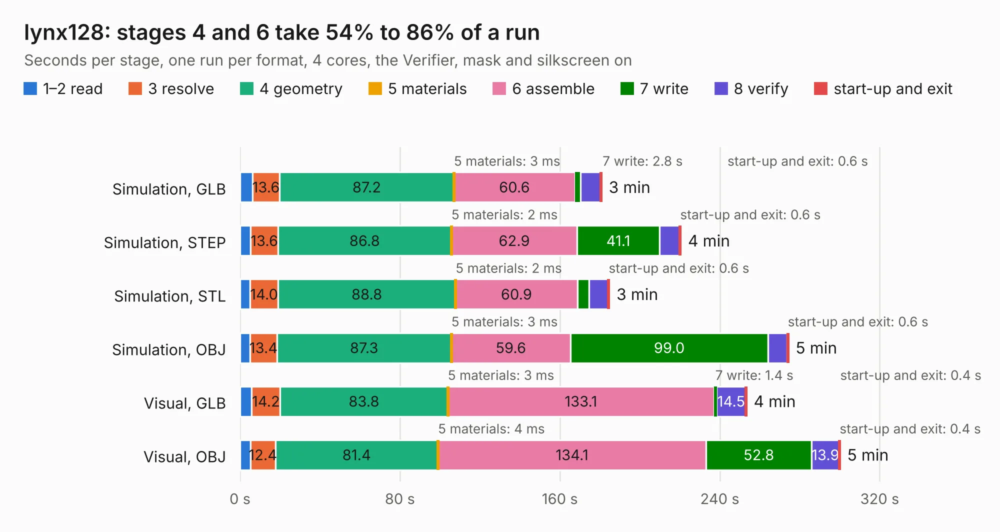

# 621. lynx128

Board 621 of the 3,119 of [Corpus Testing](../Corpus-Testing.md), on [Corpus Page 6](../CorpusTestingPages/Corpus-Testing-06.md#621-lynx128).

| Mode and format | 1–2 read | 3 resolve | 4 geometry | 5 materials | 6 assemble | 7 write | 8 verify | start-up and exit | Total |
|---|---:|---:|---:|---:|---:|---:|---:|---:|---:|
| Simulation, GLB | 6.2 | 13.6 | 87.2 | 3&nbsp;ms | 60.6 | 2.8 | 9.9 | 0.6 | 180.9 |
| Simulation, STEP | 5.4 | 13.6 | 86.8 | 2&nbsp;ms | 62.9 | 41.1 | 10.1 | 0.6 | 220.5 |
| Simulation, STL | 5.0 | 14.0 | 88.8 | 2&nbsp;ms | 60.9 | 5.9 | 9.5 | 0.6 | 184.7 |
| Simulation, OBJ | 5.1 | 13.4 | 87.3 | 3&nbsp;ms | 59.6 | 99.0 | 9.5 | 0.6 | 274.3 |
| Visual, GLB | 5.8 | 14.2 | 83.8 | 3&nbsp;ms | 133.1 | 1.4 | 14.5 | 0.4 | 253.4 |
| Visual, OBJ | 5.2 | 12.4 | 81.4 | 4&nbsp;ms | 134.1 | 52.8 | 13.9 | 0.4 | 300.1 |

<table align="center"><tr><td valign="top">

| Board | Repo: [Board-Folk/Camputers-Lynx](https://github.com/Board-Folk/Camputers-Lynx) Board: `lynx128.kicad_pcb` |
|---|---|
| Folder | Lynx 128 / Archive / Lynx 192 / Kicad |
| Complexity | 307&nbsp;/&nbsp;1000 (size&nbsp;242, features&nbsp;65) |
| KESE&nbsp;features | through vias, rounded, trapezoid or chamfered pads, filled zones, copper drawings, copper text |
| Tested | 9th November 2026 |
| Copper&nbsp;layers | 2 |
| File&nbsp;format | KiCad 7 (20221018) |
| Parts,&nbsp;tracks,&nbsp;vias | 308, 18,549, 786 |
| Triangles,&nbsp;simulation | 13,569,736 in 471 parts |
| Verifier | PASS in all six runs |

</td><td valign="top">

<table>
<tr><th>File type</th><th>File size</th><th>Peak memory used</th></tr>
<tr><th colspan="3" align="left">Simulation</th></tr>
<tr><td>GLB</td><td align="right">456&nbsp;MB</td><td align="right">4.0&nbsp;GB</td></tr>
<tr><td>STEP</td><td align="right">2.1&nbsp;GB</td><td align="right">5.0&nbsp;GB</td></tr>
<tr><td>STL</td><td align="right">679&nbsp;MB</td><td align="right">4.2&nbsp;GB</td></tr>
<tr><td>OBJ</td><td align="right">1.5&nbsp;GB</td><td align="right">8.5&nbsp;GB</td></tr>
<tr><th colspan="3" align="left">Visual</th></tr>
<tr><td>GLB</td><td align="right">286&nbsp;MB</td><td align="right">4.5&nbsp;GB</td></tr>
<tr><td>OBJ</td><td align="right">920&nbsp;MB</td><td align="right">5.7&nbsp;GB</td></tr>
</table>

</td></tr></table>

| Previous | Next |
|:---|---:|
| [620. Acorn-A3010](b0620b_Acorn-A3010_Acorn-A3010.md) | [622. lynx128](b0622b_Camputers-Lynx_Lynx-128-Kicad_lynx128.md) |
