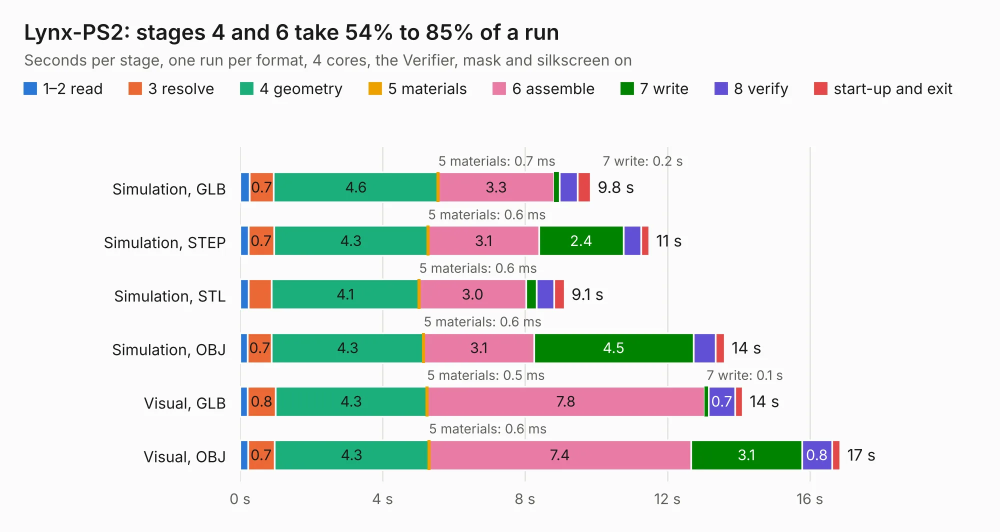

# 621. Lynx-PS2

Board 621 of the 3,111 of [Corpus Testing](../Corpus-Testing.md), on [Corpus Page 6](../CorpusTestingPages/Corpus-Testing-06.md#621-lynx-ps2).

| Mode and format | 1–2 read | 3 resolve | 4 geometry | 5 materials | 6 assemble | 7 write | 8 verify | start-up and exit | Total |
|---|---:|---:|---:|---:|---:|---:|---:|---:|---:|
| Simulation, GLB | 0.3 | 0.7 | 4.6 | 0.7&nbsp;ms | 3.3 | 0.2 | 0.5 | 0.4 | 9.8 |
| Simulation, STEP | 0.2 | 0.7 | 4.3 | 0.6&nbsp;ms | 3.1 | 2.4 | 0.5 | 0.2 | 11.5 |
| Simulation, STL | 0.2 | 0.6 | 4.1 | 0.6&nbsp;ms | 3.0 | 0.3 | 0.5 | 0.3 | 9.1 |
| Simulation, OBJ | 0.2 | 0.7 | 4.3 | 0.6&nbsp;ms | 3.1 | 4.5 | 0.6 | 0.3 | 13.6 |
| Visual, GLB | 0.2 | 0.8 | 4.3 | 0.5&nbsp;ms | 7.8 | 0.1 | 0.7 | 0.2 | 14.1 |
| Visual, OBJ | 0.2 | 0.7 | 4.3 | 0.6&nbsp;ms | 7.4 | 3.1 | 0.8 | 0.2 | 16.8 |

<table align="center"><tr><td valign="top">

| Board | Repo: [Board-Folk/Camputers-Lynx](https://github.com/Board-Folk/Camputers-Lynx) Board: `Lynx-PS2.kicad_pcb` |
|---|---|
| Folder | Lynx 96 / Expansions / Lynx-PS2 / Kicad |
| Complexity | 241&nbsp;/&nbsp;1000 (size&nbsp;156, features&nbsp;85) |
| KESE&nbsp;features | through vias, slotted holes, filled zones, curved board outline, stack-up, dielectric εr and tanδ |
| Tested | 9th November 2026 |
| Copper&nbsp;layers | 2 |
| File&nbsp;format | KiCad 7 (20221018) |
| Parts,&nbsp;tracks,&nbsp;vias | 23, 525, 20 |
| Triangles,&nbsp;simulation | 947,840 in 74 parts |
| Verifier | PASS in all six runs |

</td><td valign="top">

<table>
<tr><th>File type</th><th>File size</th><th>Peak memory used</th></tr>
<tr><th colspan="3" align="left">Simulation</th></tr>
<tr><td>GLB</td><td align="right">32&nbsp;MB</td><td align="right">420&nbsp;MB</td></tr>
<tr><td>STEP</td><td align="right">140&nbsp;MB</td><td align="right">503&nbsp;MB</td></tr>
<tr><td>STL</td><td align="right">47&nbsp;MB</td><td align="right">437&nbsp;MB</td></tr>
<tr><td>OBJ</td><td align="right">96&nbsp;MB</td><td align="right">671&nbsp;MB</td></tr>
<tr><th colspan="3" align="left">Visual</th></tr>
<tr><td>GLB</td><td align="right">21&nbsp;MB</td><td align="right">600&nbsp;MB</td></tr>
<tr><td>OBJ</td><td align="right">63&nbsp;MB</td><td align="right">559&nbsp;MB</td></tr>
</table>

</td></tr></table>

| Previous | Next |
|:---|---:|
| [620. Lynx-MK1-MEM](b0620b_Camputers-Lynx_Lynx-96-Expansions-Lynx-MK1-MEM-Kicad_Lynx-MK1-MEM.md) | [622. lynx96](b0622b_Camputers-Lynx_lynx96.md) |
