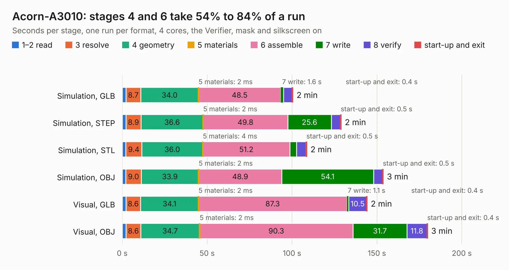

# 622. Acorn-A3010

Board 622 of the 3,131 of [Corpus Testing](../Corpus-Testing.md), on [Corpus Page 6](../CorpusTestingPages/Corpus-Testing-06.md#622-acorn-a3010).

| Mode and format | 1–2 read | 3 resolve | 4 geometry | 5 materials | 6 assemble | 7 write | 8 verify | start-up and exit | Total |
|---|---:|---:|---:|---:|---:|---:|---:|---:|---:|
| Simulation, GLB | 2.2 | 8.7 | 34.0 | 2&nbsp;ms | 48.5 | 1.6 | 5.1 | 0.4 | 100.5 |
| Simulation, STEP | 2.2 | 8.9 | 36.6 | 2&nbsp;ms | 49.8 | 25.6 | 5.3 | 0.5 | 129.0 |
| Simulation, STL | 2.1 | 9.4 | 36.0 | 4&nbsp;ms | 51.2 | 4.0 | 5.6 | 0.5 | 108.8 |
| Simulation, OBJ | 2.2 | 9.0 | 33.9 | 2&nbsp;ms | 48.9 | 54.1 | 5.2 | 0.5 | 153.8 |
| Visual, GLB | 2.2 | 8.6 | 34.1 | 2&nbsp;ms | 87.3 | 1.1 | 10.5 | 0.4 | 144.3 |
| Visual, OBJ | 2.3 | 8.6 | 34.7 | 2&nbsp;ms | 90.3 | 31.7 | 11.8 | 0.4 | 179.9 |

<table align="center"><tr><td valign="top">

| Board | Repo: [Board-Folk/Acorn_A3010](https://github.com/Board-Folk/Acorn_A3010) Board: `Acorn-A3010.kicad_pcb` |
|---|---|
| Complexity | 413&nbsp;/&nbsp;1000 (size&nbsp;303, features&nbsp;110) |
| KESE&nbsp;features | through vias, slotted holes, rounded, trapezoid or chamfered pads, filled zones, copper text, stack-up, dielectric εr and tanδ, copper finish |
| Tested | 9th November 2026 |
| Copper&nbsp;layers | 4 |
| File&nbsp;format | KiCad 8 (20240108) |
| Parts,&nbsp;tracks,&nbsp;vias | 438, 9,356, 827 |
| Triangles,&nbsp;simulation | 9,737,398 in 653 parts |
| Verifier | PASS in all six runs |

</td><td valign="top">

<table>
<tr><th>File type</th><th>File size</th><th>Peak memory used</th></tr>
<tr><th colspan="3" align="left">Simulation</th></tr>
<tr><td>GLB</td><td align="right">330&nbsp;MB</td><td align="right">2.5&nbsp;GB</td></tr>
<tr><td>STEP</td><td align="right">1.3&nbsp;GB</td><td align="right">3.3&nbsp;GB</td></tr>
<tr><td>STL</td><td align="right">487&nbsp;MB</td><td align="right">2.5&nbsp;GB</td></tr>
<tr><td>OBJ</td><td align="right">1.0&nbsp;GB</td><td align="right">6.1&nbsp;GB</td></tr>
<tr><th colspan="3" align="left">Visual</th></tr>
<tr><td>GLB</td><td align="right">204&nbsp;MB</td><td align="right">3.2&nbsp;GB</td></tr>
<tr><td>OBJ</td><td align="right">665&nbsp;MB</td><td align="right">4.2&nbsp;GB</td></tr>
</table>

</td></tr></table>

| Previous | Next |
|:---|---:|
| [621. steering_wheel](b0621b_bjr-kicad_steering-wheel.md) | [623. lynx128](b0623b_Camputers-Lynx_Lynx-128-Archive-Lynx-192-Kicad_lynx128.md) |
