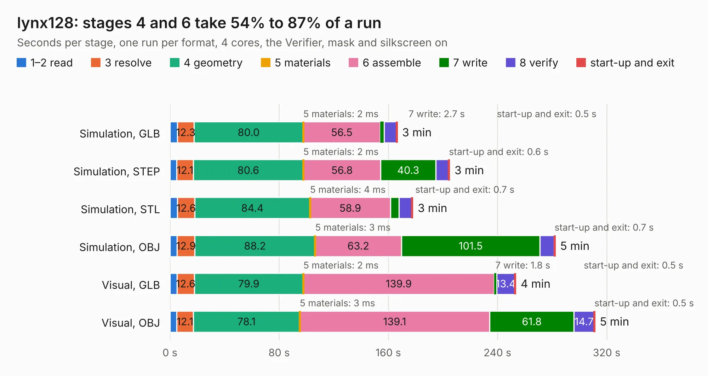

# 622. lynx128

Board 622 of the 3,119 of [Corpus Testing](../Corpus-Testing.md), on [Corpus Page 6](../CorpusTestingPages/Corpus-Testing-06.md#622-lynx128).

| Mode and format | 1–2 read | 3 resolve | 4 geometry | 5 materials | 6 assemble | 7 write | 8 verify | start-up and exit | Total |
|---|---:|---:|---:|---:|---:|---:|---:|---:|---:|
| Simulation, GLB | 5.4 | 12.3 | 80.0 | 2&nbsp;ms | 56.5 | 2.7 | 9.1 | 0.5 | 166.5 |
| Simulation, STEP | 5.0 | 12.1 | 80.6 | 2&nbsp;ms | 56.8 | 40.3 | 9.4 | 0.6 | 204.8 |
| Simulation, STL | 5.6 | 12.6 | 84.4 | 4&nbsp;ms | 58.9 | 6.3 | 9.3 | 0.7 | 177.9 |
| Simulation, OBJ | 5.3 | 12.9 | 88.2 | 3&nbsp;ms | 63.2 | 101.5 | 10.3 | 0.7 | 282.2 |
| Visual, GLB | 5.2 | 12.6 | 79.9 | 2&nbsp;ms | 139.9 | 1.8 | 13.4 | 0.5 | 253.3 |
| Visual, OBJ | 5.0 | 12.1 | 78.1 | 3&nbsp;ms | 139.1 | 61.8 | 14.7 | 0.5 | 311.3 |

<table align="center"><tr><td valign="top">

| Board | Repo: [Board-Folk/Camputers-Lynx](https://github.com/Board-Folk/Camputers-Lynx) Board: `lynx128.kicad_pcb` |
|---|---|
| Folder | Lynx 128 / Kicad |
| Complexity | 307&nbsp;/&nbsp;1000 (size&nbsp;242, features&nbsp;65) |
| KESE&nbsp;features | through vias, rounded, trapezoid or chamfered pads, filled zones, copper drawings, copper text |
| Tested | 9th November 2026 |
| Copper&nbsp;layers | 2 |
| File&nbsp;format | KiCad 7 (20221018) |
| Parts,&nbsp;tracks,&nbsp;vias | 308, 18,574, 786 |
| Triangles,&nbsp;simulation | 13,506,684 in 447 parts |
| Verifier | PASS in all six runs |

</td><td valign="top">

<table>
<tr><th>File type</th><th>File size</th><th>Peak memory used</th></tr>
<tr><th colspan="3" align="left">Simulation</th></tr>
<tr><td>GLB</td><td align="right">453&nbsp;MB</td><td align="right">4.2&nbsp;GB</td></tr>
<tr><td>STEP</td><td align="right">2.1&nbsp;GB</td><td align="right">4.8&nbsp;GB</td></tr>
<tr><td>STL</td><td align="right">675&nbsp;MB</td><td align="right">4.3&nbsp;GB</td></tr>
<tr><td>OBJ</td><td align="right">1.4&nbsp;GB</td><td align="right">8.4&nbsp;GB</td></tr>
<tr><th colspan="3" align="left">Visual</th></tr>
<tr><td>GLB</td><td align="right">283&nbsp;MB</td><td align="right">4.4&nbsp;GB</td></tr>
<tr><td>OBJ</td><td align="right">911&nbsp;MB</td><td align="right">5.7&nbsp;GB</td></tr>
</table>

</td></tr></table>

| Previous | Next |
|:---|---:|
| [621. lynx128](b0621b_Camputers-Lynx_Lynx-128-Archive-Lynx-192-Kicad_lynx128.md) | [623. Lynx-Keyboard](b0623b_Camputers-Lynx_Lynx-Keyboard.md) |
