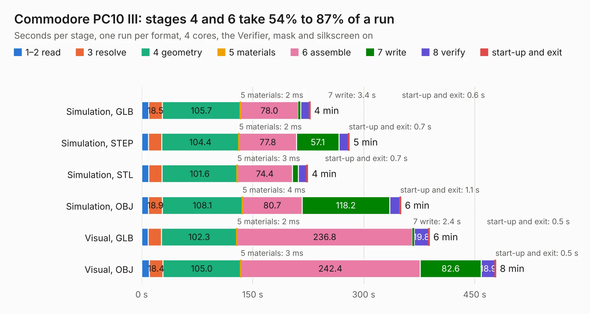

# 623. Commodore PC10 III

Board 623 of the 3,107 of [Corpus Testing](../Corpus-Testing.md), on [Corpus Page 6](../CorpusTestingPages/Corpus-Testing-06.md#623-commodore-pc10-iii).

| Mode and format | 1–2 read | 3 resolve | 4 geometry | 5 materials | 6 assemble | 7 write | 8 verify | start-up and exit | Total |
|---|---:|---:|---:|---:|---:|---:|---:|---:|---:|
| Simulation, GLB | 9.4 | 18.5 | 105.7 | 2&nbsp;ms | 78.0 | 3.4 | 11.7 | 0.6 | 227.3 |
| Simulation, STEP | 9.2 | 17.9 | 104.4 | 2&nbsp;ms | 77.8 | 57.1 | 13.1 | 0.7 | 280.3 |
| Simulation, STL | 9.5 | 18.1 | 101.6 | 3&nbsp;ms | 74.4 | 8.0 | 11.7 | 0.7 | 224.1 |
| Simulation, OBJ | 9.1 | 18.9 | 108.1 | 4&nbsp;ms | 80.7 | 118.2 | 13.9 | 1.1 | 349.9 |
| Visual, GLB | 8.8 | 17.8 | 102.3 | 2&nbsp;ms | 236.8 | 2.4 | 19.8 | 0.5 | 388.4 |
| Visual, OBJ | 10.4 | 18.4 | 105.0 | 3&nbsp;ms | 242.4 | 82.6 | 18.9 | 0.5 | 478.2 |

<table align="center"><tr><td valign="top">

| Board | Repo: [Board-Folk/Commodore-PC10-III-Reproduction](https://github.com/Board-Folk/Commodore-PC10-III-Reproduction) Board: `Commodore PC10 III.kicad_pcb` |
|---|---|
| Folder | 312628-REV-6C |
| Complexity | 390&nbsp;/&nbsp;1000 (size&nbsp;305, features&nbsp;85) |
| KESE&nbsp;features | through vias, rounded, trapezoid or chamfered pads, filled zones, curved board outline, stack-up, dielectric εr and tanδ |
| Tested | 9th November 2026 to 10th November 2026 |
| Copper&nbsp;layers | 2 |
| File&nbsp;format | KiCad 8 (20240108) |
| Parts,&nbsp;tracks,&nbsp;vias | 406, 41,077, 1,838 |
| Triangles,&nbsp;simulation | 18,353,260 in 652 parts |
| Verifier | PASS in all six runs |
| Run&nbsp;again | Simulation, OBJ: failed in the corpus run, run again with the memory cap raised from 11 GB to 14.5 GB, and passed |

</td><td valign="top">

<table>
<tr><th>File type</th><th>File size</th><th>Peak memory used</th></tr>
<tr><th colspan="3" align="left">Simulation</th></tr>
<tr><td>GLB</td><td align="right">619&nbsp;MB</td><td align="right">5.7&nbsp;GB</td></tr>
<tr><td>STEP</td><td align="right">3.0&nbsp;GB</td><td align="right">6.7&nbsp;GB</td></tr>
<tr><td>STL</td><td align="right">918&nbsp;MB</td><td align="right">5.6&nbsp;GB</td></tr>
<tr><td>OBJ</td><td align="right">2.0&nbsp;GB</td><td align="right">12&nbsp;GB</td></tr>
<tr><th colspan="3" align="left">Visual</th></tr>
<tr><td>GLB</td><td align="right">414&nbsp;MB</td><td align="right">6.4&nbsp;GB</td></tr>
<tr><td>OBJ</td><td align="right">1.3&nbsp;GB</td><td align="right">8.3&nbsp;GB</td></tr>
</table>

</td></tr></table>

| Previous | Next |
|:---|---:|
| [622. lynx96](b0622b_Camputers-Lynx_lynx96.md) | [624. CPC464-2MINIITX](b0624b_CPC464-2MINI_CPC464-2MINIITX.md) |
