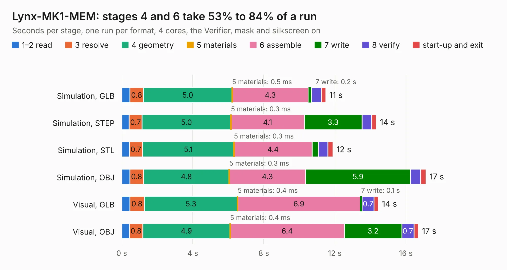

# 625. Lynx-MK1-MEM

Board 625 of the 3,125 of [Corpus Testing](../Corpus-Testing.md), on [Corpus Page 6](../CorpusTestingPages/Corpus-Testing-06.md#625-lynx-mk1-mem).

| Mode and format | 1–2 read | 3 resolve | 4 geometry | 5 materials | 6 assemble | 7 write | 8 verify | start-up and exit | Total |
|---|---:|---:|---:|---:|---:|---:|---:|---:|---:|
| Simulation, GLB | 0.5 | 0.8 | 5.0 | 0.5&nbsp;ms | 4.3 | 0.2 | 0.5 | 0.3 | 11.5 |
| Simulation, STEP | 0.4 | 0.7 | 5.0 | 0.3&nbsp;ms | 4.1 | 3.3 | 0.5 | 0.3 | 14.3 |
| Simulation, STL | 0.4 | 0.7 | 5.1 | 0.3&nbsp;ms | 4.4 | 0.3 | 0.5 | 0.3 | 11.9 |
| Simulation, OBJ | 0.5 | 0.8 | 4.8 | 0.3&nbsp;ms | 4.3 | 5.9 | 0.6 | 0.3 | 17.1 |
| Visual, GLB | 0.5 | 0.8 | 5.3 | 0.4&nbsp;ms | 6.9 | 0.1 | 0.7 | 0.2 | 14.4 |
| Visual, OBJ | 0.4 | 0.8 | 4.9 | 0.4&nbsp;ms | 6.4 | 3.2 | 0.7 | 0.2 | 16.7 |

<table align="center"><tr><td valign="top">

| Board | Repo: [Board-Folk/Camputers-Lynx](https://github.com/Board-Folk/Camputers-Lynx) Board: `Lynx-MK1-MEM.kicad_pcb` |
|---|---|
| Folder | Lynx 96 / Expansions / Lynx-MK1-MEM-Original / Kicad |
| Complexity | 193&nbsp;/&nbsp;1000 (size&nbsp;168, features&nbsp;25) |
| KESE&nbsp;features | through vias, copper text |
| Tested | 9th November 2026 |
| Copper&nbsp;layers | 2 |
| File&nbsp;format | KiCad 7 (20221018) |
| Parts,&nbsp;tracks,&nbsp;vias | 29, 1,034, 19 |
| Triangles,&nbsp;simulation | 1,075,260 in 48 parts |
| Verifier | PASS in all six runs |

</td><td valign="top">

<table>
<tr><th>File type</th><th>File size</th><th>Peak memory used</th></tr>
<tr><th colspan="3" align="left">Simulation</th></tr>
<tr><td>GLB</td><td align="right">36&nbsp;MB</td><td align="right">443&nbsp;MB</td></tr>
<tr><td>STEP</td><td align="right">150&nbsp;MB</td><td align="right">551&nbsp;MB</td></tr>
<tr><td>STL</td><td align="right">54&nbsp;MB</td><td align="right">421&nbsp;MB</td></tr>
<tr><td>OBJ</td><td align="right">107&nbsp;MB</td><td align="right">759&nbsp;MB</td></tr>
<tr><th colspan="3" align="left">Visual</th></tr>
<tr><td>GLB</td><td align="right">20&nbsp;MB</td><td align="right">535&nbsp;MB</td></tr>
<tr><td>OBJ</td><td align="right">61&nbsp;MB</td><td align="right">567&nbsp;MB</td></tr>
</table>

</td></tr></table>

| Previous | Next |
|:---|---:|
| [624. Lynx-Keyboard](b0624b_Camputers-Lynx_Lynx-Keyboard.md) | [626. Lynx-MK1-MEM](b0626b_Camputers-Lynx_Lynx-96-Expansions-Lynx-MK1-MEM-Kicad_Lynx-MK1-MEM.md) |
