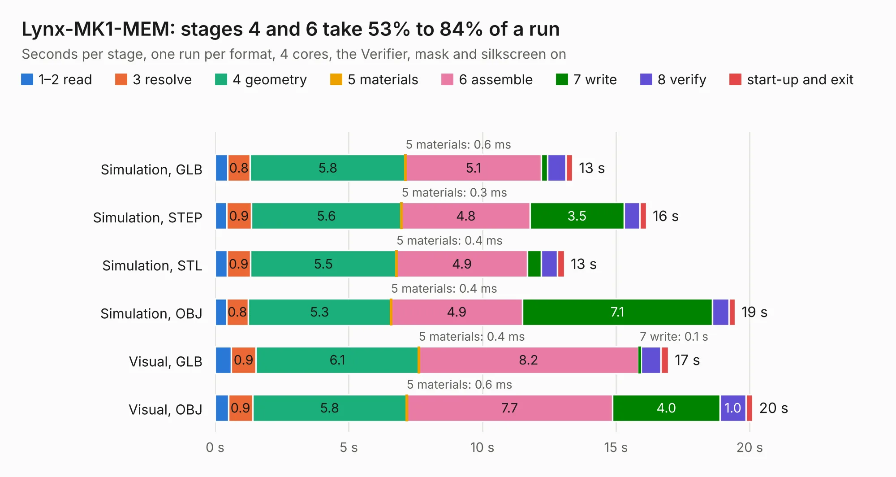

# 626. Lynx-MK1-MEM

Board 626 of the 3,130 of [Corpus Testing](../Corpus-Testing.md), on [Corpus Page 6](../CorpusTestingPages/Corpus-Testing-06.md#626-lynx-mk1-mem).

| Mode and format | 1–2 read | 3 resolve | 4 geometry | 5 materials | 6 assemble | 7 write | 8 verify | start-up and exit | Total |
|---|---:|---:|---:|---:|---:|---:|---:|---:|---:|
| Simulation, GLB | 0.5 | 0.8 | 5.8 | 0.6&nbsp;ms | 5.1 | 0.2 | 0.7 | 0.3 | 13.4 |
| Simulation, STEP | 0.4 | 0.9 | 5.6 | 0.3&nbsp;ms | 4.8 | 3.5 | 0.6 | 0.2 | 16.1 |
| Simulation, STL | 0.4 | 0.9 | 5.5 | 0.4&nbsp;ms | 4.9 | 0.5 | 0.6 | 0.3 | 13.1 |
| Simulation, OBJ | 0.4 | 0.8 | 5.3 | 0.4&nbsp;ms | 4.9 | 7.1 | 0.6 | 0.2 | 19.5 |
| Visual, GLB | 0.6 | 0.9 | 6.1 | 0.4&nbsp;ms | 8.2 | 0.1 | 0.7 | 0.3 | 17.0 |
| Visual, OBJ | 0.5 | 0.9 | 5.8 | 0.6&nbsp;ms | 7.7 | 4.0 | 1.0 | 0.3 | 20.1 |

<table align="center"><tr><td valign="top">

| Board | Repo: [Board-Folk/Camputers-Lynx](https://github.com/Board-Folk/Camputers-Lynx) Board: `Lynx-MK1-MEM.kicad_pcb` |
|---|---|
| Folder | Lynx 96 / Expansions / Lynx-MK1-MEM / Kicad |
| Complexity | 194&nbsp;/&nbsp;1000 (size&nbsp;169, features&nbsp;25) |
| KESE&nbsp;features | through vias, copper text |
| Tested | 9th November 2026 |
| Copper&nbsp;layers | 2 |
| File&nbsp;format | KiCad 7 (20221018) |
| Parts,&nbsp;tracks,&nbsp;vias | 29, 1,058, 24 |
| Triangles,&nbsp;simulation | 1,265,022 in 48 parts |
| Verifier | PASS in all six runs |

</td><td valign="top">

<table>
<tr><th>File type</th><th>File size</th><th>Peak memory used</th></tr>
<tr><th colspan="3" align="left">Simulation</th></tr>
<tr><td>GLB</td><td align="right">42&nbsp;MB</td><td align="right">491&nbsp;MB</td></tr>
<tr><td>STEP</td><td align="right">174&nbsp;MB</td><td align="right">602&nbsp;MB</td></tr>
<tr><td>STL</td><td align="right">63&nbsp;MB</td><td align="right">479&nbsp;MB</td></tr>
<tr><td>OBJ</td><td align="right">127&nbsp;MB</td><td align="right">838&nbsp;MB</td></tr>
<tr><th colspan="3" align="left">Visual</th></tr>
<tr><td>GLB</td><td align="right">23&nbsp;MB</td><td align="right">619&nbsp;MB</td></tr>
<tr><td>OBJ</td><td align="right">70&nbsp;MB</td><td align="right">635&nbsp;MB</td></tr>
</table>

</td></tr></table>

| Previous | Next |
|:---|---:|
| [625. Lynx-MK1-MEM](b0625b_Camputers-Lynx_Lynx-96-Expansions-Lynx-MK1-MEM-Original-Kicad_Lynx-MK1-MEM.md) | [627. Lynx-PS2](b0627b_Camputers-Lynx_Lynx-PS2.md) |
