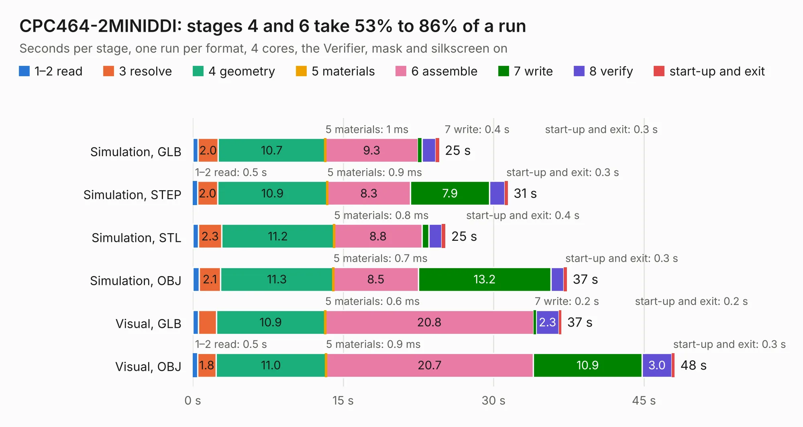

# 627. CPC464-2MINIDDI

Board 627 of the 3,107 of [Corpus Testing](../Corpus-Testing.md), on [Corpus Page 6](../CorpusTestingPages/Corpus-Testing-06.md#627-cpc464-2miniddi).

| Mode and format | 1–2 read | 3 resolve | 4 geometry | 5 materials | 6 assemble | 7 write | 8 verify | start-up and exit | Total |
|---|---:|---:|---:|---:|---:|---:|---:|---:|---:|
| Simulation, GLB | 0.5 | 2.0 | 10.7 | 1&nbsp;ms | 9.3 | 0.4 | 1.4 | 0.3 | 24.6 |
| Simulation, STEP | 0.5 | 2.0 | 10.9 | 0.9&nbsp;ms | 8.3 | 7.9 | 1.5 | 0.3 | 31.4 |
| Simulation, STL | 0.6 | 2.3 | 11.2 | 0.8&nbsp;ms | 8.8 | 0.7 | 1.3 | 0.4 | 25.2 |
| Simulation, OBJ | 0.6 | 2.1 | 11.3 | 0.7&nbsp;ms | 8.5 | 13.2 | 1.3 | 0.3 | 37.3 |
| Visual, GLB | 0.6 | 1.8 | 10.9 | 0.6&nbsp;ms | 20.8 | 0.2 | 2.3 | 0.2 | 36.8 |
| Visual, OBJ | 0.5 | 1.8 | 11.0 | 0.9&nbsp;ms | 20.7 | 10.9 | 3.0 | 0.3 | 48.1 |

<table align="center"><tr><td valign="top">

| Board | Repo: [Board-Folk/CPC464-2MINI](https://github.com/Board-Folk/CPC464-2MINI) Board: `CPC464-2MINIDDI.kicad_pcb` |
|---|---|
| Folder | Expansions / MINIDDI / Kicad |
| Complexity | 263&nbsp;/&nbsp;1000 (size&nbsp;188, features&nbsp;75) |
| KESE&nbsp;features | through vias, rounded, trapezoid or chamfered pads, filled zones, stack-up, dielectric εr and tanδ |
| Tested | 9th November 2026 |
| Copper&nbsp;layers | 2 |
| File&nbsp;format | KiCad 6 (20211014) |
| Parts,&nbsp;tracks,&nbsp;vias | 59, 1,939, 128 |
| Triangles,&nbsp;simulation | 2,016,044 in 143 parts |
| Verifier | PASS in all six runs |

</td><td valign="top">

<table>
<tr><th>File type</th><th>File size</th><th>Peak memory used</th></tr>
<tr><th colspan="3" align="left">Simulation</th></tr>
<tr><td>GLB</td><td align="right">68&nbsp;MB</td><td align="right">794&nbsp;MB</td></tr>
<tr><td>STEP</td><td align="right">321&nbsp;MB</td><td align="right">906&nbsp;MB</td></tr>
<tr><td>STL</td><td align="right">101&nbsp;MB</td><td align="right">844&nbsp;MB</td></tr>
<tr><td>OBJ</td><td align="right">208&nbsp;MB</td><td align="right">1.3&nbsp;GB</td></tr>
<tr><th colspan="3" align="left">Visual</th></tr>
<tr><td>GLB</td><td align="right">49&nbsp;MB</td><td align="right">912&nbsp;MB</td></tr>
<tr><td>OBJ</td><td align="right">151&nbsp;MB</td><td align="right">1.0&nbsp;GB</td></tr>
</table>

</td></tr></table>

| Previous | Next |
|:---|---:|
| [626. CPC464-2MINIDDI3ADAPT](b0626b_CPC464-2MINI_CPC464-2MINIDDI3ADAPT.md) | [628. CPC464-2MINIDOCK](b0628b_CPC464-2MINI_CPC464-2MINIDOCK.md) |
