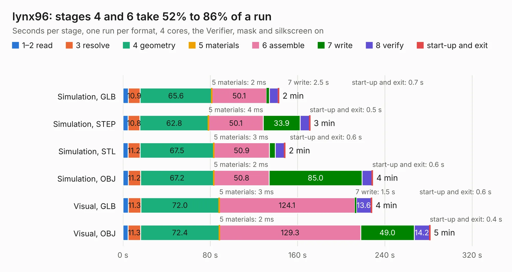

# 627. lynx96

Board 627 of the 3,121 of [Corpus Testing](../Corpus-Testing.md), on [Corpus Page 6](../CorpusTestingPages/Corpus-Testing-06.md#627-lynx96).

| Mode and format | 1–2 read | 3 resolve | 4 geometry | 5 materials | 6 assemble | 7 write | 8 verify | start-up and exit | Total |
|---|---:|---:|---:|---:|---:|---:|---:|---:|---:|
| Simulation, GLB | 4.9 | 10.9 | 65.6 | 2&nbsp;ms | 50.1 | 2.5 | 8.1 | 0.7 | 142.9 |
| Simulation, STEP | 4.8 | 10.8 | 62.8 | 4&nbsp;ms | 50.1 | 33.9 | 8.6 | 0.5 | 171.5 |
| Simulation, STL | 4.6 | 11.2 | 67.5 | 3&nbsp;ms | 50.9 | 5.4 | 8.5 | 0.6 | 148.7 |
| Simulation, OBJ | 4.9 | 11.2 | 67.2 | 2&nbsp;ms | 50.8 | 85.0 | 9.3 | 0.6 | 228.9 |
| Visual, GLB | 5.0 | 11.3 | 72.0 | 3&nbsp;ms | 124.1 | 1.5 | 13.6 | 0.6 | 228.1 |
| Visual, OBJ | 4.8 | 11.3 | 72.4 | 2&nbsp;ms | 129.3 | 49.0 | 14.2 | 0.4 | 281.5 |

<table align="center"><tr><td valign="top">

| Board | Repo: [Board-Folk/Camputers-Lynx](https://github.com/Board-Folk/Camputers-Lynx) Board: `lynx96.kicad_pcb` |
|---|---|
| Folder | Lynx 96 / Kicad |
| Complexity | 325&nbsp;/&nbsp;1000 (size&nbsp;240, features&nbsp;85) |
| KESE&nbsp;features | through vias, filled zones, copper text, curved board outline, stack-up, dielectric εr and tanδ |
| Tested | 9th November 2026 |
| Copper&nbsp;layers | 2 |
| File&nbsp;format | KiCad 7 (20221018) |
| Parts,&nbsp;tracks,&nbsp;vias | 309, 16,618, 727 |
| Triangles,&nbsp;simulation | 12,387,500 in 465 parts |
| Verifier | PASS in all six runs |

</td><td valign="top">

<table>
<tr><th>File type</th><th>File size</th><th>Peak memory used</th></tr>
<tr><th colspan="3" align="left">Simulation</th></tr>
<tr><td>GLB</td><td align="right">416&nbsp;MB</td><td align="right">4.1&nbsp;GB</td></tr>
<tr><td>STEP</td><td align="right">1.9&nbsp;GB</td><td align="right">4.3&nbsp;GB</td></tr>
<tr><td>STL</td><td align="right">619&nbsp;MB</td><td align="right">3.8&nbsp;GB</td></tr>
<tr><td>OBJ</td><td align="right">1.3&nbsp;GB</td><td align="right">7.7&nbsp;GB</td></tr>
<tr><th colspan="3" align="left">Visual</th></tr>
<tr><td>GLB</td><td align="right">251&nbsp;MB</td><td align="right">3.9&nbsp;GB</td></tr>
<tr><td>OBJ</td><td align="right">806&nbsp;MB</td><td align="right">5.2&nbsp;GB</td></tr>
</table>

</td></tr></table>

| Previous | Next |
|:---|---:|
| [626. Lynx-PS2](b0626b_Camputers-Lynx_Lynx-PS2.md) | [628. Commodore PC10 III](b0628b_Commodore-PC10-III-Reproduction_312628-REV-5-7A_Commodore-PC10-III.md) |
