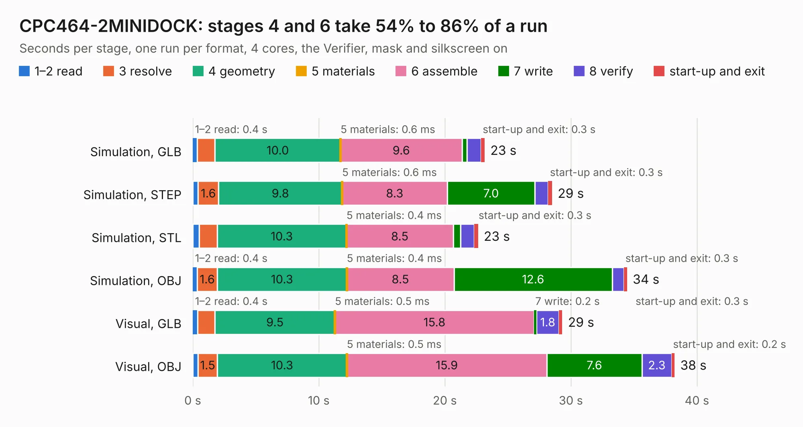

# 628. CPC464-2MINIDOCK

Board 628 of the 3,109 of [Corpus Testing](../Corpus-Testing.md), on [Corpus Page 6](../CorpusTestingPages/Corpus-Testing-06.md#628-cpc464-2minidock).

| Mode and format | 1–2 read | 3 resolve | 4 geometry | 5 materials | 6 assemble | 7 write | 8 verify | start-up and exit | Total |
|---|---:|---:|---:|---:|---:|---:|---:|---:|---:|
| Simulation, GLB | 0.4 | 1.4 | 10.0 | 0.6&nbsp;ms | 9.6 | 0.4 | 1.1 | 0.3 | 23.2 |
| Simulation, STEP | 0.4 | 1.6 | 9.8 | 0.6&nbsp;ms | 8.3 | 7.0 | 1.0 | 0.3 | 28.5 |
| Simulation, STL | 0.5 | 1.4 | 10.3 | 0.4&nbsp;ms | 8.5 | 0.6 | 1.1 | 0.3 | 22.6 |
| Simulation, OBJ | 0.4 | 1.6 | 10.3 | 0.4&nbsp;ms | 8.5 | 12.6 | 0.9 | 0.3 | 34.5 |
| Visual, GLB | 0.4 | 1.4 | 9.5 | 0.5&nbsp;ms | 15.8 | 0.2 | 1.8 | 0.3 | 29.3 |
| Visual, OBJ | 0.4 | 1.5 | 10.3 | 0.5&nbsp;ms | 15.9 | 7.6 | 2.3 | 0.2 | 38.2 |

<table align="center"><tr><td valign="top">

| Board | Repo: [Board-Folk/CPC464-2MINI](https://github.com/Board-Folk/CPC464-2MINI) Board: `CPC464-2MINIDOCK.kicad_pcb` |
|---|---|
| Folder | Expansions / MINIDOCK / Kicad |
| Complexity | 245&nbsp;/&nbsp;1000 (size&nbsp;160, features&nbsp;85) |
| KESE&nbsp;features | through vias, slotted holes, rounded, trapezoid or chamfered pads, filled zones, stack-up, dielectric εr and tanδ |
| Tested | 9th November 2026 |
| Copper&nbsp;layers | 2 |
| File&nbsp;format | KiCad 6 (20211014) |
| Parts,&nbsp;tracks,&nbsp;vias | 13, 1,020, 14 |
| Triangles,&nbsp;simulation | 1,908,702 in 61 parts |
| Verifier | PASS in all six runs |

</td><td valign="top">

<table>
<tr><th>File type</th><th>File size</th><th>Peak memory used</th></tr>
<tr><th colspan="3" align="left">Simulation</th></tr>
<tr><td>GLB</td><td align="right">63&nbsp;MB</td><td align="right">697&nbsp;MB</td></tr>
<tr><td>STEP</td><td align="right">261&nbsp;MB</td><td align="right">837&nbsp;MB</td></tr>
<tr><td>STL</td><td align="right">95&nbsp;MB</td><td align="right">706&nbsp;MB</td></tr>
<tr><td>OBJ</td><td align="right">196&nbsp;MB</td><td align="right">1.3&nbsp;GB</td></tr>
<tr><th colspan="3" align="left">Visual</th></tr>
<tr><td>GLB</td><td align="right">37&nbsp;MB</td><td align="right">846&nbsp;MB</td></tr>
<tr><td>OBJ</td><td align="right">113&nbsp;MB</td><td align="right">943&nbsp;MB</td></tr>
</table>

</td></tr></table>

| Previous | Next |
|:---|---:|
| [627. CPC464-2MINIDDI](b0627b_CPC464-2MINI_CPC464-2MINIDDI.md) | [629. CPC464-2MINI-EDGE](b0629b_CPC464-2MINI_CPC464-2MINI-EDGE.md) |
