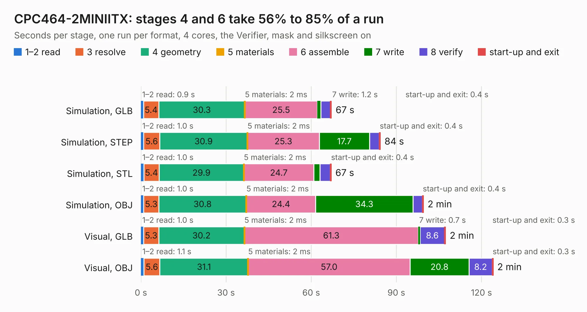

# 628. CPC464-2MINIITX

Board 628 of the 3,116 of [Corpus Testing](../Corpus-Testing.md), on [Corpus Page 6](../CorpusTestingPages/Corpus-Testing-06.md#628-cpc464-2miniitx).

| Mode and format | 1–2 read | 3 resolve | 4 geometry | 5 materials | 6 assemble | 7 write | 8 verify | start-up and exit | Total |
|---|---:|---:|---:|---:|---:|---:|---:|---:|---:|
| Simulation, GLB | 0.9 | 5.4 | 30.3 | 2&nbsp;ms | 25.5 | 1.2 | 3.4 | 0.4 | 67.1 |
| Simulation, STEP | 1.0 | 5.6 | 30.9 | 2&nbsp;ms | 25.3 | 17.7 | 3.4 | 0.4 | 84.4 |
| Simulation, STL | 1.0 | 5.4 | 29.9 | 2&nbsp;ms | 24.7 | 2.2 | 3.6 | 0.4 | 67.0 |
| Simulation, OBJ | 1.0 | 5.3 | 30.8 | 2&nbsp;ms | 24.4 | 34.3 | 3.3 | 0.4 | 99.5 |
| Visual, GLB | 1.0 | 5.3 | 30.2 | 2&nbsp;ms | 61.3 | 0.7 | 8.6 | 0.3 | 107.3 |
| Visual, OBJ | 1.1 | 5.6 | 31.1 | 2&nbsp;ms | 57.0 | 20.8 | 8.2 | 0.3 | 124.1 |

<table align="center"><tr><td valign="top">

| Board | Repo: [Board-Folk/CPC464-2MINI](https://github.com/Board-Folk/CPC464-2MINI) Board: `CPC464-2MINIITX.kicad_pcb` |
|---|---|
| Folder | Archive / MINIITXv1.2 / Kicad |
| Complexity | 364&nbsp;/&nbsp;1000 (size&nbsp;274, features&nbsp;90) |
| KESE&nbsp;features | through vias, slotted holes, custom pads, rounded, trapezoid or chamfered pads, copper drawings, stack-up, dielectric εr and tanδ |
| Tested | 9th November 2026 |
| Copper&nbsp;layers | 2 |
| File&nbsp;format | KiCad 7 (20221018) |
| Parts,&nbsp;tracks,&nbsp;vias | 239, 8,256, 638 |
| Triangles,&nbsp;simulation | 6,998,502 in 372 parts |
| Verifier | PASS in all six runs |

</td><td valign="top">

<table>
<tr><th>File type</th><th>File size</th><th>Peak memory used</th></tr>
<tr><th colspan="3" align="left">Simulation</th></tr>
<tr><td>GLB</td><td align="right">240&nbsp;MB</td><td align="right">1.8&nbsp;GB</td></tr>
<tr><td>STEP</td><td align="right">1.2&nbsp;GB</td><td align="right">2.7&nbsp;GB</td></tr>
<tr><td>STL</td><td align="right">350&nbsp;MB</td><td align="right">1.8&nbsp;GB</td></tr>
<tr><td>OBJ</td><td align="right">752&nbsp;MB</td><td align="right">4.4&nbsp;GB</td></tr>
<tr><th colspan="3" align="left">Visual</th></tr>
<tr><td>GLB</td><td align="right">160&nbsp;MB</td><td align="right">2.9&nbsp;GB</td></tr>
<tr><td>OBJ</td><td align="right">511&nbsp;MB</td><td align="right">3.2&nbsp;GB</td></tr>
</table>

</td></tr></table>

| Previous | Next |
|:---|---:|
| [627. Commodore PC10 III](b0627b_Commodore-PC10-III-Reproduction_312628-REV-6C_Commodore-PC10-III.md) | [629. CPC464-2MINI](b0629b_CPC464-2MINI_Archive-v1-Kicad_CPC464-2MINI.md) |
