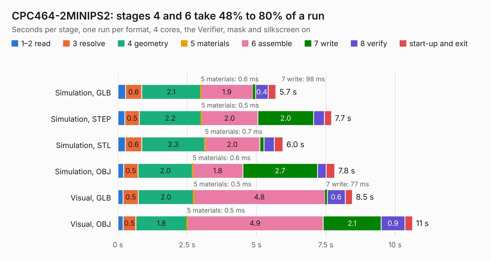

# 628. CPC464-2MINIPS2

Board 628 of the 3,103 of [Corpus Testing](../Corpus-Testing.md), on [Corpus Page 6](../CorpusTestingPages/Corpus-Testing-06.md#628-cpc464-2minips2).

| Mode and format | 1–2 read | 3 resolve | 4 geometry | 5 materials | 6 assemble | 7 write | 8 verify | start-up and exit | Total |
|---|---:|---:|---:|---:|---:|---:|---:|---:|---:|
| Simulation, GLB | 0.3 | 0.6 | 2.1 | 0.6&nbsp;ms | 1.9 | 98&nbsp;ms | 0.4 | 0.3 | 5.7 |
| Simulation, STEP | 0.3 | 0.5 | 2.2 | 0.5&nbsp;ms | 2.0 | 2.0 | 0.4 | 0.3 | 7.7 |
| Simulation, STL | 0.3 | 0.6 | 2.3 | 0.7&nbsp;ms | 2.0 | 0.1 | 0.4 | 0.3 | 6.0 |
| Simulation, OBJ | 0.2 | 0.5 | 2.0 | 0.6&nbsp;ms | 1.8 | 2.7 | 0.3 | 0.3 | 7.8 |
| Visual, GLB | 0.2 | 0.5 | 2.0 | 0.5&nbsp;ms | 4.8 | 77&nbsp;ms | 0.6 | 0.3 | 8.5 |
| Visual, OBJ | 0.2 | 0.5 | 1.8 | 0.5&nbsp;ms | 4.9 | 2.1 | 0.9 | 0.3 | 10.6 |

<table align="center"><tr><td valign="top">

| Board | Repo: [Board-Folk/CPC464-2MINI](https://github.com/Board-Folk/CPC464-2MINI) Board: `CPC464-2MINIPS2.kicad_pcb` |
|---|---|
| Folder | Expansions / MINIPS2 / Kicad |
| Complexity | 309&nbsp;/&nbsp;1000 (size&nbsp;199, features&nbsp;110) |
| KESE&nbsp;features | through vias, slotted holes, custom pads, rounded, trapezoid or chamfered pads, filled zones, copper drawings, stack-up, dielectric εr and tanδ |
| Tested | 9th November 2026 |
| Copper&nbsp;layers | 2 |
| File&nbsp;format | KiCad 6 (20211014) |
| Parts,&nbsp;tracks,&nbsp;vias | 17, 440, 47 |
| Triangles,&nbsp;simulation | 418,416 in 75 parts |
| Verifier | PASS in all six runs |

</td><td valign="top">

<table>
<tr><th>File type</th><th>File size</th><th>Peak memory used</th></tr>
<tr><th colspan="3" align="left">Simulation</th></tr>
<tr><td>GLB</td><td align="right">14&nbsp;MB</td><td align="right">266&nbsp;MB</td></tr>
<tr><td>STEP</td><td align="right">68&nbsp;MB</td><td align="right">315&nbsp;MB</td></tr>
<tr><td>STL</td><td align="right">21&nbsp;MB</td><td align="right">292&nbsp;MB</td></tr>
<tr><td>OBJ</td><td align="right">42&nbsp;MB</td><td align="right">336&nbsp;MB</td></tr>
<tr><th colspan="3" align="left">Visual</th></tr>
<tr><td>GLB</td><td align="right">11&nbsp;MB</td><td align="right">343&nbsp;MB</td></tr>
<tr><td>OBJ</td><td align="right">34&nbsp;MB</td><td align="right">336&nbsp;MB</td></tr>
</table>

</td></tr></table>

| Previous | Next |
|:---|---:|
| [627. CPC464-2MINI-EDGE](b0627b_CPC464-2MINI_CPC464-2MINI-EDGE.md) | [629. CPC464-2MINIRS232C](b0629b_CPC464-2MINI_CPC464-2MINIRS232C.md) |
