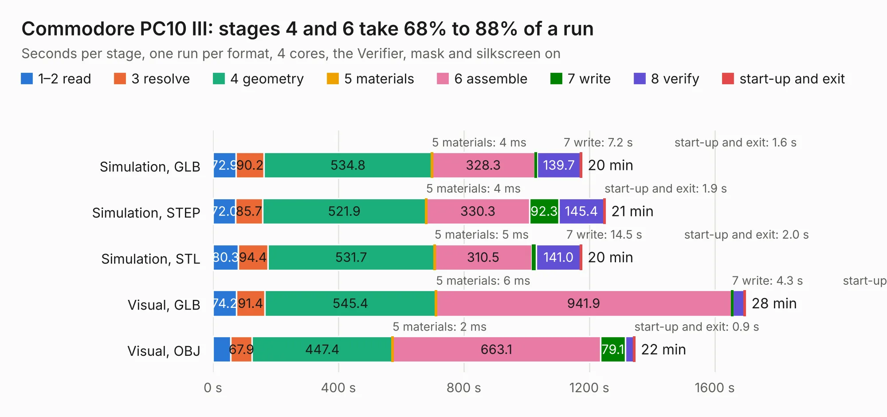

# 630 Commodore PC10 III

Board 630 of the 3,138 of [Corpus Testing](../Corpus-Testing.md), on [Corpus Page 6](../CorpusTestingPages/Corpus-Testing-06.md#630-commodore-pc10-iii).

| Mode and format | 1–2 read | 3 resolve | 4 geometry | 5 materials | 6 assemble | 7 write | 8 verify | start-up and exit | Total |
|---|---:|---:|---:|---:|---:|---:|---:|---:|---:|
| Simulation, GLB | 72.9 | 90.2 | 534.8 | 4&nbsp;ms | 328.3 | 7.2 | 139.7 | 1.6 | 1174.7 |
| Simulation, STEP | 72.0 | 85.7 | 521.9 | 4&nbsp;ms | 330.3 | 92.3 | 145.4 | 1.9 | 1249.4 |
| Simulation, STL | 80.3 | 94.4 | 531.7 | 5&nbsp;ms | 310.5 | 14.5 | 141.0 | 2.0 | 1174.4 |
| Simulation, OBJ |  |  |  |  |  |  |  |  | exceeded 11 GB on a 15 GB machine (stopped there, not a KESE failure); it will be run again on a machine with more memory |
| Visual, GLB | 74.2 | 91.4 | 545.4 | 6&nbsp;ms | 941.9 | 4.3 | 37.8 | 1.6 | 1696.6 |
| Visual, OBJ | 57.0 | 67.9 | 447.4 | 2&nbsp;ms | 663.1 | 79.1 | 28.6 | 0.9 | 1344.1 |

<table align="center"><tr><td valign="top">

| Board | Repo: [Board-Folk/Commodore-PC10-III-Reproduction](https://github.com/Board-Folk/Commodore-PC10-III-Reproduction) Board: `Commodore PC10 III.kicad_pcb` |
|---|---|
| Folder | 312628-REV-5.7A |
| Complexity | 384&nbsp;/&nbsp;1000 (size&nbsp;299, features&nbsp;85) |
| KESE&nbsp;features | through vias, rounded, trapezoid or chamfered pads, filled zones, curved board outline, stack-up, dielectric εr and tanδ |
| Tested | 9th November 2026 to 10th November 2026 |
| Copper&nbsp;layers | 2 |
| File&nbsp;format | KiCad 8 (20240108) |
| Parts,&nbsp;tracks,&nbsp;vias | 397, 28,255, 1,516 |
| Triangles,&nbsp;simulation | 24,329,594 in 614 parts |
| Verifier | Simulation, OBJ: exceeded 11 GB on a 15 GB machine (stopped there, not a KESE failure); it will be run again on a machine with more memory |
| Run&nbsp;again | Visual, OBJ: failed in the corpus run, run again with the memory cap raised from 11 GB to 14.5 GB, and passed |

</td><td valign="top">

<table>
<tr><th>File type</th><th>File size</th><th>Peak memory used</th></tr>
<tr><th colspan="3" align="left">Simulation</th></tr>
<tr><td>GLB</td><td align="right">883&nbsp;MB</td><td align="right">6.9&nbsp;GB</td></tr>
<tr><td>STEP</td><td align="right">4.9&nbsp;GB</td><td align="right">9.5&nbsp;GB</td></tr>
<tr><td>STL</td><td align="right">1.2&nbsp;GB</td><td align="right">7.0&nbsp;GB</td></tr>
<tr><td>OBJ</td><td align="right">–</td><td align="right">11&nbsp;GB</td></tr>
<tr><th colspan="3" align="left">Visual</th></tr>
<tr><td>GLB</td><td align="right">618&nbsp;MB</td><td align="right">10.0&nbsp;GB</td></tr>
<tr><td>OBJ</td><td align="right">2.0&nbsp;GB</td><td align="right">13&nbsp;GB</td></tr>
</table>

</td></tr></table>

| Previous | Next |
|:---|---:|
| [629 lynx96](b0629b_Camputers-Lynx_lynx96.md) | [631 Commodore PC10 III](b0631b_Commodore-PC10-III-Reproduction_312628-REV-6C_Commodore-PC10-III.md) |
