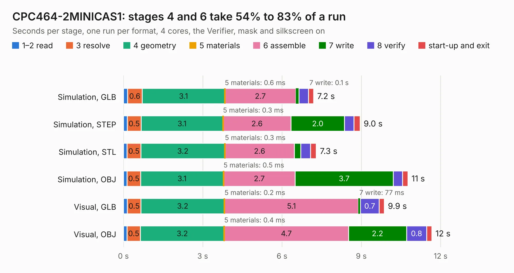

# 631. CPC464-2MINICAS1

Board 631 of the 3,101 of [Corpus Testing](../Corpus-Testing.md), on [Corpus Page 6](../CorpusTestingPages/Corpus-Testing-06.md#631-cpc464-2minicas1).

| Mode and format | 1–2 read | 3 resolve | 4 geometry | 5 materials | 6 assemble | 7 write | 8 verify | start-up and exit | Total |
|---|---:|---:|---:|---:|---:|---:|---:|---:|---:|
| Simulation, GLB | 0.2 | 0.6 | 3.1 | 0.6&nbsp;ms | 2.7 | 0.1 | 0.4 | 0.2 | 7.2 |
| Simulation, STEP | 0.1 | 0.5 | 3.1 | 0.3&nbsp;ms | 2.6 | 2.0 | 0.4 | 0.2 | 9.0 |
| Simulation, STL | 0.1 | 0.5 | 3.2 | 0.3&nbsp;ms | 2.6 | 0.2 | 0.4 | 0.2 | 7.3 |
| Simulation, OBJ | 0.1 | 0.5 | 3.1 | 0.5&nbsp;ms | 2.7 | 3.7 | 0.3 | 0.2 | 10.8 |
| Visual, GLB | 0.1 | 0.5 | 3.2 | 0.2&nbsp;ms | 5.1 | 77&nbsp;ms | 0.7 | 0.2 | 9.9 |
| Visual, OBJ | 0.1 | 0.5 | 3.2 | 0.4&nbsp;ms | 4.7 | 2.2 | 0.8 | 0.2 | 11.7 |

<table align="center"><tr><td valign="top">

| Board | Repo: [Board-Folk/CPC464-2MINI](https://github.com/Board-Folk/CPC464-2MINI) Board: `CPC464-2MINICAS1.kicad_pcb` |
|---|---|
| Folder | v4.1 / Extras / MINICAS1 / Kicad |
| Complexity | 218&nbsp;/&nbsp;1000 (size&nbsp;163, features&nbsp;55) |
| KESE&nbsp;features | through vias, rounded, trapezoid or chamfered pads, stack-up, dielectric εr and tanδ |
| Tested | 9th November 2026 |
| Copper&nbsp;layers | 2 |
| File&nbsp;format | KiCad 6 (20211014) |
| Parts,&nbsp;tracks,&nbsp;vias | 19, 952, 30 |
| Triangles,&nbsp;simulation | 939,968 in 44 parts |
| Verifier | PASS in all six runs |

</td><td valign="top">

<table>
<tr><th>File type</th><th>File size</th><th>Peak memory used</th></tr>
<tr><th colspan="3" align="left">Simulation</th></tr>
<tr><td>GLB</td><td align="right">32&nbsp;MB</td><td align="right">432&nbsp;MB</td></tr>
<tr><td>STEP</td><td align="right">132&nbsp;MB</td><td align="right">491&nbsp;MB</td></tr>
<tr><td>STL</td><td align="right">47&nbsp;MB</td><td align="right">413&nbsp;MB</td></tr>
<tr><td>OBJ</td><td align="right">94&nbsp;MB</td><td align="right">668&nbsp;MB</td></tr>
<tr><th colspan="3" align="left">Visual</th></tr>
<tr><td>GLB</td><td align="right">19&nbsp;MB</td><td align="right">505&nbsp;MB</td></tr>
<tr><td>OBJ</td><td align="right">57&nbsp;MB</td><td align="right">500&nbsp;MB</td></tr>
</table>

</td></tr></table>

| Previous | Next |
|:---|---:|
| [630. CPC-40007AdapterLM1117](b0630b_CPC464-2MINI_CPC-40007AdapterLM1117.md) | [632. CPC464-2MINITapeAdapter](b0632b_CPC464-2MINI_CPC464-2MINITapeAdapter.md) |
