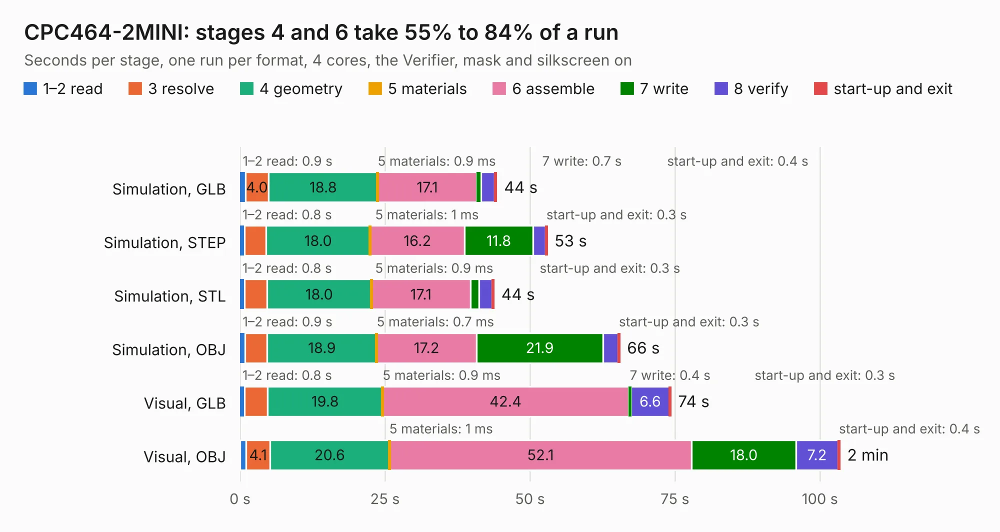

# 632. CPC464-2MINI

Board 632 of the 3,127 of [Corpus Testing](../Corpus-Testing.md), on [Corpus Page 6](../CorpusTestingPages/Corpus-Testing-06.md#632-cpc464-2mini).

| Mode and format | 1–2 read | 3 resolve | 4 geometry | 5 materials | 6 assemble | 7 write | 8 verify | start-up and exit | Total |
|---|---:|---:|---:|---:|---:|---:|---:|---:|---:|
| Simulation, GLB | 0.9 | 4.0 | 18.8 | 0.9&nbsp;ms | 17.1 | 0.7 | 2.3 | 0.4 | 44.3 |
| Simulation, STEP | 0.8 | 3.7 | 18.0 | 1&nbsp;ms | 16.2 | 11.8 | 2.1 | 0.3 | 53.0 |
| Simulation, STL | 0.8 | 3.9 | 18.0 | 0.9&nbsp;ms | 17.1 | 1.5 | 2.3 | 0.3 | 43.8 |
| Simulation, OBJ | 0.9 | 3.8 | 18.9 | 0.7&nbsp;ms | 17.2 | 21.9 | 2.5 | 0.3 | 65.5 |
| Visual, GLB | 0.8 | 3.9 | 19.8 | 0.9&nbsp;ms | 42.4 | 0.4 | 6.6 | 0.3 | 74.3 |
| Visual, OBJ | 1.0 | 4.1 | 20.6 | 1&nbsp;ms | 52.1 | 18.0 | 7.2 | 0.4 | 103.5 |

<table align="center"><tr><td valign="top">

| Board | Repo: [Board-Folk/CPC464-2MINI](https://github.com/Board-Folk/CPC464-2MINI) Board: `CPC464-2MINI.kicad_pcb` |
|---|---|
| Folder | Archive / v1 / Kicad |
| Complexity | 300&nbsp;/&nbsp;1000 (size&nbsp;215, features&nbsp;85) |
| KESE&nbsp;features | through vias, slotted holes, rounded, trapezoid or chamfered pads, filled zones, stack-up, dielectric εr and tanδ |
| Tested | 9th November 2026 |
| Copper&nbsp;layers | 2 |
| File&nbsp;format | KiCad 6 (20211014) |
| Parts,&nbsp;tracks,&nbsp;vias | 127, 5,893, 450 |
| Triangles,&nbsp;simulation | 4,314,836 in 201 parts |
| Verifier | PASS in all six runs |

</td><td valign="top">

<table>
<tr><th>File type</th><th>File size</th><th>Peak memory used</th></tr>
<tr><th colspan="3" align="left">Simulation</th></tr>
<tr><td>GLB</td><td align="right">146&nbsp;MB</td><td align="right">1.5&nbsp;GB</td></tr>
<tr><td>STEP</td><td align="right">675&nbsp;MB</td><td align="right">1.8&nbsp;GB</td></tr>
<tr><td>STL</td><td align="right">216&nbsp;MB</td><td align="right">1.4&nbsp;GB</td></tr>
<tr><td>OBJ</td><td align="right">455&nbsp;MB</td><td align="right">2.8&nbsp;GB</td></tr>
<tr><th colspan="3" align="left">Visual</th></tr>
<tr><td>GLB</td><td align="right">103&nbsp;MB</td><td align="right">1.8&nbsp;GB</td></tr>
<tr><td>OBJ</td><td align="right">325&nbsp;MB</td><td align="right">2.0&nbsp;GB</td></tr>
</table>

</td></tr></table>

| Previous | Next |
|:---|---:|
| [631. CPC464-2MINIITX](b0631b_CPC464-2MINI_CPC464-2MINIITX.md) | [633. CPC464-2MINIDDI3ADAPT](b0633b_CPC464-2MINI_CPC464-2MINIDDI3ADAPT.md) |
