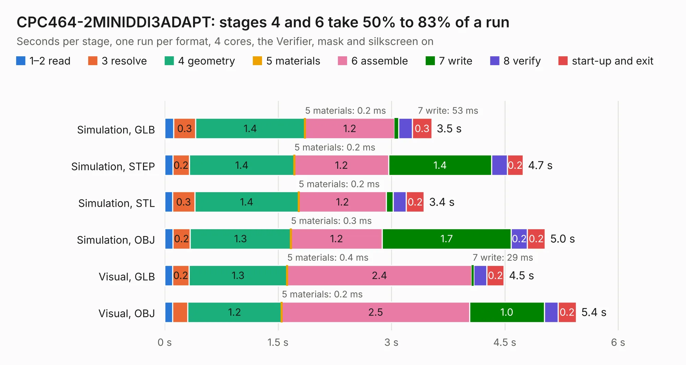

# 632. CPC464-2MINIDDI3ADAPT

Board 632 of the 3,119 of [Corpus Testing](../Corpus-Testing.md), on [Corpus Page 6](../CorpusTestingPages/Corpus-Testing-06.md#632-cpc464-2miniddi3adapt).

| Mode and format | 1–2 read | 3 resolve | 4 geometry | 5 materials | 6 assemble | 7 write | 8 verify | start-up and exit | Total |
|---|---:|---:|---:|---:|---:|---:|---:|---:|---:|
| Simulation, GLB | 0.1 | 0.3 | 1.4 | 0.2&nbsp;ms | 1.2 | 53&nbsp;ms | 0.2 | 0.3 | 3.5 |
| Simulation, STEP | 0.1 | 0.2 | 1.4 | 0.2&nbsp;ms | 1.2 | 1.4 | 0.2 | 0.2 | 4.7 |
| Simulation, STL | 0.1 | 0.3 | 1.4 | 0.2&nbsp;ms | 1.2 | 90&nbsp;ms | 0.2 | 0.2 | 3.4 |
| Simulation, OBJ | 0.1 | 0.2 | 1.3 | 0.3&nbsp;ms | 1.2 | 1.7 | 0.2 | 0.2 | 5.0 |
| Visual, GLB | 0.1 | 0.2 | 1.3 | 0.4&nbsp;ms | 2.4 | 29&nbsp;ms | 0.2 | 0.2 | 4.5 |
| Visual, OBJ | 0.1 | 0.2 | 1.2 | 0.2&nbsp;ms | 2.5 | 1.0 | 0.2 | 0.2 | 5.4 |

<table align="center"><tr><td valign="top">

| Board | Repo: [Board-Folk/CPC464-2MINI](https://github.com/Board-Folk/CPC464-2MINI) Board: `CPC464-2MINIDDI3ADAPT.kicad_pcb` |
|---|---|
| Folder | Expansions / MINIDDI / Extras / MINIDDI3ADAPT / Kicad |
| Complexity | 150&nbsp;/&nbsp;1000 (size&nbsp;90, features&nbsp;60) |
| KESE&nbsp;features | rounded, trapezoid or chamfered pads, filled zones, stack-up, dielectric εr and tanδ |
| Tested | 9th November 2026 |
| Copper&nbsp;layers | 2 |
| File&nbsp;format | KiCad 6 (20211014) |
| Parts,&nbsp;tracks,&nbsp;vias | 2, 41, 0 |
| Triangles,&nbsp;simulation | 332,256 in 30 parts |
| Verifier | PASS in all six runs |

</td><td valign="top">

<table>
<tr><th>File type</th><th>File size</th><th>Peak memory used</th></tr>
<tr><th colspan="3" align="left">Simulation</th></tr>
<tr><td>GLB</td><td align="right">11&nbsp;MB</td><td align="right">241&nbsp;MB</td></tr>
<tr><td>STEP</td><td align="right">47&nbsp;MB</td><td align="right">281&nbsp;MB</td></tr>
<tr><td>STL</td><td align="right">17&nbsp;MB</td><td align="right">255&nbsp;MB</td></tr>
<tr><td>OBJ</td><td align="right">33&nbsp;MB</td><td align="right">245&nbsp;MB</td></tr>
<tr><th colspan="3" align="left">Visual</th></tr>
<tr><td>GLB</td><td align="right">6.2&nbsp;MB</td><td align="right">238&nbsp;MB</td></tr>
<tr><td>OBJ</td><td align="right">18&nbsp;MB</td><td align="right">237&nbsp;MB</td></tr>
</table>

</td></tr></table>

| Previous | Next |
|:---|---:|
| [631. CPC464-2MINI](b0631b_CPC464-2MINI_Archive-v1-Kicad_CPC464-2MINI.md) | [633. CPC464-2MINIDDI](b0633b_CPC464-2MINI_CPC464-2MINIDDI.md) |
