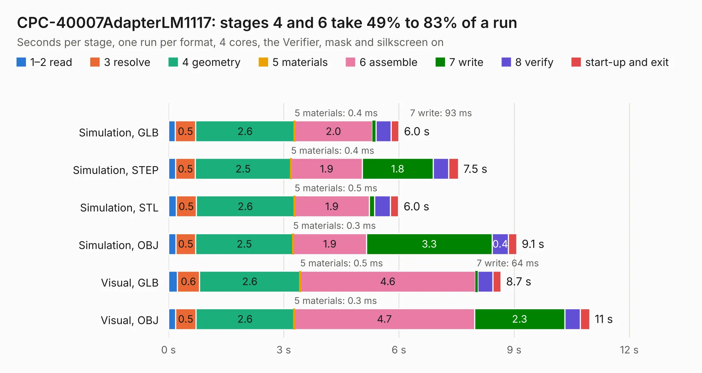

# 633. CPC-40007AdapterLM1117

Board 633 of the 3,106 of [Corpus Testing](../Corpus-Testing.md), on [Corpus Page 6](../CorpusTestingPages/Corpus-Testing-06.md#633-cpc-40007adapterlm1117).

| Mode and format | 1–2 read | 3 resolve | 4 geometry | 5 materials | 6 assemble | 7 write | 8 verify | start-up and exit | Total |
|---|---:|---:|---:|---:|---:|---:|---:|---:|---:|
| Simulation, GLB | 0.2 | 0.5 | 2.6 | 0.4&nbsp;ms | 2.0 | 93&nbsp;ms | 0.4 | 0.2 | 6.0 |
| Simulation, STEP | 0.2 | 0.5 | 2.5 | 0.4&nbsp;ms | 1.9 | 1.8 | 0.4 | 0.3 | 7.5 |
| Simulation, STL | 0.2 | 0.5 | 2.6 | 0.5&nbsp;ms | 1.9 | 0.1 | 0.4 | 0.2 | 6.0 |
| Simulation, OBJ | 0.2 | 0.5 | 2.5 | 0.3&nbsp;ms | 1.9 | 3.3 | 0.4 | 0.2 | 9.1 |
| Visual, GLB | 0.2 | 0.6 | 2.6 | 0.5&nbsp;ms | 4.6 | 64&nbsp;ms | 0.4 | 0.2 | 8.7 |
| Visual, OBJ | 0.2 | 0.5 | 2.6 | 0.3&nbsp;ms | 4.7 | 2.3 | 0.4 | 0.2 | 11.0 |

<table align="center"><tr><td valign="top">

| Board | Repo: [Board-Folk/CPC464-2MINI](https://github.com/Board-Folk/CPC464-2MINI) Board: `CPC-40007AdapterLM1117.kicad_pcb` |
|---|---|
| Folder | v4.1 / Extras / CPC-40007Adapter / Kicad |
| Complexity | 224&nbsp;/&nbsp;1000 (size&nbsp;149, features&nbsp;75) |
| KESE&nbsp;features | through vias, rounded, trapezoid or chamfered pads, filled zones, stack-up, dielectric εr and tanδ |
| Tested | 9th November 2026 |
| Copper&nbsp;layers | 2 |
| File&nbsp;format | KiCad 6 (20211014) |
| Parts,&nbsp;tracks,&nbsp;vias | 11, 506, 36 |
| Triangles,&nbsp;simulation | 558,168 in 51 parts |
| Verifier | PASS in all six runs |

</td><td valign="top">

<table>
<tr><th>File type</th><th>File size</th><th>Peak memory used</th></tr>
<tr><th colspan="3" align="left">Simulation</th></tr>
<tr><td>GLB</td><td align="right">19&nbsp;MB</td><td align="right">319&nbsp;MB</td></tr>
<tr><td>STEP</td><td align="right">92&nbsp;MB</td><td align="right">354&nbsp;MB</td></tr>
<tr><td>STL</td><td align="right">28&nbsp;MB</td><td align="right">321&nbsp;MB</td></tr>
<tr><td>OBJ</td><td align="right">56&nbsp;MB</td><td align="right">394&nbsp;MB</td></tr>
<tr><th colspan="3" align="left">Visual</th></tr>
<tr><td>GLB</td><td align="right">14&nbsp;MB</td><td align="right">394&nbsp;MB</td></tr>
<tr><td>OBJ</td><td align="right">40&nbsp;MB</td><td align="right">392&nbsp;MB</td></tr>
</table>

</td></tr></table>

| Previous | Next |
|:---|---:|
| [632. CPC464-2MINIUSIFACII](b0632b_CPC464-2MINI_CPC464-2MINIUSIFACII.md) | [634. CPC464-2MINICAS1](b0634b_CPC464-2MINI_CPC464-2MINICAS1.md) |
