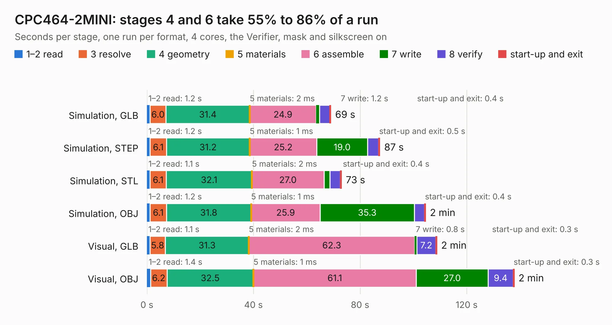

# 635. CPC464-2MINI

Board 635 of the 3,104 of [Corpus Testing](../Corpus-Testing.md), on [Corpus Page 6](../CorpusTestingPages/Corpus-Testing-06.md#635-cpc464-2mini).

| Mode and format | 1–2 read | 3 resolve | 4 geometry | 5 materials | 6 assemble | 7 write | 8 verify | start-up and exit | Total |
|---|---:|---:|---:|---:|---:|---:|---:|---:|---:|
| Simulation, GLB | 1.2 | 6.0 | 31.4 | 2&nbsp;ms | 24.9 | 1.2 | 3.9 | 0.4 | 69.0 |
| Simulation, STEP | 1.2 | 6.1 | 31.2 | 1&nbsp;ms | 25.2 | 19.0 | 4.2 | 0.5 | 87.4 |
| Simulation, STL | 1.1 | 6.1 | 32.1 | 2&nbsp;ms | 27.0 | 2.2 | 4.0 | 0.4 | 73.0 |
| Simulation, OBJ | 1.2 | 6.1 | 31.8 | 1&nbsp;ms | 25.9 | 35.3 | 3.8 | 0.4 | 104.6 |
| Visual, GLB | 1.1 | 5.8 | 31.3 | 2&nbsp;ms | 62.3 | 0.8 | 7.2 | 0.3 | 108.8 |
| Visual, OBJ | 1.4 | 6.2 | 32.5 | 1&nbsp;ms | 61.1 | 27.0 | 9.4 | 0.3 | 137.8 |

<table align="center"><tr><td valign="top">

| Board | Repo: [Board-Folk/CPC464-2MINI](https://github.com/Board-Folk/CPC464-2MINI) Board: `CPC464-2MINI.kicad_pcb` |
|---|---|
| Folder | v4.1 / Kicad |
| Complexity | 346&nbsp;/&nbsp;1000 (size&nbsp;261, features&nbsp;85) |
| KESE&nbsp;features | through vias, slotted holes, rounded, trapezoid or chamfered pads, filled zones, stack-up, dielectric εr and tanδ |
| Tested | 9th November 2026 |
| Copper&nbsp;layers | 2 |
| File&nbsp;format | KiCad 7 (20221018) |
| Parts,&nbsp;tracks,&nbsp;vias | 145, 7,612, 738 |
| Triangles,&nbsp;simulation | 5,887,166 in 239 parts |
| Verifier | PASS in all six runs |

</td><td valign="top">

<table>
<tr><th>File type</th><th>File size</th><th>Peak memory used</th></tr>
<tr><th colspan="3" align="left">Simulation</th></tr>
<tr><td>GLB</td><td align="right">199&nbsp;MB</td><td align="right">1.9&nbsp;GB</td></tr>
<tr><td>STEP</td><td align="right">944&nbsp;MB</td><td align="right">2.4&nbsp;GB</td></tr>
<tr><td>STL</td><td align="right">294&nbsp;MB</td><td align="right">2.0&nbsp;GB</td></tr>
<tr><td>OBJ</td><td align="right">623&nbsp;MB</td><td align="right">3.7&nbsp;GB</td></tr>
<tr><th colspan="3" align="left">Visual</th></tr>
<tr><td>GLB</td><td align="right">145&nbsp;MB</td><td align="right">2.3&nbsp;GB</td></tr>
<tr><td>OBJ</td><td align="right">462&nbsp;MB</td><td align="right">2.9&nbsp;GB</td></tr>
</table>

</td></tr></table>

| Previous | Next |
|:---|---:|
| [634. CPC464-2MINITapeAdapter](b0634b_CPC464-2MINI_CPC464-2MINITapeAdapter.md) | [636. CPC464-2MINI](b0636b_CPC464-2MINI_v5-3-Kicad_CPC464-2MINI.md) |
