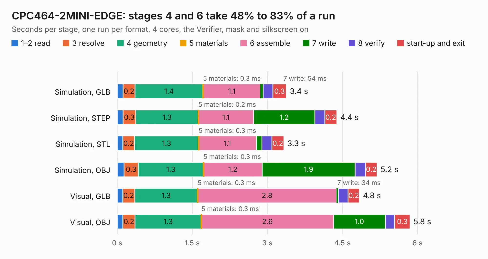

# 637 CPC464-2MINI-EDGE

Board 637 of the 3,138 of [Corpus Testing](../Corpus-Testing.md), on [Corpus Page 6](../CorpusTestingPages/Corpus-Testing-06.md#637-cpc464-2mini-edge).

| Mode and format | 1–2 read | 3 resolve | 4 geometry | 5 materials | 6 assemble | 7 write | 8 verify | start-up and exit | Total |
|---|---:|---:|---:|---:|---:|---:|---:|---:|---:|
| Simulation, GLB | 0.1 | 0.2 | 1.4 | 0.3&nbsp;ms | 1.1 | 54&nbsp;ms | 0.2 | 0.3 | 3.4 |
| Simulation, STEP | 0.1 | 0.3 | 1.3 | 0.2&nbsp;ms | 1.1 | 1.2 | 0.2 | 0.2 | 4.4 |
| Simulation, STL | 0.1 | 0.2 | 1.3 | 0.3&nbsp;ms | 1.1 | 0.1 | 0.2 | 0.2 | 3.3 |
| Simulation, OBJ | 0.1 | 0.3 | 1.3 | 0.3&nbsp;ms | 1.2 | 1.9 | 0.2 | 0.2 | 5.2 |
| Visual, GLB | 0.1 | 0.2 | 1.3 | 0.3&nbsp;ms | 2.8 | 34&nbsp;ms | 0.2 | 0.2 | 4.8 |
| Visual, OBJ | 0.1 | 0.2 | 1.3 | 0.3&nbsp;ms | 2.6 | 1.0 | 0.2 | 0.3 | 5.8 |

<table align="center"><tr><td valign="top">

| Board | Repo: [Board-Folk/CPC464-2MINI](https://github.com/Board-Folk/CPC464-2MINI) Board: `CPC464-2MINI-EDGE.kicad_pcb` |
|---|---|
| Folder | Expansions / MINIEDGE / Kicad |
| Complexity | 185&nbsp;/&nbsp;1000 (size&nbsp;120, features&nbsp;65) |
| KESE&nbsp;features | through vias, filled zones, stack-up, dielectric εr and tanδ |
| Tested | 9th November 2026 |
| Copper&nbsp;layers | 2 |
| File&nbsp;format | KiCad 7 (20221018) |
| Parts,&nbsp;tracks,&nbsp;vias | 2, 253, 3 |
| Triangles,&nbsp;simulation | 286,622 in 60 parts |
| Verifier | PASS in all six runs |

</td><td valign="top">

<table>
<tr><th>File type</th><th>File size</th><th>Peak memory used</th></tr>
<tr><th colspan="3" align="left">Simulation</th></tr>
<tr><td>GLB</td><td align="right">9.7&nbsp;MB</td><td align="right">230&nbsp;MB</td></tr>
<tr><td>STEP</td><td align="right">41&nbsp;MB</td><td align="right">246&nbsp;MB</td></tr>
<tr><td>STL</td><td align="right">14&nbsp;MB</td><td align="right">228&nbsp;MB</td></tr>
<tr><td>OBJ</td><td align="right">29&nbsp;MB</td><td align="right">244&nbsp;MB</td></tr>
<tr><th colspan="3" align="left">Visual</th></tr>
<tr><td>GLB</td><td align="right">6.1&nbsp;MB</td><td align="right">251&nbsp;MB</td></tr>
<tr><td>OBJ</td><td align="right">18&nbsp;MB</td><td align="right">248&nbsp;MB</td></tr>
</table>

</td></tr></table>

| Previous | Next |
|:---|---:|
| [636 CPC464-2MINIDOCK](b0636b_CPC464-2MINI_CPC464-2MINIDOCK.md) | [638 CPC464-2MINIPS2](b0638b_CPC464-2MINI_CPC464-2MINIPS2.md) |
