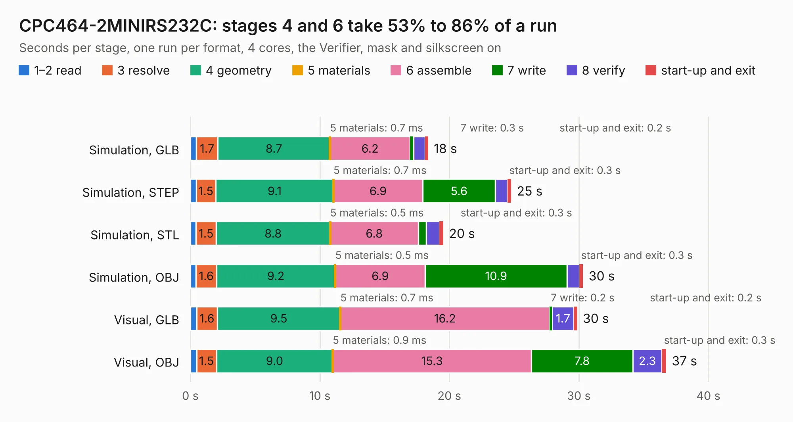

# 637. CPC464-2MINIRS232C

Board 637 of the 3,121 of [Corpus Testing](../Corpus-Testing.md), on [Corpus Page 6](../CorpusTestingPages/Corpus-Testing-06.md#637-cpc464-2minirs232c).

| Mode and format | 1–2 read | 3 resolve | 4 geometry | 5 materials | 6 assemble | 7 write | 8 verify | start-up and exit | Total |
|---|---:|---:|---:|---:|---:|---:|---:|---:|---:|
| Simulation, GLB | 0.5 | 1.7 | 8.7 | 0.7&nbsp;ms | 6.2 | 0.3 | 0.9 | 0.2 | 18.4 |
| Simulation, STEP | 0.4 | 1.5 | 9.1 | 0.7&nbsp;ms | 6.9 | 5.6 | 0.9 | 0.3 | 24.8 |
| Simulation, STL | 0.4 | 1.5 | 8.8 | 0.5&nbsp;ms | 6.8 | 0.6 | 1.0 | 0.3 | 19.5 |
| Simulation, OBJ | 0.4 | 1.6 | 9.2 | 0.5&nbsp;ms | 6.9 | 10.9 | 1.0 | 0.3 | 30.3 |
| Visual, GLB | 0.5 | 1.6 | 9.5 | 0.7&nbsp;ms | 16.2 | 0.2 | 1.7 | 0.2 | 29.9 |
| Visual, OBJ | 0.5 | 1.5 | 9.0 | 0.9&nbsp;ms | 15.3 | 7.8 | 2.3 | 0.3 | 36.7 |

<table align="center"><tr><td valign="top">

| Board | Repo: [Board-Folk/CPC464-2MINI](https://github.com/Board-Folk/CPC464-2MINI) Board: `CPC464-2MINIRS232C.kicad_pcb` |
|---|---|
| Folder | Expansions / MINIRS232C / Kicad |
| Complexity | 255&nbsp;/&nbsp;1000 (size&nbsp;180, features&nbsp;75) |
| KESE&nbsp;features | through vias, rounded, trapezoid or chamfered pads, filled zones, stack-up, dielectric εr and tanδ |
| Tested | 9th November 2026 |
| Copper&nbsp;layers | 2 |
| File&nbsp;format | KiCad 7 (20221018) |
| Parts,&nbsp;tracks,&nbsp;vias | 39, 1,501, 104 |
| Triangles,&nbsp;simulation | 1,751,162 in 121 parts |
| Verifier | PASS in all six runs |

</td><td valign="top">

<table>
<tr><th>File type</th><th>File size</th><th>Peak memory used</th></tr>
<tr><th colspan="3" align="left">Simulation</th></tr>
<tr><td>GLB</td><td align="right">59&nbsp;MB</td><td align="right">700&nbsp;MB</td></tr>
<tr><td>STEP</td><td align="right">268&nbsp;MB</td><td align="right">814&nbsp;MB</td></tr>
<tr><td>STL</td><td align="right">88&nbsp;MB</td><td align="right">754&nbsp;MB</td></tr>
<tr><td>OBJ</td><td align="right">180&nbsp;MB</td><td align="right">1.2&nbsp;GB</td></tr>
<tr><th colspan="3" align="left">Visual</th></tr>
<tr><td>GLB</td><td align="right">42&nbsp;MB</td><td align="right">871&nbsp;MB</td></tr>
<tr><td>OBJ</td><td align="right">127&nbsp;MB</td><td align="right">924&nbsp;MB</td></tr>
</table>

</td></tr></table>

| Previous | Next |
|:---|---:|
| [636. CPC464-2MINIPS2](b0636b_CPC464-2MINI_CPC464-2MINIPS2.md) | [638. CPC464-2MINIUSIFACII](b0638b_CPC464-2MINI_CPC464-2MINIUSIFACII.md) |
