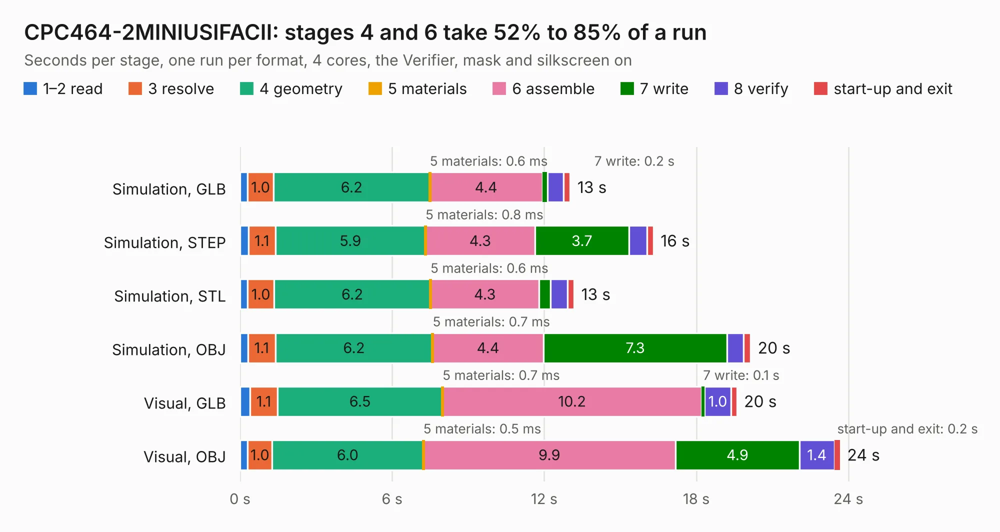

# 638. CPC464-2MINIUSIFACII

Board 638 of the 3,118 of [Corpus Testing](../Corpus-Testing.md), on [Corpus Page 6](../CorpusTestingPages/Corpus-Testing-06.md#638-cpc464-2miniusifacii).

| Mode and format | 1–2 read | 3 resolve | 4 geometry | 5 materials | 6 assemble | 7 write | 8 verify | start-up and exit | Total |
|---|---:|---:|---:|---:|---:|---:|---:|---:|---:|
| Simulation, GLB | 0.3 | 1.0 | 6.2 | 0.6&nbsp;ms | 4.4 | 0.2 | 0.6 | 0.3 | 13.0 |
| Simulation, STEP | 0.3 | 1.1 | 5.9 | 0.8&nbsp;ms | 4.3 | 3.7 | 0.7 | 0.3 | 16.3 |
| Simulation, STL | 0.3 | 1.0 | 6.2 | 0.6&nbsp;ms | 4.3 | 0.4 | 0.7 | 0.3 | 13.2 |
| Simulation, OBJ | 0.3 | 1.1 | 6.2 | 0.7&nbsp;ms | 4.4 | 7.3 | 0.7 | 0.3 | 20.1 |
| Visual, GLB | 0.4 | 1.1 | 6.5 | 0.7&nbsp;ms | 10.2 | 0.1 | 1.0 | 0.2 | 19.6 |
| Visual, OBJ | 0.3 | 1.0 | 6.0 | 0.5&nbsp;ms | 9.9 | 4.9 | 1.4 | 0.2 | 23.7 |

<table align="center"><tr><td valign="top">

| Board | Repo: [Board-Folk/CPC464-2MINI](https://github.com/Board-Folk/CPC464-2MINI) Board: `CPC464-2MINIUSIFACII.kicad_pcb` |
|---|---|
| Folder | Expansions / MINIUSIFACII / Kicad |
| Complexity | 242&nbsp;/&nbsp;1000 (size&nbsp;167, features&nbsp;75) |
| KESE&nbsp;features | through vias, rounded, trapezoid or chamfered pads, filled zones, stack-up, dielectric εr and tanδ |
| Tested | 9th November 2026 |
| Copper&nbsp;layers | 2 |
| File&nbsp;format | KiCad 6 (20211014) |
| Parts,&nbsp;tracks,&nbsp;vias | 29, 860, 43 |
| Triangles,&nbsp;simulation | 1,270,196 in 101 parts |
| Verifier | PASS in all six runs |

</td><td valign="top">

<table>
<tr><th>File type</th><th>File size</th><th>Peak memory used</th></tr>
<tr><th colspan="3" align="left">Simulation</th></tr>
<tr><td>GLB</td><td align="right">43&nbsp;MB</td><td align="right">531&nbsp;MB</td></tr>
<tr><td>STEP</td><td align="right">190&nbsp;MB</td><td align="right">628&nbsp;MB</td></tr>
<tr><td>STL</td><td align="right">64&nbsp;MB</td><td align="right">573&nbsp;MB</td></tr>
<tr><td>OBJ</td><td align="right">129&nbsp;MB</td><td align="right">875&nbsp;MB</td></tr>
<tr><th colspan="3" align="left">Visual</th></tr>
<tr><td>GLB</td><td align="right">29&nbsp;MB</td><td align="right">770&nbsp;MB</td></tr>
<tr><td>OBJ</td><td align="right">87&nbsp;MB</td><td align="right">707&nbsp;MB</td></tr>
</table>

</td></tr></table>

| Previous | Next |
|:---|---:|
| [637. CPC464-2MINIRS232C](b0637b_CPC464-2MINI_CPC464-2MINIRS232C.md) | [639. CPC-40007AdapterLM1117](b0639b_CPC464-2MINI_CPC-40007AdapterLM1117.md) |
