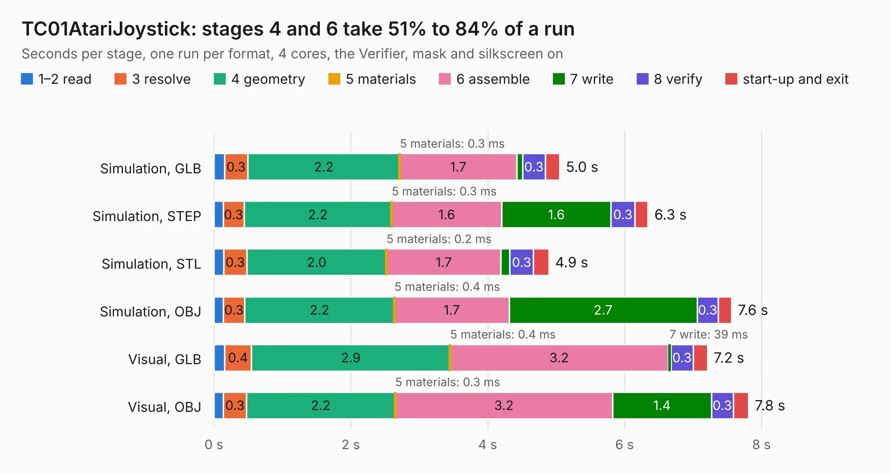

# 641. TC01AtariJoystick

Board 641 of the 3,106 of [Corpus Testing](../Corpus-Testing.md), on [Corpus Page 6](../CorpusTestingPages/Corpus-Testing-06.md#641-tc01atarijoystick).

| Mode and format | 1–2 read | 3 resolve | 4 geometry | 5 materials | 6 assemble | 7 write | 8 verify | start-up and exit | Total |
|---|---:|---:|---:|---:|---:|---:|---:|---:|---:|
| Simulation, GLB | 0.2 | 0.3 | 2.2 | 0.3&nbsp;ms | 1.7 | 85&nbsp;ms | 0.3 | 0.2 | 5.0 |
| Simulation, STEP | 0.1 | 0.3 | 2.2 | 0.3&nbsp;ms | 1.6 | 1.6 | 0.3 | 0.2 | 6.3 |
| Simulation, STL | 0.1 | 0.3 | 2.0 | 0.2&nbsp;ms | 1.7 | 0.1 | 0.3 | 0.2 | 4.9 |
| Simulation, OBJ | 0.1 | 0.3 | 2.2 | 0.4&nbsp;ms | 1.7 | 2.7 | 0.3 | 0.2 | 7.6 |
| Visual, GLB | 0.2 | 0.4 | 2.9 | 0.4&nbsp;ms | 3.2 | 39&nbsp;ms | 0.3 | 0.2 | 7.2 |
| Visual, OBJ | 0.1 | 0.3 | 2.2 | 0.3&nbsp;ms | 3.2 | 1.4 | 0.3 | 0.2 | 7.8 |

<table align="center"><tr><td valign="top">

| Board | Repo: [Board-Folk/Einstein-TC-01](https://github.com/Board-Folk/Einstein-TC-01) Board: `TC01AtariJoystick.kicad_pcb` |
|---|---|
| Folder | Expansions / TC01AtariJoystick / Kicad |
| Complexity | 191&nbsp;/&nbsp;1000 (size&nbsp;131, features&nbsp;60) |
| KESE&nbsp;features | filled zones, curved board outline, stack-up, dielectric εr and tanδ |
| Tested | 9th November 2026 |
| Copper&nbsp;layers | 2 |
| File&nbsp;format | KiCad 9 (20241229) |
| Parts,&nbsp;tracks,&nbsp;vias | 10, 219, 0 |
| Triangles,&nbsp;simulation | 503,944 in 29 parts |
| Verifier | PASS in all six runs |

</td><td valign="top">

<table>
<tr><th>File type</th><th>File size</th><th>Peak memory used</th></tr>
<tr><th colspan="3" align="left">Simulation</th></tr>
<tr><td>GLB</td><td align="right">17&nbsp;MB</td><td align="right">287&nbsp;MB</td></tr>
<tr><td>STEP</td><td align="right">68&nbsp;MB</td><td align="right">334&nbsp;MB</td></tr>
<tr><td>STL</td><td align="right">25&nbsp;MB</td><td align="right">284&nbsp;MB</td></tr>
<tr><td>OBJ</td><td align="right">50&nbsp;MB</td><td align="right">377&nbsp;MB</td></tr>
<tr><th colspan="3" align="left">Visual</th></tr>
<tr><td>GLB</td><td align="right">9.4&nbsp;MB</td><td align="right">333&nbsp;MB</td></tr>
<tr><td>OBJ</td><td align="right">28&nbsp;MB</td><td align="right">327&nbsp;MB</td></tr>
</table>

</td></tr></table>

| Previous | Next |
|:---|---:|
| [640. EinsteinTC01PS2Mini](b0640b_Einstein-TC-01_EinsteinTC01PS2Mini.md) | [642. TC02Mini](b0642b_Einstein-TC-01_TC02Mini.md) |
