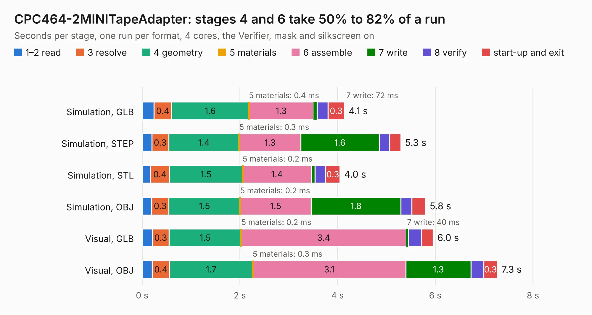

# 643. CPC464-2MINITapeAdapter

Board 643 of the 3,139 of [Corpus Testing](../Corpus-Testing.md), on [Corpus Page 6](../CorpusTestingPages/Corpus-Testing-06.md#643-cpc464-2minitapeadapter).

| Mode and format | 1–2 read | 3 resolve | 4 geometry | 5 materials | 6 assemble | 7 write | 8 verify | start-up and exit | Total |
|---|---:|---:|---:|---:|---:|---:|---:|---:|---:|
| Simulation, GLB | 0.2 | 0.4 | 1.6 | 0.4&nbsp;ms | 1.3 | 72&nbsp;ms | 0.2 | 0.3 | 4.1 |
| Simulation, STEP | 0.2 | 0.3 | 1.4 | 0.3&nbsp;ms | 1.3 | 1.6 | 0.2 | 0.2 | 5.3 |
| Simulation, STL | 0.2 | 0.4 | 1.5 | 0.2&nbsp;ms | 1.4 | 73&nbsp;ms | 0.2 | 0.3 | 4.0 |
| Simulation, OBJ | 0.2 | 0.3 | 1.5 | 0.2&nbsp;ms | 1.5 | 1.8 | 0.2 | 0.3 | 5.8 |
| Visual, GLB | 0.2 | 0.3 | 1.5 | 0.2&nbsp;ms | 3.4 | 40&nbsp;ms | 0.3 | 0.2 | 6.0 |
| Visual, OBJ | 0.2 | 0.4 | 1.7 | 0.3&nbsp;ms | 3.1 | 1.3 | 0.3 | 0.3 | 7.3 |

<table align="center"><tr><td valign="top">

| Board | Repo: [Board-Folk/CPC464-2MINI](https://github.com/Board-Folk/CPC464-2MINI) Board: `CPC464-2MINITapeAdapter.kicad_pcb` |
|---|---|
| Folder | v4.1 / Extras / TapeAdapter / Kicad |
| Complexity | 176&nbsp;/&nbsp;1000 (size&nbsp;116, features&nbsp;60) |
| KESE&nbsp;features | slotted holes, filled zones, stack-up, dielectric εr and tanδ |
| Tested | 9th November 2026 |
| Copper&nbsp;layers | 2 |
| File&nbsp;format | KiCad 6 (20211014) |
| Parts,&nbsp;tracks,&nbsp;vias | 13, 75, 0 |
| Triangles,&nbsp;simulation | 278,362 in 28 parts |
| Verifier | PASS in all six runs |

</td><td valign="top">

<table>
<tr><th>File type</th><th>File size</th><th>Peak memory used</th></tr>
<tr><th colspan="3" align="left">Simulation</th></tr>
<tr><td>GLB</td><td align="right">9.5&nbsp;MB</td><td align="right">246&nbsp;MB</td></tr>
<tr><td>STEP</td><td align="right">42&nbsp;MB</td><td align="right">250&nbsp;MB</td></tr>
<tr><td>STL</td><td align="right">14&nbsp;MB</td><td align="right">246&nbsp;MB</td></tr>
<tr><td>OBJ</td><td align="right">28&nbsp;MB</td><td align="right">239&nbsp;MB</td></tr>
<tr><th colspan="3" align="left">Visual</th></tr>
<tr><td>GLB</td><td align="right">6.6&nbsp;MB</td><td align="right">248&nbsp;MB</td></tr>
<tr><td>OBJ</td><td align="right">19&nbsp;MB</td><td align="right">249&nbsp;MB</td></tr>
</table>

</td></tr></table>

| Previous | Next |
|:---|---:|
| [642. CPC464-2MINICAS1](b0642b_CPC464-2MINI_CPC464-2MINICAS1.md) | [644. CPC464-2MINI](b0644b_CPC464-2MINI_v4-1-Kicad_CPC464-2MINI.md) |
