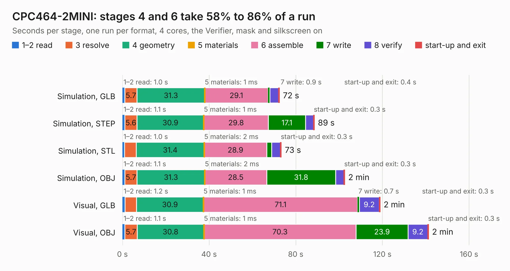

# 644. CPC464-2MINI

Board 644 of the 3,126 of [Corpus Testing](../Corpus-Testing.md), on [Corpus Page 6](../CorpusTestingPages/Corpus-Testing-06.md#644-cpc464-2mini).

| Mode and format | 1–2 read | 3 resolve | 4 geometry | 5 materials | 6 assemble | 7 write | 8 verify | start-up and exit | Total |
|---|---:|---:|---:|---:|---:|---:|---:|---:|---:|
| Simulation, GLB | 1.0 | 5.7 | 31.3 | 1&nbsp;ms | 29.1 | 0.9 | 4.0 | 0.4 | 72.4 |
| Simulation, STEP | 1.1 | 5.6 | 30.9 | 1&nbsp;ms | 29.8 | 17.1 | 3.7 | 0.3 | 88.6 |
| Simulation, STL | 1.0 | 5.4 | 31.4 | 2&nbsp;ms | 28.9 | 2.3 | 4.1 | 0.3 | 73.3 |
| Simulation, OBJ | 1.1 | 5.7 | 31.3 | 2&nbsp;ms | 28.5 | 31.8 | 3.8 | 0.3 | 102.6 |
| Visual, GLB | 1.2 | 5.4 | 30.9 | 1&nbsp;ms | 71.1 | 0.7 | 9.2 | 0.3 | 118.9 |
| Visual, OBJ | 1.1 | 5.7 | 30.8 | 1&nbsp;ms | 70.3 | 23.9 | 9.2 | 0.3 | 141.3 |

<table align="center"><tr><td valign="top">

| Board | Repo: [Board-Folk/CPC464-2MINI](https://github.com/Board-Folk/CPC464-2MINI) Board: `CPC464-2MINI.kicad_pcb` |
|---|---|
| Folder | v5.3 / Kicad |
| Complexity | 357&nbsp;/&nbsp;1000 (size&nbsp;272, features&nbsp;85) |
| KESE&nbsp;features | through vias, slotted holes, rounded, trapezoid or chamfered pads, filled zones, stack-up, dielectric εr and tanδ |
| Tested | 9th November 2026 |
| Copper&nbsp;layers | 2 |
| File&nbsp;format | KiCad 7 (20221018) |
| Parts,&nbsp;tracks,&nbsp;vias | 157, 7,238, 705 |
| Triangles,&nbsp;simulation | 5,789,680 in 321 parts |
| Verifier | PASS in all six runs |

</td><td valign="top">

<table>
<tr><th>File type</th><th>File size</th><th>Peak memory used</th></tr>
<tr><th colspan="3" align="left">Simulation</th></tr>
<tr><td>GLB</td><td align="right">196&nbsp;MB</td><td align="right">1.6&nbsp;GB</td></tr>
<tr><td>STEP</td><td align="right">937&nbsp;MB</td><td align="right">2.4&nbsp;GB</td></tr>
<tr><td>STL</td><td align="right">290&nbsp;MB</td><td align="right">1.6&nbsp;GB</td></tr>
<tr><td>OBJ</td><td align="right">614&nbsp;MB</td><td align="right">3.7&nbsp;GB</td></tr>
<tr><th colspan="3" align="left">Visual</th></tr>
<tr><td>GLB</td><td align="right">149&nbsp;MB</td><td align="right">2.4&nbsp;GB</td></tr>
<tr><td>OBJ</td><td align="right">478&nbsp;MB</td><td align="right">3.1&nbsp;GB</td></tr>
</table>

</td></tr></table>

| Previous | Next |
|:---|---:|
| [643. CPC464-2MINI](b0643b_CPC464-2MINI_v4-1-Kicad_CPC464-2MINI.md) | [645. EinsteinTC01](b0645b_Einstein-TC-01_Archive-MainBoard-v1-1-Kicad_EinsteinTC01.md) |
