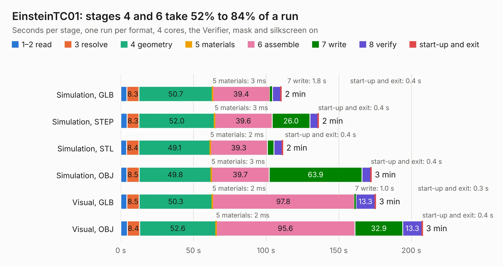

# 645. EinsteinTC01

Board 645 of the 3,127 of [Corpus Testing](../Corpus-Testing.md), on [Corpus Page 6](../CorpusTestingPages/Corpus-Testing-06.md#645-einsteintc01).

| Mode and format | 1–2 read | 3 resolve | 4 geometry | 5 materials | 6 assemble | 7 write | 8 verify | start-up and exit | Total |
|---|---:|---:|---:|---:|---:|---:|---:|---:|---:|
| Simulation, GLB | 4.2 | 8.3 | 50.7 | 3&nbsp;ms | 39.4 | 1.8 | 5.7 | 0.4 | 110.5 |
| Simulation, STEP | 4.3 | 8.3 | 52.0 | 3&nbsp;ms | 39.6 | 26.0 | 5.5 | 0.4 | 136.1 |
| Simulation, STL | 4.1 | 8.4 | 49.1 | 2&nbsp;ms | 39.3 | 4.6 | 5.6 | 0.4 | 111.5 |
| Simulation, OBJ | 4.2 | 8.5 | 49.8 | 3&nbsp;ms | 39.7 | 63.9 | 5.9 | 0.4 | 172.4 |
| Visual, GLB | 4.1 | 8.5 | 50.3 | 2&nbsp;ms | 97.8 | 1.0 | 13.3 | 0.3 | 175.4 |
| Visual, OBJ | 4.5 | 8.4 | 52.6 | 2&nbsp;ms | 95.6 | 32.9 | 13.3 | 0.4 | 207.7 |

<table align="center"><tr><td valign="top">

| Board | Repo: [Board-Folk/Einstein-TC-01](https://github.com/Board-Folk/Einstein-TC-01) Board: `EinsteinTC01.kicad_pcb` |
|---|---|
| Folder | Archive / MainBoard / v1.1 / Kicad |
| Complexity | 309&nbsp;/&nbsp;1000 (size&nbsp;234, features&nbsp;75) |
| KESE&nbsp;features | through vias, slotted holes, rounded, trapezoid or chamfered pads, drill offsets, filled zones, curved board outline |
| Tested | 9th November 2026 |
| Copper&nbsp;layers | 2 |
| File&nbsp;format | KiCad 9 (20241229) |
| Parts,&nbsp;tracks,&nbsp;vias | 346, 9,719, 769 |
| Triangles,&nbsp;simulation | 11,902,236 in 528 parts |
| Verifier | PASS in all six runs |

</td><td valign="top">

<table>
<tr><th>File type</th><th>File size</th><th>Peak memory used</th></tr>
<tr><th colspan="3" align="left">Simulation</th></tr>
<tr><td>GLB</td><td align="right">398&nbsp;MB</td><td align="right">3.3&nbsp;GB</td></tr>
<tr><td>STEP</td><td align="right">1.7&nbsp;GB</td><td align="right">4.1&nbsp;GB</td></tr>
<tr><td>STL</td><td align="right">595&nbsp;MB</td><td align="right">3.1&nbsp;GB</td></tr>
<tr><td>OBJ</td><td align="right">1.3&nbsp;GB</td><td align="right">7.4&nbsp;GB</td></tr>
<tr><th colspan="3" align="left">Visual</th></tr>
<tr><td>GLB</td><td align="right">238&nbsp;MB</td><td align="right">3.8&nbsp;GB</td></tr>
<tr><td>OBJ</td><td align="right">765&nbsp;MB</td><td align="right">5.0&nbsp;GB</td></tr>
</table>

</td></tr></table>

| Previous | Next |
|:---|---:|
| [644. CPC464-2MINI](b0644b_CPC464-2MINI_v5-3-Kicad_CPC464-2MINI.md) | [646. EinsteinTC01PS2](b0646b_Einstein-TC-01_EinsteinTC01PS2.md) |
