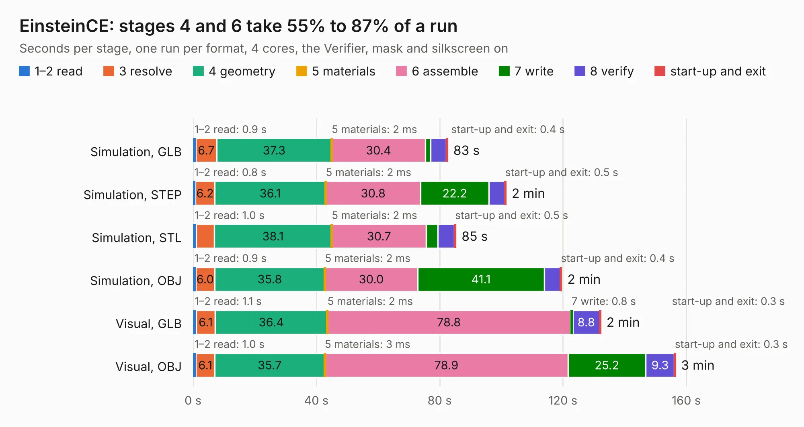

# 645. EinsteinCE

Board 645 of the 3,105 of [Corpus Testing](../Corpus-Testing.md), on [Corpus Page 6](../CorpusTestingPages/Corpus-Testing-06.md#645-einsteince).

| Mode and format | 1–2 read | 3 resolve | 4 geometry | 5 materials | 6 assemble | 7 write | 8 verify | start-up and exit | Total |
|---|---:|---:|---:|---:|---:|---:|---:|---:|---:|
| Simulation, GLB | 0.9 | 6.7 | 37.3 | 2&nbsp;ms | 30.4 | 1.7 | 5.1 | 0.4 | 82.6 |
| Simulation, STEP | 0.8 | 6.2 | 36.1 | 2&nbsp;ms | 30.8 | 22.2 | 5.0 | 0.5 | 101.5 |
| Simulation, STL | 1.0 | 5.9 | 38.1 | 2&nbsp;ms | 30.7 | 3.7 | 5.5 | 0.5 | 85.3 |
| Simulation, OBJ | 0.9 | 6.0 | 35.8 | 2&nbsp;ms | 30.0 | 41.1 | 5.1 | 0.4 | 119.6 |
| Visual, GLB | 1.1 | 6.1 | 36.4 | 2&nbsp;ms | 78.8 | 0.8 | 8.8 | 0.3 | 132.2 |
| Visual, OBJ | 1.0 | 6.1 | 35.7 | 3&nbsp;ms | 78.9 | 25.2 | 9.3 | 0.3 | 156.5 |

<table align="center"><tr><td valign="top">

| Board | Repo: [Board-Folk/Einstein-TC-01](https://github.com/Board-Folk/Einstein-TC-01) Board: `EinsteinCE.kicad_pcb` |
|---|---|
| Folder | Remix / EinsteinCE / Kicad |
| Complexity | 253&nbsp;/&nbsp;1000 (size&nbsp;218, features&nbsp;35) |
| KESE&nbsp;features | through vias, slotted holes, rounded, trapezoid or chamfered pads |
| Tested | 9th November 2026 |
| Copper&nbsp;layers | 2 |
| File&nbsp;format | KiCad 9 (20241229) |
| Parts,&nbsp;tracks,&nbsp;vias | 154, 6,261, 418 |
| Triangles,&nbsp;simulation | 7,959,458 in 329 parts |
| Verifier | PASS in all six runs |

</td><td valign="top">

<table>
<tr><th>File type</th><th>File size</th><th>Peak memory used</th></tr>
<tr><th colspan="3" align="left">Simulation</th></tr>
<tr><td>GLB</td><td align="right">265&nbsp;MB</td><td align="right">2.1&nbsp;GB</td></tr>
<tr><td>STEP</td><td align="right">1.3&nbsp;GB</td><td align="right">2.8&nbsp;GB</td></tr>
<tr><td>STL</td><td align="right">398&nbsp;MB</td><td align="right">2.1&nbsp;GB</td></tr>
<tr><td>OBJ</td><td align="right">836&nbsp;MB</td><td align="right">4.9&nbsp;GB</td></tr>
<tr><th colspan="3" align="left">Visual</th></tr>
<tr><td>GLB</td><td align="right">170&nbsp;MB</td><td align="right">2.6&nbsp;GB</td></tr>
<tr><td>OBJ</td><td align="right">542&nbsp;MB</td><td align="right">3.4&nbsp;GB</td></tr>
</table>

</td></tr></table>

| Previous | Next |
|:---|---:|
| [644. EinsteinTC01](b0644b_Einstein-TC-01_Kicad_EinsteinTC01.md) | [646. MegaCD](b0646b_MegaCD-Main-BD_MegaCD-837-8015-01-Rev1-MCE2_MegaCD.md) |
