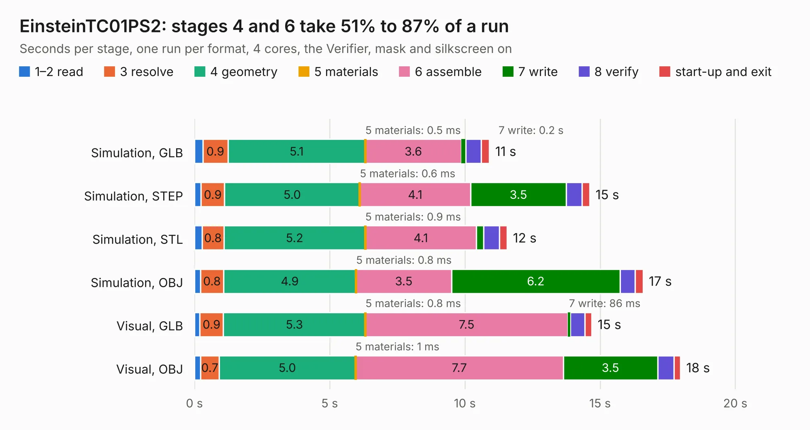

# 646. EinsteinTC01PS2

Board 646 of the 3,128 of [Corpus Testing](../Corpus-Testing.md), on [Corpus Page 6](../CorpusTestingPages/Corpus-Testing-06.md#646-einsteintc01ps2).

| Mode and format | 1–2 read | 3 resolve | 4 geometry | 5 materials | 6 assemble | 7 write | 8 verify | start-up and exit | Total |
|---|---:|---:|---:|---:|---:|---:|---:|---:|---:|
| Simulation, GLB | 0.3 | 0.9 | 5.1 | 0.5&nbsp;ms | 3.6 | 0.2 | 0.6 | 0.3 | 10.9 |
| Simulation, STEP | 0.2 | 0.9 | 5.0 | 0.6&nbsp;ms | 4.1 | 3.5 | 0.6 | 0.3 | 14.6 |
| Simulation, STL | 0.3 | 0.8 | 5.2 | 0.9&nbsp;ms | 4.1 | 0.3 | 0.6 | 0.3 | 11.6 |
| Simulation, OBJ | 0.2 | 0.8 | 4.9 | 0.8&nbsp;ms | 3.5 | 6.2 | 0.6 | 0.3 | 16.6 |
| Visual, GLB | 0.2 | 0.9 | 5.3 | 0.8&nbsp;ms | 7.5 | 86&nbsp;ms | 0.5 | 0.3 | 14.7 |
| Visual, OBJ | 0.2 | 0.7 | 5.0 | 1&nbsp;ms | 7.7 | 3.5 | 0.6 | 0.2 | 18.0 |

<table align="center"><tr><td valign="top">

| Board | Repo: [Board-Folk/Einstein-TC-01](https://github.com/Board-Folk/Einstein-TC-01) Board: `EinsteinTC01PS2.kicad_pcb` |
|---|---|
| Folder | Expansions / EinsteinTC01PS2 / Kicad |
| Complexity | 183&nbsp;/&nbsp;1000 (size&nbsp;153, features&nbsp;30) |
| KESE&nbsp;features | slotted holes, rounded, trapezoid or chamfered pads, curved board outline |
| Tested | 9th November 2026 |
| Copper&nbsp;layers | 2 |
| File&nbsp;format | KiCad 9 (20241229) |
| Parts,&nbsp;tracks,&nbsp;vias | 22, 500, 0 |
| Triangles,&nbsp;simulation | 898,748 in 71 parts |
| Verifier | PASS in all six runs |

</td><td valign="top">

<table>
<tr><th>File type</th><th>File size</th><th>Peak memory used</th></tr>
<tr><th colspan="3" align="left">Simulation</th></tr>
<tr><td>GLB</td><td align="right">31&nbsp;MB</td><td align="right">374&nbsp;MB</td></tr>
<tr><td>STEP</td><td align="right">132&nbsp;MB</td><td align="right">479&nbsp;MB</td></tr>
<tr><td>STL</td><td align="right">45&nbsp;MB</td><td align="right">395&nbsp;MB</td></tr>
<tr><td>OBJ</td><td align="right">91&nbsp;MB</td><td align="right">653&nbsp;MB</td></tr>
<tr><th colspan="3" align="left">Visual</th></tr>
<tr><td>GLB</td><td align="right">17&nbsp;MB</td><td align="right">476&nbsp;MB</td></tr>
<tr><td>OBJ</td><td align="right">50&nbsp;MB</td><td align="right">484&nbsp;MB</td></tr>
</table>

</td></tr></table>

| Previous | Next |
|:---|---:|
| [645. EinsteinTC01](b0645b_Einstein-TC-01_Archive-MainBoard-v1-1-Kicad_EinsteinTC01.md) | [647. EinsteinTC01PS2Mini](b0647b_Einstein-TC-01_EinsteinTC01PS2Mini.md) |
