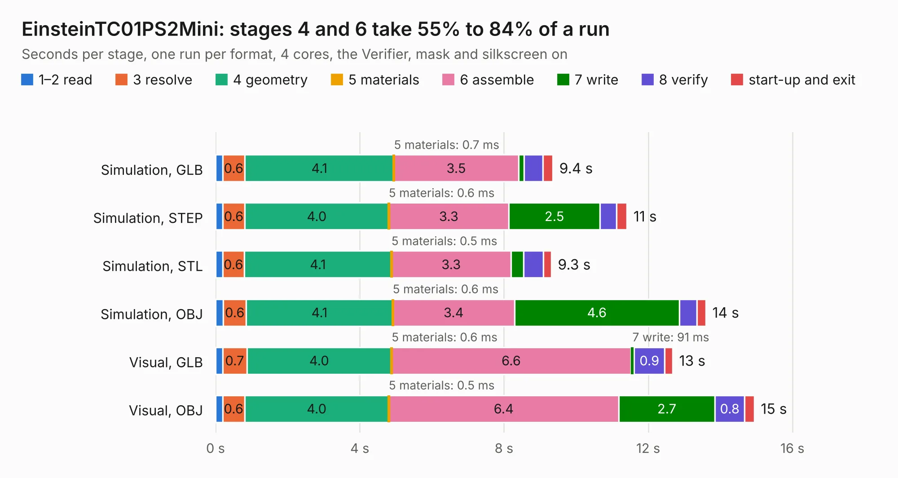

# 647. EinsteinTC01PS2Mini

Board 647 of the 3,129 of [Corpus Testing](../Corpus-Testing.md), on [Corpus Page 6](../CorpusTestingPages/Corpus-Testing-06.md#647-einsteintc01ps2mini).

| Mode and format | 1–2 read | 3 resolve | 4 geometry | 5 materials | 6 assemble | 7 write | 8 verify | start-up and exit | Total |
|---|---:|---:|---:|---:|---:|---:|---:|---:|---:|
| Simulation, GLB | 0.2 | 0.6 | 4.1 | 0.7&nbsp;ms | 3.5 | 0.2 | 0.5 | 0.3 | 9.4 |
| Simulation, STEP | 0.2 | 0.6 | 4.0 | 0.6&nbsp;ms | 3.3 | 2.5 | 0.5 | 0.3 | 11.4 |
| Simulation, STL | 0.2 | 0.6 | 4.1 | 0.5&nbsp;ms | 3.3 | 0.4 | 0.5 | 0.2 | 9.3 |
| Simulation, OBJ | 0.2 | 0.6 | 4.1 | 0.6&nbsp;ms | 3.4 | 4.6 | 0.5 | 0.2 | 13.6 |
| Visual, GLB | 0.2 | 0.7 | 4.0 | 0.6&nbsp;ms | 6.6 | 91&nbsp;ms | 0.9 | 0.2 | 12.7 |
| Visual, OBJ | 0.2 | 0.6 | 4.0 | 0.5&nbsp;ms | 6.4 | 2.7 | 0.8 | 0.3 | 14.9 |

<table align="center"><tr><td valign="top">

| Board | Repo: [Board-Folk/Einstein-TC-01](https://github.com/Board-Folk/Einstein-TC-01) Board: `EinsteinTC01PS2Mini.kicad_pcb` |
|---|---|
| Folder | Expansions / EinsteinTC01PS2Mini / Kicad |
| Complexity | 198&nbsp;/&nbsp;1000 (size&nbsp;148, features&nbsp;50) |
| KESE&nbsp;features | slotted holes, rounded, trapezoid or chamfered pads, filled zones, curved board outline |
| Tested | 9th November 2026 |
| Copper&nbsp;layers | 2 |
| File&nbsp;format | KiCad 9 (20241229) |
| Parts,&nbsp;tracks,&nbsp;vias | 18, 430, 0 |
| Triangles,&nbsp;simulation | 943,244 in 72 parts |
| Verifier | PASS in all six runs |

</td><td valign="top">

<table>
<tr><th>File type</th><th>File size</th><th>Peak memory used</th></tr>
<tr><th colspan="3" align="left">Simulation</th></tr>
<tr><td>GLB</td><td align="right">31&nbsp;MB</td><td align="right">426&nbsp;MB</td></tr>
<tr><td>STEP</td><td align="right">130&nbsp;MB</td><td align="right">493&nbsp;MB</td></tr>
<tr><td>STL</td><td align="right">47&nbsp;MB</td><td align="right">434&nbsp;MB</td></tr>
<tr><td>OBJ</td><td align="right">94&nbsp;MB</td><td align="right">652&nbsp;MB</td></tr>
<tr><th colspan="3" align="left">Visual</th></tr>
<tr><td>GLB</td><td align="right">19&nbsp;MB</td><td align="right">500&nbsp;MB</td></tr>
<tr><td>OBJ</td><td align="right">57&nbsp;MB</td><td align="right">537&nbsp;MB</td></tr>
</table>

</td></tr></table>

| Previous | Next |
|:---|---:|
| [646. EinsteinTC01PS2](b0646b_Einstein-TC-01_EinsteinTC01PS2.md) | [648. TC01AtariJoystick](b0648b_Einstein-TC-01_TC01AtariJoystick.md) |
