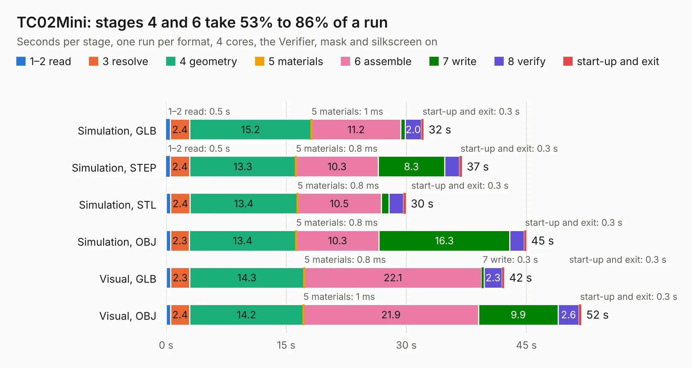

# 647. TC02Mini

Board 647 of the 3,117 of [Corpus Testing](../Corpus-Testing.md), on [Corpus Page 6](../CorpusTestingPages/Corpus-Testing-06.md#647-tc02mini).

| Mode and format | 1–2 read | 3 resolve | 4 geometry | 5 materials | 6 assemble | 7 write | 8 verify | start-up and exit | Total |
|---|---:|---:|---:|---:|---:|---:|---:|---:|---:|
| Simulation, GLB | 0.5 | 2.4 | 15.2 | 1&nbsp;ms | 11.2 | 0.5 | 2.0 | 0.3 | 32.2 |
| Simulation, STEP | 0.5 | 2.4 | 13.3 | 0.8&nbsp;ms | 10.3 | 8.3 | 1.8 | 0.3 | 36.9 |
| Simulation, STL | 0.6 | 2.4 | 13.4 | 0.8&nbsp;ms | 10.5 | 1.0 | 1.8 | 0.3 | 29.9 |
| Simulation, OBJ | 0.6 | 2.3 | 13.4 | 0.8&nbsp;ms | 10.3 | 16.3 | 1.8 | 0.3 | 45.0 |
| Visual, GLB | 0.6 | 2.3 | 14.3 | 0.8&nbsp;ms | 22.1 | 0.3 | 2.3 | 0.3 | 42.2 |
| Visual, OBJ | 0.6 | 2.4 | 14.2 | 1&nbsp;ms | 21.9 | 9.9 | 2.6 | 0.3 | 51.9 |

<table align="center"><tr><td valign="top">

| Board | Repo: [Board-Folk/Einstein-TC-01](https://github.com/Board-Folk/Einstein-TC-01) Board: `TC02Mini.kicad_pcb` |
|---|---|
| Folder | Expansions / TC02Mini / Kicad |
| Complexity | 264&nbsp;/&nbsp;1000 (size&nbsp;189, features&nbsp;75) |
| KESE&nbsp;features | through vias, filled zones, curved board outline, stack-up, dielectric εr and tanδ |
| Tested | 9th November 2026 |
| Copper&nbsp;layers | 2 |
| File&nbsp;format | KiCad 9 (20241229) |
| Parts,&nbsp;tracks,&nbsp;vias | 51, 2,290, 128 |
| Triangles,&nbsp;simulation | 2,815,452 in 155 parts |
| Verifier | PASS in all six runs |

</td><td valign="top">

<table>
<tr><th>File type</th><th>File size</th><th>Peak memory used</th></tr>
<tr><th colspan="3" align="left">Simulation</th></tr>
<tr><td>GLB</td><td align="right">96&nbsp;MB</td><td align="right">1.0&nbsp;GB</td></tr>
<tr><td>STEP</td><td align="right">419&nbsp;MB</td><td align="right">1.1&nbsp;GB</td></tr>
<tr><td>STL</td><td align="right">141&nbsp;MB</td><td align="right">972&nbsp;MB</td></tr>
<tr><td>OBJ</td><td align="right">295&nbsp;MB</td><td align="right">1.8&nbsp;GB</td></tr>
<tr><th colspan="3" align="left">Visual</th></tr>
<tr><td>GLB</td><td align="right">57&nbsp;MB</td><td align="right">1.2&nbsp;GB</td></tr>
<tr><td>OBJ</td><td align="right">176&nbsp;MB</td><td align="right">1.3&nbsp;GB</td></tr>
</table>

</td></tr></table>

| Previous | Next |
|:---|---:|
| [646. TC01AtariJoystick](b0646b_Einstein-TC-01_TC01AtariJoystick.md) | [648. TMSAdapterTC01](b0648b_Einstein-TC-01_TMSAdapterTC01.md) |
