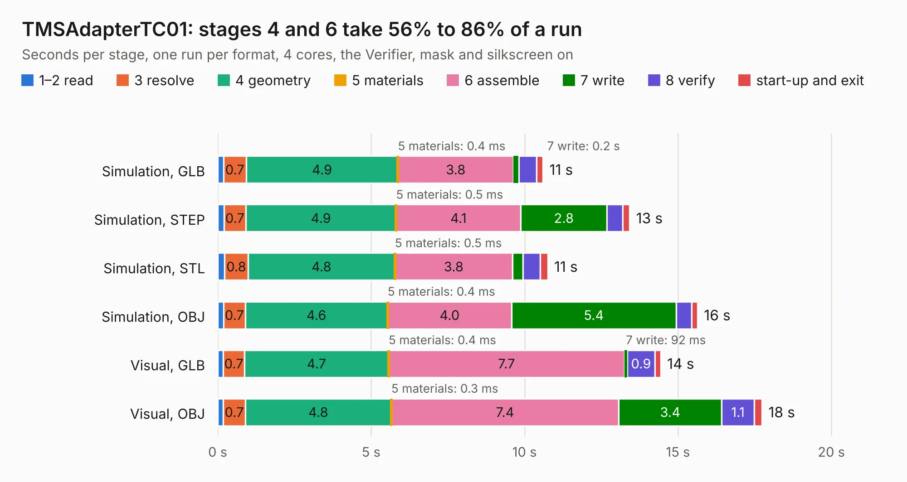

# 649. TMSAdapterTC01

Board 649 of the 3,121 of [Corpus Testing](../Corpus-Testing.md), on [Corpus Page 7](../CorpusTestingPages/Corpus-Testing-07.md#649-tmsadaptertc01).

| Mode and format | 1–2 read | 3 resolve | 4 geometry | 5 materials | 6 assemble | 7 write | 8 verify | start-up and exit | Total |
|---|---:|---:|---:|---:|---:|---:|---:|---:|---:|
| Simulation, GLB | 0.2 | 0.7 | 4.9 | 0.4&nbsp;ms | 3.8 | 0.2 | 0.6 | 0.2 | 10.6 |
| Simulation, STEP | 0.2 | 0.7 | 4.9 | 0.5&nbsp;ms | 4.1 | 2.8 | 0.5 | 0.2 | 13.4 |
| Simulation, STL | 0.2 | 0.8 | 4.8 | 0.5&nbsp;ms | 3.8 | 0.3 | 0.6 | 0.3 | 10.8 |
| Simulation, OBJ | 0.2 | 0.7 | 4.6 | 0.4&nbsp;ms | 4.0 | 5.4 | 0.5 | 0.2 | 15.6 |
| Visual, GLB | 0.2 | 0.7 | 4.7 | 0.4&nbsp;ms | 7.7 | 92&nbsp;ms | 0.9 | 0.2 | 14.4 |
| Visual, OBJ | 0.2 | 0.7 | 4.8 | 0.3&nbsp;ms | 7.4 | 3.4 | 1.1 | 0.3 | 17.7 |

<table align="center"><tr><td valign="top">

| Board | Repo: [Board-Folk/Einstein-TC-01](https://github.com/Board-Folk/Einstein-TC-01) Board: `TMSAdapterTC01.kicad_pcb` |
|---|---|
| Folder | Expansions / TMSAdapterTC01 / Kicad |
| Complexity | 238&nbsp;/&nbsp;1000 (size&nbsp;163, features&nbsp;75) |
| KESE&nbsp;features | through vias, filled zones, curved board outline, stack-up, dielectric εr and tanδ |
| Tested | 9th November 2026 |
| Copper&nbsp;layers | 2 |
| File&nbsp;format | KiCad 9 (20241229) |
| Parts,&nbsp;tracks,&nbsp;vias | 22, 850, 24 |
| Triangles,&nbsp;simulation | 1,335,060 in 72 parts |
| Verifier | PASS in all six runs |

</td><td valign="top">

<table>
<tr><th>File type</th><th>File size</th><th>Peak memory used</th></tr>
<tr><th colspan="3" align="left">Simulation</th></tr>
<tr><td>GLB</td><td align="right">45&nbsp;MB</td><td align="right">542&nbsp;MB</td></tr>
<tr><td>STEP</td><td align="right">191&nbsp;MB</td><td align="right">630&nbsp;MB</td></tr>
<tr><td>STL</td><td align="right">67&nbsp;MB</td><td align="right">537&nbsp;MB</td></tr>
<tr><td>OBJ</td><td align="right">135&nbsp;MB</td><td align="right">903&nbsp;MB</td></tr>
<tr><th colspan="3" align="left">Visual</th></tr>
<tr><td>GLB</td><td align="right">27&nbsp;MB</td><td align="right">646&nbsp;MB</td></tr>
<tr><td>OBJ</td><td align="right">83&nbsp;MB</td><td align="right">728&nbsp;MB</td></tr>
</table>

</td></tr></table>

| Previous | Next |
|:---|---:|
| [648. TC02Mini](b0648b_Einstein-TC-01_TC02Mini.md) | [650. V9958AdapterTC01](b0650b_Einstein-TC-01_V9958AdapterTC01.md) |
